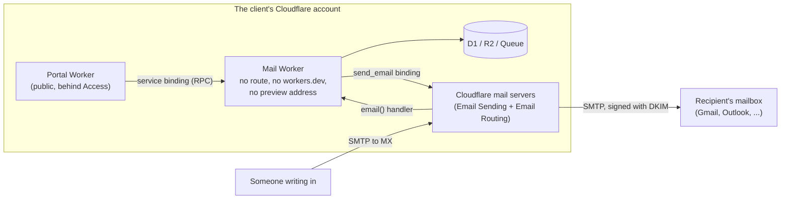
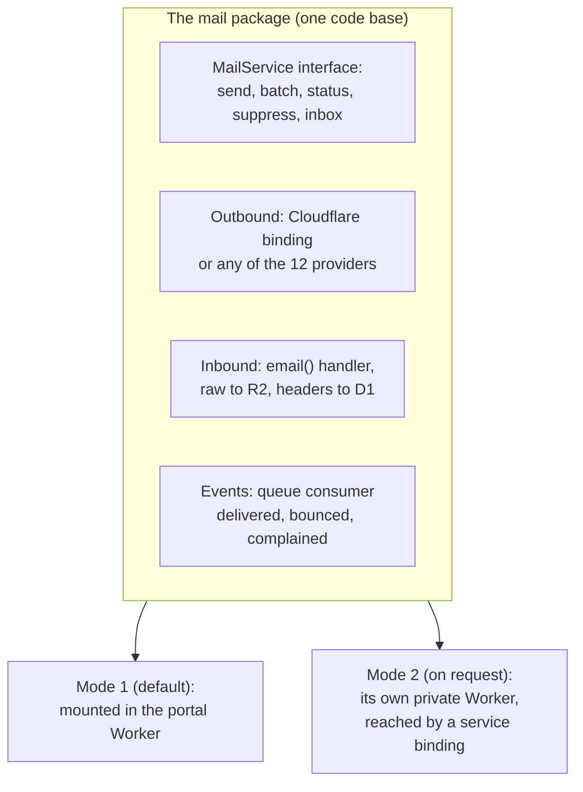

# A private mail Worker

> **In plain words.** The owner asked about Mailflare, and whether the whole email system could
> run as its own Worker on Cloudflare, with no address on the internet, reached by the portal
> only through a service binding in `wrangler.toml`. **Yes, and Cloudflare now has the missing
> piece built in.** Since 2026 a Worker can send mail through a `send_email` binding and receive
> it through Email Routing, with no API key, no webhook address and no outside provider. Mail
> still has to leave Cloudflare to reach a recipient (that is what email is), but our code never
> opens a connection to the internet: Cloudflare's own mail servers deliver it, sign it and
> handle bounces. The catch is money, not technology: sending to anyone needs the Workers Paid
> plan ($5 a month, 3,000 emails included, then $0.35 per 1,000). On the free plan Cloudflare
> sends only to addresses verified in the account, which still covers the portal's own staff
> alerts. Mailflare itself is a good product to learn from but should not be bundled: its
> licence is AGPL-3.0 and it needs many more resources than one client may have.

## The short answer

| Question | Answer |
|---|---|
| What is Mailflare? | An open-source "Google Workspace on Cloudflare": mailboxes on your own domain, calendar, booking, drive and AI agents, in one Worker (section 1) |
| Can we bundle it into the kit? | No: AGPL-3.0, rule R-03 (design, not code) and its resource count rule it out; we can learn from its design (section 1) |
| Can an email system run in a Worker with no public address? | Yes: `workers_dev = false`, `preview_urls = false`, no route, no custom domain; the portal calls it over a service binding (section 4) |
| Can it be *completely* cut off? | Inbound yes. Outbound, the mail is carried by Cloudflare's mail servers through the binding; our code makes no internet request and holds no key. A Worker cannot deliver to mail servers itself: port 25 is blocked (section 2) |
| Does it work on the free plan? | Receiving: yes, unlimited. Sending to anyone: no, Workers Paid only. Sending to verified addresses (up to 200 per account): yes, free (section 3) |
| What is recommended? | One mail package with two hosting modes: inside the portal Worker by default, or as a private mail Worker behind a service binding when a client wants isolation (section 5) |

## 1. Mailflare, read on 2026-11-02

**What it is.** A self-hosted suite for custom-domain email, calendar, drive, booking and AI
agents, by an independent author, with about 5,400 stars. It runs as one Cloudflare Worker or as
one Docker container. Per domain, you choose who receives and who sends: Cloudflare (Email
Routing in, Email Sending out), Resend or Amazon SES.

**What it uses on Cloudflare** (from its `wrangler.jsonc`): one Worker that must keep the name
`mailflare`, D1, an R2 bucket for raw messages, three queues (inbound, outbound, agent), a
Durable Object for live updates, the Images and Workers AI bindings, two cron triggers, two rate
limit bindings, the `send_email` binding and a service binding to itself. It needs one API token
with Email Sending, Email Routing, DNS and Zone Settings edit rights.

**What it does well, worth learning from (design only, R-03):**

- The receive and send providers are chosen per domain, separately; a domain can be receive-only
  or send-only, and a new provider can be prepared while the old one keeps working.
- A DNS audit per domain reports MX, SPF, DKIM and DMARC as `ok`, `missing` or `unknown`, and
  creates a missing record on request.
- Raw messages go to R2 and are parsed by a queue consumer, so the inbound handler stays small.
- Replies thread correctly because it sets its own `Message-ID`.

**Why not bundle it or run it beside the portal:**

| Reason | Detail |
|---|---|
| Licence | AGPL-3.0: offering a modified copy to clients over a network obliges us to publish that modified source. It does not fit a kit sold under the Oltrem Licence |
| R-03 | Nothing is copied or adapted from other projects' code; we design our own |
| R-09 | One of each resource per client; Mailflare alone brings three queues, a Durable Object, a second D1 and R2, two crons |
| A second front door | It has its own public pages and its own administrator sign-in, separate from the portal's Access and permissions |
| A wide token | Its runtime token can edit the client's DNS; the kit keeps such rights out of the running Worker |
| Same price wall | Its Cloudflare sending also needs Workers Paid; on the free plan it falls back to Resend or SES keys, which the kit already supports |

## 2. What "cut off from the internet" can mean



- **No public door:** the mail Worker has no route, no custom domain, `workers_dev = false` and
  `preview_urls = false`. Nothing on the internet can call it. The portal reaches it through a
  service binding, which never leaves Cloudflare.
- **No internet request from our code:** with the `send_email` binding the Worker hands the
  message to Cloudflare's mail servers inside Cloudflare; with Email Routing, Cloudflare hands
  incoming mail to the Worker's `email()` handler; with event subscriptions, delivery, bounce and
  complaint events arrive on a queue. No `fetch()` to a provider, no webhook address to protect.
- **No secret:** the binding needs no API key. The only credentials are the deploy token's rights
  to set up the domain, used at deploy time and never stored in the Worker.
- **What cannot be cut:** delivering mail means talking SMTP to the recipient's mail server.
  Workers may not open port 25, and a mail server needs a trusted sending address and reputation
  anyway. So the last hop is always someone's mail servers: Cloudflare's (binding) or a
  provider's (Brevo, Resend and the other ten definitions the kit already has).

## 3. Cloudflare's own email, as of 2026-11-02

| Fact | Detail |
|---|---|
| Sending to anyone | Workers Paid only: 3,000 emails a month included per account, then $0.35 per 1,000. Hard bounces count; sends refused at the door (for example a suppressed address) do not |
| Sending on the free plan | Only to verified destination addresses of the account (up to 200), free and outside every quota |
| Receiving | Email Routing, free and unlimited on both plans; a rule sends an address (or a catch-all) to the Worker's `email()` handler |
| Three ways to send | the Workers binding, a REST API, and authenticated SMTP on port 465 only. Same limits for all three |
| Per message | up to 50 recipients (to, cc and bcc together), 25 MiB, a 998-character subject, 16 KB of headers |
| Daily limit | per account, starts low and grows with good sending; a form asks for more |
| Domain setup | onboarding a domain adds MX, SPF and DKIM records on a `cf-bounce` subdomain and a DMARC record; DNS must be on Cloudflare |
| Signing and reputation | DKIM and ARC signing, SPF alignment, IP reputation and complaint handling are Cloudflare's |
| Suppression list | hard bounces and spam complaints are suppressed automatically; manual entries per account or per sending domain; bulk import 1,000 per request |
| Delivery events | six events (delivered, deferred, bounced, failed, rejected, complained) published to a queue per sending domain |
| Binding limits | a binding can be restricted to fixed senders (`allowed_sender_addresses`) or recipients in `wrangler.toml` |
| Replies from the handler | `message.reply()` works once per incoming mail, only to its sender, only from the domain that received it, and only when the incoming mail passes DMARC |
| Free plan inbound | the `email()` handler has the usual 10 ms CPU; a heavy handler fails with `EXCEEDED_CPU` |

## 4. The designs

### A. Cloudflare as a built-in provider, inside the portal Worker

The smallest step. The kit's providers module gets a thirteenth email definition, `cloudflare`,
whose transport is the `send_email` binding instead of HTTP. Everything the kit already has keeps
working on top of it: senders, templates, lists, the bulk engine, Sent with Undo, suppression.

- **Free plan:** offered for staff mail only (alerts, approvals, sign-in codes to verified staff
  addresses), shown as "free, staff only" in Connect.
- **Paid plan:** offered for everything, and the cheapest provider the kit supports at volume
  (20,000 emails in a month cost about $5 + 17 × $0.35 ≈ $11, with the Workers Paid plan's other
  limits included).
- **Events:** the event subscription points at the kit's existing queue (one of each resource,
  R-09); the consumer tells the events apart by their `type`.

### B. A private mail Worker behind a service binding

What the owner described. A second Worker per client holds the binding, the `email()` handler
and the event consumer, and exposes a small typed interface over RPC (a `WorkerEntrypoint`):
send one, send a batch, the status of a message, suppress and release an address, list and read
the inbox. The portal declares it once:

```toml
# the portal's wrangler.toml (sketch)
[[services]]
binding = "MAIL"
service = "acme-mail"          # the client's mail Worker
entrypoint = "MailService"
```

and calls it like a local object. The mail Worker's own configuration has no route, no custom
domain, `workers_dev = false` and `preview_urls = false`, and binds the client's existing D1 and
R2 rather than new ones.

| Gains | Costs |
|---|---|
| A portal bug cannot read mail settings or raw messages beyond what the interface returns | A second Worker per client: an exception to R-09 that needs the owner's yes |
| The mail Worker is deployed and rolled back on its own | Two deploys to keep in step: the mail Worker first when the interface grows |
| Its code has no public surface at all to attack | Each binding call counts as a subrequest of the portal's request, and a request may chain at most 32 Workers |
| Billing stays one request (the portal's), with the CPU of both Workers added up | Whether the free plan's 10 ms applies to each Worker or to both together is not stated; measure before relying on it |

Service bindings reach only Workers in the **same account**. With one Cloudflare account per
client, there is no shared mail Worker across clients; a future central portal would read each
client's mail figures through that client's own API, not through a binding.

### C. Mailflare beside the portal

Possible for one person's own use, not as part of a sold kit, for the reasons in section 1.

### D. A curiosity: SMTP inside Cloudflare

A Worker can accept a TCP connection forwarded by another Worker over a service binding (a
`connect()` handler), so a private "SMTP server" Worker is possible. It adds a protocol where RPC
is simpler, so it is not proposed.

## 5. Recommended: one mail package, two hosting modes



The kit's email module talks only to the `MailService` interface. In mode 1 the interface is a
plain object inside the portal Worker: free-plan friendly, no extra Worker. In mode 2 the same
package is deployed as the client's private mail Worker and the interface is the service
binding. A client moves from one to the other by a setting and a deploy, with no code change.

## 6. What it would let the portal do

1. **A shared inbox** for `support@example.com` and the like, inside the portal, with the
   portal's own permissions on who reads which address.
2. **Replies come back to the portal**: an answer to a campaign or a Write email lands on that
   message's page, threaded, instead of in someone's personal mailbox.
3. **Approve by replying**: an approval email carries a signed, single-use reply address
   (`approve+<token>@example.com`, using subaddressing). A reply "yes" from the right person,
   passing DMARC, records the approval with the same permission check as the button. Anything
   unclear is refused and the person is asked to use the portal (R-10).
4. **Email in, records out**: a receipt sent to `expenses@` becomes an expense with the
   attachment in R2; a mail to `tasks@` becomes a task.
5. **Bounces and complaints at once**: the event queue updates the do-not-mail list and the
   campaign's live page without a public webhook.
6. **No keys to rotate** for Cloudflare sending, and nothing to leak.
7. **A DNS check** that shows each sending domain's MX, SPF, DKIM and DMARC state in plain words.

## 7. The free plan's budgets

| Limit | What it means here | Design answer |
|---|---|---|
| 10 ms CPU per invocation | a large incoming mail cannot be parsed in the `email()` handler | store the raw message in R2 and read only the headers there; parse the body when someone opens it, or in the tick in small steps |
| 1,000 KV writes a day | nothing about mail may write KV | messages, threads, stamps and events go to D1 (100,000 rows written a day) |
| 50 subrequests | each send through the binding is one | the bulk engine already counts its calls per run; on the free plan Cloudflare sends only staff mail anyway |
| Queues 10,000 operations a day | about three operations per event | delivery events only exist with paid sending, where the included queue operations are far larger |
| 100,000 requests a day | each incoming mail is one invocation | fine for a business inbox; a flood is cut by Email Routing's own spam checks first |

## 8. What needs the owner's yes before any of it is built

- The `send_email` binding: the kit's manifest lists it as outside the kit today (R-09).
- The deploy token's new rights to onboard a sending domain and create routing rules, with rows in
  the token registry (R-05).
- An email parser: write our own small one (as the kit wrote its own SMTP client and MIME writer)
  or register a dependency such as postal-mime, MIT licensed (R-09).
- For design B only: a second Worker per client.

## 9. Order of work, if approved

1. The `cloudflare` provider definition over the binding, staff-only on the free plan, full on
   paid; the event queue feeding the do-not-mail list.
2. Inbound: the `email()` handler, raw to R2, a message list in D1, the shared inbox page.
3. Replies threaded to Sent and campaigns; the DNS check.
4. Approve by reply; email-to-expense and email-to-task.
5. Mode 2: the same package as a private mail Worker, behind the client's choice.

Each step is measured with the local CPU profile and has its tests, as the rest of the kit.

## Sources

- Mailflare: its README, `docs/providers.md`, `docs/api.md`, `wrangler.jsonc` and `LICENSE`
  (GitHub, `hieunc229/mailflare`), read 2026-11-02.
- Cloudflare Email Service: Pricing (updated 2026-06-09), Limits (updated 2026-10-30), Email
  Sending Workers API, Send bindings, SMTP, Event subscriptions (changelog 2026-07-15), Email
  handler, Deliverability and Suppressions pages, read 2026-11-02.
- Cloudflare Workers: TCP sockets (port 25 and Cloudflare addresses blocked), Service bindings
  (limits), Limits (subrequests) and Pricing (service bindings) pages, read 2026-11-02.
