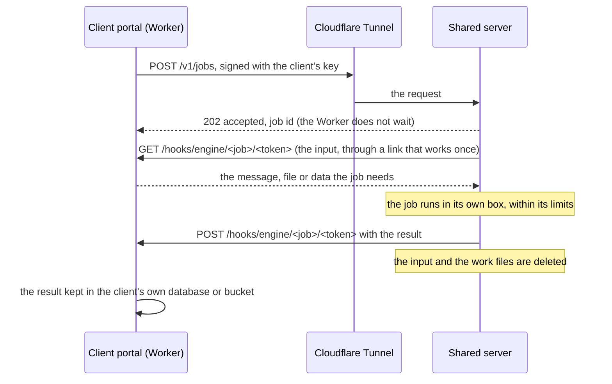

# The shared server

> **In plain words.** The owner has a server of his own and wants to lend its power to every
> client: each client portal holds a key, and the server gives that key a fixed allowance. This
> page designs that server, the **shared server**. It is an extra, never a requirement. A
> portal without a key, or one whose shared server is down, keeps working exactly as it does on
> Cloudflare alone. With a key, the jobs that are too heavy for a portal's 10 ms of CPU go to the
> shared server: reading whole emails and their attachments, search, virus checks, PDFs and big
> files. The server keeps no client data. It fetches what a job needs, does the job, hands back
> the result and deletes the rest. Mail is its first user; any kit module may use it later.
> Nothing here is built until the owner approves the decisions in section 11.

## 1. What it is, and what it is not

| It is | It is not |
|---|---|
| one server the vendor runs, on any cloud: Oracle, AWS, Azure or any Linux machine with Docker | a requirement: every feature that uses it has a Cloudflare-only path, and the portal falls back to it (R-10) |
| a queue of heavy jobs with a fair share for each client and a hard limit for each key | a mail server: Oracle, AWS and Azure all block outgoing mail on port 25 by default (Oracle since 2021), so mail still leaves through the providers or Cloudflare |
| reached through a Cloudflare Tunnel, so it opens no port to the internet | a store of client data: nothing is kept after a job, and its logs hold no content and no addresses |
| managed from its own small admin page, behind Cloudflare Access on the vendor's account | part of a client's Cloudflare account: a client's resources stay one of each (R-09) |
| written fresh in a new private repository | built from the first client's server tools: R-03 holds, nothing is copied or adapted |

## 2. How a portal uses it

- **The portal never waits.** It asks for a job and goes on. The result comes back to a public
  hook of the portal (mounted before identity, like the delivery reports), or the portal's tick
  collects it. So a job costs the portal one or two outgoing requests and a few milliseconds of
  CPU, inside the free plan's budgets.
- **The input is pulled through the portal.** The shared server never holds a client's
  Cloudflare, bucket or provider keys. It fetches each input through a link the portal makes for
  that job, which works once and expires within minutes. Removing the key on the portal ends
  everything at once.
- **Results are small.** For example, a parsed message comes back as its headers, its text for
  search, its attachment list and a scan verdict. The portal stores them where it would store
  them without the server.

## 3. Keys and allowances

- **A client entry.** On the admin page the vendor adds a client: a name, the job kinds it may
  use, and its allowance. The page shows the key once. The server keeps only a hash of it.
- **On the portal.** The key is pasted into Settings → Shared server and stored sealed with the
  portal's key-encryption key, like a provider's key. That keeps the variable count unchanged
  (R-09). Because it is a credential, it still gets a row in the token registry (R-05).
- **Each request is signed.** The portal signs the method, path, time and a hash of the body with
  the key (HMAC-SHA-256). The server refuses a request more than five minutes old or one it has
  seen before, so a copied request cannot be replayed.
- **The allowance is locked on the server.** Per key: requests a minute, jobs a day, CPU seconds
  a day, megabytes in a day, the largest input and jobs at once. Past any of these, the answer is
  429 with when it resets, and the portal shows "Today's allowance on the shared server is used;
  it resets at 00:00 UTC" and uses its Cloudflare-only path.
- **Usage the client can see.** `GET /v1/usage` returns today's use against the allowance, for
  the portal's Settings card and for the admin page.
- **Rotate and revoke** at any time from the admin page. A revoked key fails closed on the
  portal, which falls back.

## 4. One server, many clients, fairly

- **A fair queue.** Jobs wait in one queue that takes turns between clients, so one client's
  thousand-message import cannot hold up another client's single message. Each key also has its
  own cap on jobs at once.
- **Workers sized to the machine.** One job runner per core, minus one core for the API and the
  admin page.
- **Each job in its own box.** Email and files from the internet are untrusted, so every job runs
  in a separate process with a CPU-time limit, a memory limit, a wall-clock limit and no network
  except the fetch of its own input. A job that crashes or runs over its limits fails alone.
- **Nothing kept.** Inputs and work files live in a temporary folder deleted when the job ends. A
  result is kept for at most 24 hours, only until the portal confirms it has it. The server's own
  records are client entries, key hashes, counters and job timings.

## 5. Installed the same way on any cloud

- **One bundle.** A Docker Compose file with the API, the job runners and `cloudflared`, built on
  the server from the private repository's source. No registry, in line with the owner's decision
  that Oltrem stays private. It builds for Arm (Oracle's free servers) and Intel (AWS, Azure).
- **One state file.** SQLite holds the client entries, key hashes, counters and queue. One server
  needs no separate database service.
- **Three commands.** `./install.sh` checks Docker, asks for the Tunnel's token and the admin
  page's address, builds and starts everything, and prints the health check. `./update.sh`
  rebuilds, checks health and rolls back if the new build is unhealthy. `./backup.sh` copies the
  state file (no client data is in it) to the vendor's own bucket.
- **What it needs.** Linux on Arm or Intel, Docker, about 2 cores and 4 GB of memory to start,
  more for virus scanning. These figures are estimates to be measured in phase E1.
- **Oracle notes**, from Oracle's pages read 2026-11-02. A new free account gets 2 Arm cores and
  12 GB in total, not 4 and 24, and 200 GB of disk. A free server that sits mostly idle for 7 days
  can be reclaimed. An account upgraded to pay as you go keeps the free amounts without that
  risk.

## 6. The vendor's admin page

Served by the shared server through the Tunnel, behind Cloudflare Access on the vendor's own
account. It holds clients, keys (make, rotate, revoke), allowances, today's use per client, the
queue, the health of each part and the server's own load. It is phone first, with options in a
sideways row (R-12). The same actions are in an admin API, so the central management portal the
owner may build later can drive it. The first client's server console is not used for this.

## 7. What a client portal shows

**Settings → Shared server** has a field for the key, a "Test the connection" button, the
server's state, today's use against the allowance and the job kinds this key may use. A feature
that uses the server says so in a small note, and says when it fell back. The kit owns this card;
a module only names the job kinds it uses.

## 8. Privacy and safety

- **The vendor becomes a processor** of each client's data while a job runs. Before the first
  real client uses it, the client agreement needs a data processing section: what is processed,
  where the server is, how long anything is kept (nothing past 24 hours) and who the cloud
  provider is. This is for the owner and his lawyer; the design keeps it small.
- **One break-in exposes no stored data.** The server keeps none, and it holds no client
  Cloudflare, bucket or provider keys. It does see each input while a job runs.
- **One server is one point of failure.** The portal falls back, the admin page shows the server's
  health, and the vendor gets an alert when it stops answering.
- **Abuse** is bounded by the allowance, the job kinds a key may use and the largest input size.

## 9. What mail uses it for (first user)

| Job kind | Without the shared server (oltrem-mail's plan) | With it |
|---|---|---|
| `mail.parse` | the Worker reads the first 128 KB of each arrival; the phone parses the message when opened | the whole message and every attachment parsed on arrival; text, headers and the attachment list returned |
| `mail.search` | the first 8 KB of text indexed | the whole text extracted for the portal's own search index |
| `mail.scan` | none | a virus and spam verdict before the message is shown |
| `lists.check` | the address's form checked | the domain's mail records looked up, and throwaway domains flagged, before a bulk send |

Sending stays in the portal: provider keys never leave the client, and a provider's daily limit,
not CPU, caps how much mail goes out. The mail thread designs these job kinds; the kit owns the
queue, the keys and the Settings card (oltrem-mail `docs/kit-contract.md`).

Other kit modules could use it later for PDFs of quotes and invoices, image thumbnails for files
and assets, and very large imports and exports.

## 10. Build order

| Phase | What | Where |
|---|---|---|
| E1 | the bundle, the Tunnel, the admin page with clients, keys and allowances, the health check, usage; the portal's Settings card and "Test the connection" | a new private repository, and this kit |
| E2 | `mail.parse` and `mail.search` | oltrem-mail, with the kit's job interface |
| E3 | `mail.scan` and `lists.check` | oltrem-mail |
| E4 | PDFs and images for kit modules | this kit |

Each phase is measured on the real server before the next: CPU per job, memory, and how many jobs a
day a client's allowance really buys.

## 11. The owner's decisions

1. **A new private repository** for the shared server, `oltrem-engine`, under the owner's account.
2. **The key on the portal** stored sealed in the client's database, with a token registry row,
   instead of a new Worker secret.
3. **Keep nothing:** inputs deleted when a job ends, results kept at most 24 hours.
4. **The first allowance** for each client, to be tuned after phase E1's measurements: 2,000 jobs a
   day, 10 CPU minutes a day, 500 MB a day, 25 MB per input, one job at a time.
5. **The admin page** on the shared server behind Cloudflare Access (recommended), or only through
   the admin API until the central management portal exists.
6. **The owner's Oracle account:** check the billing page, since his server has 4 cores and 24 GB
   against today's free 2 and 12, and consider pay as you go so an idle server is not reclaimed.
