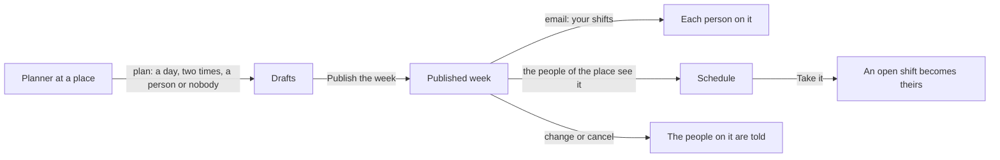

# @oltrem/shifts

Shifts: who works when at each place. Whoever plans at a place drafts the week's shifts, each with
a person or left open, and publishes the week when it is ready: the people of the place see it,
and everyone on it is emailed their shifts. A person sees their own shifts on their phone and
takes an open shift at a place they see. A published shift that changes or is cancelled tells the
people on it. Drafts nobody sees yet and open shifts nobody took wait in Needs you. Every step is
in the audit log.

It plans the work; the time clock (`@oltrem/timeclock`) records the hours actually worked.

## Using it

```ts
import { createShifts } from '@oltrem/shifts';
import { pages as shiftsPages } from '@oltrem/shifts/pages';
import { withPages } from '@oltrem/core-module';

const shifts = createShifts<Env>({
  bindings: (env) => ({ db: env.DB }),
  // The company's clock: shifts are typed and shown on it, and kept in UTC.
  timeZone: async (env) => (await settingsFor(env)).get<string>(TIME_ZONE_SETTING.key),
  // The messages are plain; the client template sends them through email.
  send: async (env, message) => {
    await email.send(env, {
      tenantId: message.tenantId,
      template: 'shifts.message',
      to: [{ email: message.to }],
      data: { subject: message.subject, text: message.text },
      messageKey: message.key,
    });
  },
});
const modules = [iam.module, /* ... */ withPages(shifts.module, shiftsPages)];
```

`createShifts` returns the `store` and the module manifest. It stands on the IAM module (places,
people, the authorizer), the audit log and the company's clock in `@oltrem/core-config`. It adds
one table and no binding, secret, variable or setting.

## How a week goes



| Rule | Why |
|---|---|
| A shift belongs to a place; the roles held there decide who sees its schedule and who plans it | The same permissions as every other place-bound module |
| A shift is a draft, seen only by whoever plans its place, until its week is published there | People see a schedule once it is decided, not while it is being made |
| A day and two times on the company's clock; an end before the start is the next day | A night shift is typed as people say it; daylight saving is handled by the clock |
| A person works one shift at a time, checked in the same statement that writes it | Two planners at once cannot double-book someone |
| A shift is given to a person of the company whose account is on, by their address, or left open | Nobody is put on a shift they cannot see |
| An open, published shift that has not started is taken by someone who sees its place and is free then, once | The first to take it has it; nobody takes a shift that clashes with theirs |
| Publishing emails each person their shifts of the week at that place; a change to a published shift emails whoever works it now and whoever no longer does; removing it emails whoever worked it | Nobody learns of a change by surprise |
| A failed email is reported and never undoes the change | The schedule stays right when the mail is down |

## Who may do what

Two capabilities on bit plane `27`, held at a place (and so at the places under it):

| Capability | Lets them |
|---|---|
| `shifts.view` | see the place's published schedule and take its open shifts |
| `shifts.plan` | plan, change, remove and publish the place's shifts, drafts included |

Everyone sees their own published shifts, whatever else they hold.

## The pages

| Path | Shows |
|---|---|
| `/shifts` | in a sideways row, Mine or Schedule (to whoever sees a place); the week before, this week, the week after; to whoever plans, "Plan a shift" and "Publish the week (n)" in dialogs; Mine: the person's shifts of the week and the open shifts they can take, each with "Take it"; Schedule: every shift of the week at the places they see, drafts marked to whoever plans |
| `/shifts/:id` | one shift: when, how long, where, who or open, a draft or not, the note; "Take it", "Change it" and "Remove it", each in a dialog |

The places to plan at are a row of choices when there is more than one.

## The routes

| Route | Capability | What it does |
|---|---|---|
| `GET /shifts` (`view`, `week`) | everyone | a week on the company's clock (`week` is any day in it): the person's shifts and the open ones they may take (`mine`), or the schedule of the places they see (`schedule`), with the drafts waiting |
| `POST /shifts` | `shifts.plan` at the place | plans a draft: the place, a day, two times, an address or none, a label and a note |
| `GET /shifts/:id` | everyone | one shift, to whoever works it or sees its place once published, or plans its place |
| `POST /shifts/:id` | `shifts.plan` at its place | changes its times, person, label and note |
| `POST /shifts/:id/remove` | `shifts.plan` at its place | removes it |
| `POST /shifts/:id/take` | `shifts.view` at its place | takes an open shift |
| `POST /publish` | `shifts.plan` at the place | publishes the week's drafts there and emails each person their shifts |
| `GET /todo` | `shifts.plan` | Needs you: drafts and open shifts in the next 14 days at the places the person plans |

Every change is audited: `shifts.plan`, `shifts.change`, `shifts.remove`, `shifts.publish` (with
the week and how many) and `shifts.take`, refusals included.

A privacy request (`@oltrem/privacy`) finds every shift the person was given: the place, the
times, the label and note, when it was published and who planned it.

## Tables

Migration `0038_shifts.sql`, additive and idempotent: `shifts_items`, one row a shift: its place,
who works it or none, its start and end in UTC, a label, a note, when it was published, and who
planned it and when.

## Errors

The `37xx` block: `KIT-E-3701` the person works another shift then, `KIT-E-3702` the shift cannot
be taken (someone has it, it is a draft, or it started), `KIT-E-3703` nobody of the company whose
account is on has that address. A day or a time written wrong is the core's `KIT-E-0422`; a shift
that is not there is `KIT-E-0404`; a place the person does not plan is `KIT-E-0403`.

## Not here yet

- Repeating a week, or copying last week's shifts.
- Swapping a shift between two people, and asking to give one up.
- Shifts beside time off: a person away that day is not yet warned about.
- Breaks and the hours planned against the hours clocked.

## Tests

Inside the Workers runtime, through the pipeline beside the IAM module, on the Mexico City clock:
the manifest; drafts planned only where the person plans, an overnight shift read as the next day,
a person on two shifts at once refused, an unknown address, another place, someone without the
capability and a day that does not exist refused; drafts seen only by whoever plans; Needs you;
publishing by the week, refused to someone who does not plan, emailing the person their shifts;
the person's week and the open shift they may take, the schedule to someone who sees the company,
nothing to someone who holds nothing; another week; an open shift refused to someone busy then,
taken once, and no longer taken once started; a published shift changed and removed, the people on
it emailed, a draft removed quietly; the privacy answer; each step audited. The client template's
screens journey plans a shift on the page, is refused a second at the same time, publishes the
week, and finds the shift and the email.
