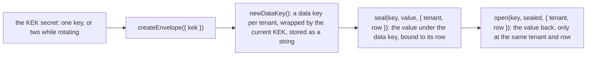

# @oltrem/core-crypto

Envelope encryption for the credentials a client Worker keeps in its database (plan section 8.4):
many tenants times many providers cannot be Worker secrets, so one key-encryption key is the
secret and everything else is a sealed string in a row. Web Crypto only, no dependency.

## How it is layered



```ts
const envelope = await createEnvelope({ kek: env.KEK }); // once per isolate
const wrapped = await envelope.newDataKey(); // stored on the tenant's row
const sealed = await envelope.seal(wrapped, apiKey, { tenant, row: instanceId }); // stored on the instance's row
const apiKey = await envelope.open(wrapped, sealed, { tenant, row: instanceId }); // inside the request that uses it
```

| Call | What it does |
|---|---|
| `generateKek()` | a fresh key-encryption key, the value of the `KEK` secret: printed once at setup, never logged |
| `createEnvelope({ kek })` | reads the secret: one or two base64url keys of 32 bytes separated by a space, the current one first; refuses a missing, malformed, repeated or third key |
| `kekIds` | the ids of the configured keys (twelve hex characters of each key's SHA-256), the current one first |
| `newDataKey()` | a random AES-256 data key, wrapped by the current key-encryption key: `k1.<kek id>.<iv>.<ciphertext>` |
| `seal(wrapped, plaintext, { tenant, row })` | AES-GCM under the data key with a random 96-bit IV and the tenant and row as additional authenticated data: `v1.<iv>.<ciphertext>` |
| `open(wrapped, sealed, { tenant, row })` | the plaintext, when the value was sealed under this data key at this address; a value copied to another row, altered, or sealed under another key is refused |
| `needsRewrap(wrapped)` | true when the data key was wrapped by a key-encryption key that is not the current one |
| `rewrap(wrapped)` | the same data key wrapped by the current key-encryption key |

## Rotation with one secret name

The kit has no second secret for the previous key (R-09): the `KEK` secret holds the new key and
the old one, separated by a space, for as long as the rotation takes. The first key wraps; any
key in the list unwraps. The procedure: set `KEK` to `<new> <old>`, rewrap every stored data key
(`needsRewrap` finds them), then set `KEK` to `<new>`. A data key wrapped by a key the Worker no
longer has is refused with `KIT-E-1303`, which names the key's id; putting the old key back
beside the current one recovers it.

## What the caller owes

- Decrypt only inside the request that uses the value; never write a plaintext or a wrapped key
  to a log, an error, or an audit row (the audit log refuses fields that look like credentials).
- Store the wrapped data key on the tenant and the sealed value on the row it belongs to, and pass
  that same tenant and row to `open`: the binding is what refuses a value moved between rows.
- Audit every create, rotate and failed use, with the actor: the envelope has no actor and writes
  no row. The providers module does this.
- Unwrapped data keys are kept in memory per isolate, the most recent sixty-four; nothing is
  cached across isolates.

## Errors

`KIT-E-1301` no `KEK` secret (503); `1302` the secret is malformed; `1303` a data key wrapped by
a key this Worker lacks (503); `1304` a wrapped key or sealed value in a shape this package did
not write; `1305` a sealed value that did not open (moved, altered, or another key); `1306` a
seal or open asked without its tenant and row.

## Tests

Inside the Workers runtime: a value sealed and opened at its address, two seals of it different,
the empty value allowed; refused at another tenant, another row, altered, under another data key,
malformed, or without its address; a key wrapped under one key-encryption key opened under the
next with the old one beside it, rewrapped, then refused once the old key is gone; the secret
refused when missing, malformed, repeated or three keys long.
