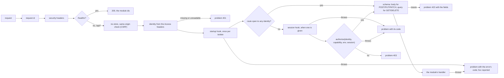

# @oltrem/core-http

The one request pipeline of a client Worker (plan section 4.2 and 11), built on Hono: request
ids, security headers, the identity the Access door asserted, the startup hook once per isolate,
the session hook, the module routes with their capability and schema checks, one problem shape for
every error, and the three Worker handlers (`fetch`, `scheduled`, `queue`) from one place.

## The pipeline



Every mutation needs same-origin proof (an `Origin` or `Sec-Fetch-Site` header that matches);
a bare cross-site POST is refused with `KIT-E-0440`. Every response carries `x-request-id`,
`X-Frame-Options: SAMEORIGIN`, `Referrer-Policy: same-origin` and a content security policy
that allows framing by the same origin only. Routes mount at `/api/<module id><path>`.

## Using it

```ts
import { createApp, createWorker } from '@oltrem/core-http';

const iam = createIam({ bindings: (env) => ({ kv: env.CACHE, db: env.DB }) }); // @oltrem/iam
const modules = [iam.module, notes, settings];
const scheduler = createScheduler({ bindings: (env) => ({ db: env.DB }), modules }); // @oltrem/core-jobs

const app = createApp({
  modules,
  startup: iam.startup,
  session: iam.sessions.hook,
  authorize: iam.sessions.authorize,
  report: (error, requestId) => sentry(error, requestId),
});

export default createWorker({
  app,
  modules,
  tick: scheduler.tick,
  onHandled: (event, env) => outbox(env).complete(event.idempotencyKey),
  report: (error, context) => sentry(error, context),
});
```

A route the module marked `access: 'identity'` (`@oltrem/core-module`) skips the session hook
and the capability check: the door's identity is enough, for a person who has no account yet.
Its body is still validated and the same-origin check still applies; the handler sees
`ctx.session` as `undefined`.

`startup` runs once per isolate, on the first request that passed the door and before its session
hook, with the mounted modules: the IAM module's `startup` registers the capabilities they declare.
Requests that arrive while it runs wait on the same run; when it fails, that request is answered
with the error, reported as every 5xx is, and the next request runs it again. `/healthz` and a
request without an identity never start it.

`session` and `authorize` are the two places the permission model plugs in. The session hook
runs once per request after the identity is read and before the capability check; whatever it
returns reaches the authorizer as its fourth argument and the handler as `ctx.session`. Either may
throw a `KitError` to answer with a reason of its own. The IAM module provides both, with the
startup hook (`createIam` in `@oltrem/iam`); without the module a client uses the own-account authorizer
and no hook: the one owner email holds every capability and `ctx.session` is `undefined`.

The identity comes from the headers Cloudflare Access adds: the email, and the token whose claims
(`sub`, `iat`, `aud`) become `subject`, `signedInAt` and `audience`. Access verified the person at
the edge, so the Worker does no crypto in the request (plan 11): the claims are decoded, not
verified, and a token that does not parse or lacks a subject or a sign-in time is no identity at
all. The IAM module checks the audience.

## The three handlers

| Handler | What it does |
|---|---|
| `fetch` | the pipeline above |
| `scheduled` | runs the `tick` it was given (the jobs' scheduler of `@oltrem/core-jobs`), then every module's `scheduled` hook, on the one cron; an error in one is reported and the others still run |
| `queue` | reads each message as an envelope, dispatches on `type` to the module that declares it, calls `onHandled` (the outbox marks its row done), acknowledges; a handler that throws retries the message; an unknown type is reported and retried, so it reaches the dead-letter queue |

Tests run inside the Workers runtime with a sample module that has one route of each shape, and
a second module that echoes what the session hook returned.
