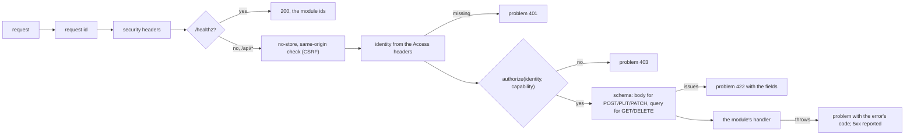

# @oltrem/core-http

The one request pipeline of a client Worker (plan section 4.2 and 11), built on Hono: request
ids, security headers, the identity the Access door asserted, the module routes with their
capability and schema checks, one problem shape for every error, and the three Worker handlers
(`fetch`, `scheduled`, `queue`) from one place.

## The pipeline



Every mutation needs same-origin proof (an `Origin` or `Sec-Fetch-Site` header that matches);
a bare cross-site POST is refused with `KIT-E-0440`. Every response carries `x-request-id`,
`X-Frame-Options: SAMEORIGIN`, `Referrer-Policy: same-origin` and a content security policy
that allows framing by the same origin only. Routes mount at `/api/<module id><path>`.

## Using it

```ts
import { createApp, createWorker } from '@oltrem/core-http';

const app = createApp({
  modules: [notes, settings],
  authorize: (identity, capability, env) => can(env, identity, capability),
  report: (error, requestId) => sentry(error, requestId),
});

export default createWorker({
  app,
  modules: [notes, settings],
  onHandled: (event, env) => outbox(env).complete(event.idempotencyKey),
  report: (error, context) => sentry(error, context),
});
```

`authorize` is the one place the permission model plugs in; until the IAM module (phase 2) a
client uses the own-account authorizer: the one owner email holds every capability. The identity
comes from the headers Cloudflare Access adds; Access verified the person at the edge, so the
Worker does no crypto in the request (plan 11). The IAM module adds the audience check.

## The three handlers

| Handler | What it does |
|---|---|
| `fetch` | the pipeline above |
| `scheduled` | runs every module's `scheduled` hook on the one cron; an error in one is reported and the others still run |
| `queue` | reads each message as an envelope, dispatches on `type` to the module that declares it, calls `onHandled` (the outbox marks its row done), acknowledges; a handler that throws retries the message; an unknown type is reported and retried, so it reaches the dead-letter queue |

Tests run inside the Workers runtime with a sample module that has one route of each shape.
