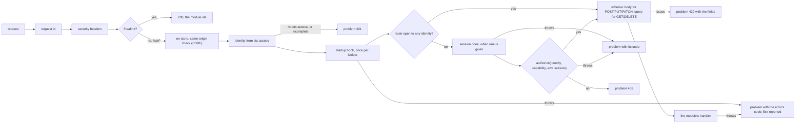

# @oltrem/core-http: the pipeline

> Part of [the @oltrem/core-http README](../README.md).

## The pipeline

Routes mount at `/api/<module id><path>`. A mutation needs same-origin proof (`Origin` or
`Sec-Fetch-Site`), else `KIT-E-0440`. Every answer carries `x-request-id`,
`X-Frame-Options: SAMEORIGIN`, `Referrer-Policy: same-origin` and `frame-ancestors 'self'`, added
to a policy the handler set (a download keeps its sandbox).

## What is told

| Option | What it hands over |
|---|---|
| `onChange` | Each POST, PUT, PATCH or DELETE that reached a route, and each GET marked `audited: true` (outside data read in), as a `RouteChange`: module, action (the route's `action`, else made from method and fixed segments, `create-lists-items`), route as declared, last parameter as target, status and outcome (`ok` under 400, `failed` from 500, `refused` between), code, `reason`, `fields`, `download` and `bytesOut`, time, identity, session, address, country, browser (`deviceName`). Session, capability and schema refusals are told; door and same-origin refusals never reach a route. A key refused before a route is `iam.key-refused` (target the key's public id, `outside` when none). The template passes `createChangeAudit` |
| `noteRequest` | Before the route runs: address, country, region, city, network (`request.cf`), browser, user agent, and the key or sign-in, so a module's own rows say them too |

A hook that throws goes to `report` and leaves the answer as it was.

## Idempotency-Key and a key's pace

With `idempotency`, a key's POST, PATCH or DELETE with `Idempotency-Key` (1 to 255 printable
characters) runs once (`src/idempotency.ts`, the IETF draft): claimed with method, path and body
hash, the answer kept (body up to `IDEMPOTENCY_KEPT_BYTES`, 8 KB). For `IDEMPOTENCY_KEEP_MS` (a day)
a repeat gets it with `Idempotent-Replayed: true`; another request under the key is 422; a repeat
while the first runs, or of an answer too big to keep, is 409 `KIT-E-0409`. A throw or 5xx frees
the key; a failing store never fails the call. One read and up to two writes, only with the header.

With `limiter`, an answer to a known key carries `RateLimit-Policy: "key";q=<60 / weight>;w=60`, a
429 also `RateLimit: "key";r=0;t=60`; a key past its limit writes at most one `iam.key-refused` row
a minute.

## The inner call

The screens render a page by calling the API inside the page's request (Home makes about 25). The
app exposes `INNER_CALL` (`Symbol.for('oltrem.core-http.inner-call')`), an `InnerCall(outer,
request)` the screens' `api` uses. It reuses the outer identity and parts switched off, makes a
fresh request id, and skips headers and the same-origin check (the answer never leaves the Worker);
part off, session hook, capability, schema, handler and `onChange` run as on their own request.
It falls back to the whole pipeline with no identity, before startup finished, to another origin,
or outside `/api/`.

## The router

Hono's trie router takes routes as they are added at load; the default would build two routers on
an isolate's first request, about 10 ms of its CPU.
