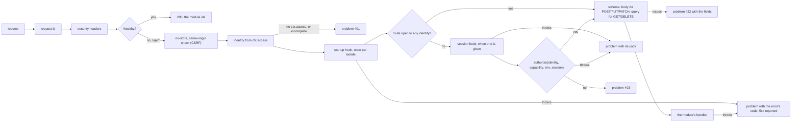

# @oltrem/core-http: The pipeline

> Part of [the @oltrem/core-http README](../README.md).

## The pipeline

Every mutation needs same-origin proof (an `Origin` or `Sec-Fetch-Site` header that matches);
a bare cross-site POST is refused with `KIT-E-0440`. Every response carries `x-request-id`,
`X-Frame-Options: SAMEORIGIN`, `Referrer-Policy: same-origin` and a content security policy
that allows framing by the same origin only. Routes mount at `/api/<module id><path>`.

**Every change is told, and every read that matters**. With `onChange` given, each POST, PUT, PATCH
or DELETE that reached a route, and each such read, is handed over once it answered or threw, as a
`RouteChange` (`@oltrem/core-module`): the module, the action (the route's `action`, or one made
from its method and fixed path segments, `POST /lists/:id/items` as `create-lists-items`), the route
as declared, the last parameter as the target, the status, `ok` below 400, `failed` from 500,
`refused` between, the error code, the refusal's own words (`reason`) and the fields a refused input
named (`fields`), the file and size an answer handed over (`download`, `bytesOut`), the time taken,
the identity and session, the caller's address and country as the edge gave them, and the browser
and system read from the user-agent (`deviceName`). The same address and country, the region, city
and network the edge placed it in (`request.cf`), the browser, the user agent as sent, and the API
key or the sign-in the call rode on are noted for the request (`noteRequest`, `@oltrem/core-module`)
before the route runs, so a row a module writes itself says them too. A call to `/hooks/api/`
refused before it reaches a route (no key, a key that is not one or was revoked, a key refused by
its own rules, past its limit, or a path it does not have) is told as `iam.key-refused`, with the
key's public id as the target and `outside` when no key let it in. The session hook's, the
capability check's and the schema's refusals are told too; what the door or the same-origin check
refuses never reaches a route and is not. A hook that throws goes to `report` and leaves the answer
as it was. The client template passes the audit module's `createChangeAudit` (`@oltrem/core-audit`),
so every change is a row in the audit log. A GET that brings in data from outside the portal (a
connected database's tables or rows) is marked `audited: true` on its route and is told the same
way, so every read of outside data is on record too; `audited` on any other method is refused by the
contract.

**Idempotency-Key and limits on a key's call.** With `idempotency` given, a key's POST, PATCH or
DELETE sending `Idempotency-Key` (1 to 255 printable characters) runs once (`src/idempotency.ts`;
draft-ietf-httpapi-idempotency-key-header). The first call claims it with its method, path and body
hash and keeps the answer (the body when at most 8 KB of text). For a day a repeat gets it with
`Idempotent-Replayed: true`; another request is 422; a repeat while the first runs, or of an answer
too big to keep, is 409 `KIT-E-0409`. A throw or 5xx frees the key; a failing store never fails the
call. Cost: one read and up to two writes, only for a change sent with the header. With `limiter`
given, every answer to a known key carries `RateLimit-Policy: "key";q=<60 / weight>;w=60`
(draft-ietf-httpapi-ratelimit-headers-11), a 429 also `RateLimit: "key";r=0;t=60`; a key past its
limit writes at most one `iam.key-refused` row a minute.

**A page's own calls to the API stay in process.** The screens render a page by calling the
portal's API inside the page's request (Home makes about 25 such calls). Each used to go through
`app.fetch`, the whole pipeline again, which cost most of a page's CPU. The app now keeps an
inner way to its module routes under the well-known symbol `INNER_CALL`
(`Symbol.for('oltrem.core-http.inner-call')`), an `InnerCall(outer, request)`, and the screens'
`api` uses it when the app has it. It reuses only what the door already established for the
outer request: its identity and the parts switched off. It leaves out the request id (a fresh
one is made for the call), the security headers and the same-origin check, since the answer
never leaves the Worker. Everything that decides what may be done runs exactly as on a request
of its own: the part switched off, the session hook, the capability check, the schema, the
handler and `onChange`; a refusal is the same problem with the same status. A call goes through
the whole pipeline instead when the outer request has no identity (a public route), before the
startup hook has finished, to another origin, or to a path that is not under `/api/`.

**The router.** The app uses Hono's trie router, which takes each route as it is added while the
Worker loads. Hono's default router tries a faster router first, cannot take every module route,
and so builds two routers on an isolate's first request, about 10 ms of that request's CPU
(`archive/records/2026-11-01-cpu-budget.md`).
