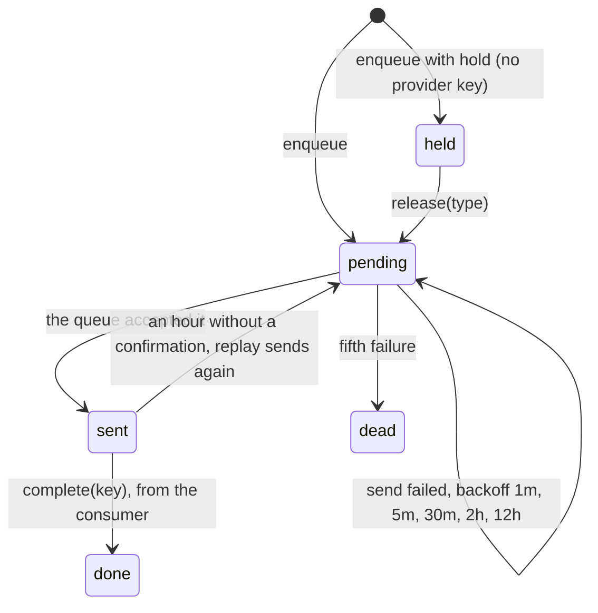

# @oltrem/core-outbox

The one outbox of a client Worker (plan sections 9.1, 10 and 15.4): every event is written to
D1 before it is sent to the queue, confirmed when the consumer handled it, held when its
provider is not ready, and replayed by the tick when it did not land. Email, webhooks and the
audit-first writes (consent, bookings) all go through it: **write the attempt row first, then
the truth, then replay what did not land.**

## How a row moves



```ts
const outbox = createOutbox({ db: env.DB, send: (event) => env.EVENTS.send(event) });
await outbox.enqueue({ type: 'booking.confirmed', v: 1, payload, idempotencyKey: bookingId });
// in the tick:
await outbox.replay();
// in the Worker, so a handled event closes its row:
createWorker({ ..., onHandled: (event) => outbox.complete(event.idempotencyKey) });
```

| Call | What it does |
|---|---|
| `enqueue(event, { hold, delaySeconds })` | inserts the row by its idempotency key (a second call with the same key writes nothing and sends nothing), then sends it; a failed send leaves it pending with the error and the next time to try. `delaySeconds` (at most 43 200, the queue's twelve hours) is handed to the queue on that first send, as `send(event, { delaySeconds })`; when that send fails, the replay comes no sooner than the wait would have ended |
| `complete(key)` | the consumer handled it: done |
| `release(type)` | held rows of that type become pending, for when the provider's key appears |
| `replay({ limit })` | sends what is due: pending rows whose time has come, and sent rows an hour old with no confirmation; returns how many were sent, failed, went dead, or were claimed by another replay first |
| `stats()` | a count per status, for the health card |
| `get(key)` | one row |

Consumers are idempotent by the envelope's key, so a replay that overlaps a live send, or a
confirmation that did not land, costs one duplicate delivery and nothing else. A row goes dead
after five failed sends; a person looks at it. The storage is the table `oltrem_outbox`,
migration `0002`, which depends on no other module's table.

## Tests

Inside the Workers runtime against a local D1 with the migration applied: the row written before
the send, the duplicate key, the failed send and its backoff, held and released rows, a handled
row done, every status counted, the ladder to dead, the unconfirmed row sent again, and two
replays that overlap.
