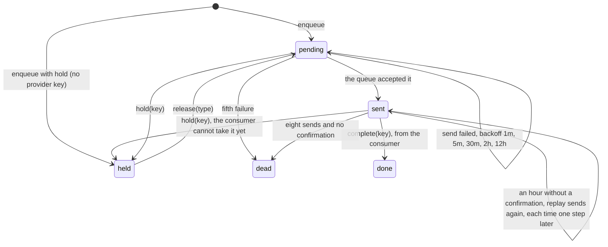

# @oltrem/core-outbox

The one outbox of a client Worker (plan sections 9.1, 10 and 15.4): every event is written to
D1 before it is sent to the queue, confirmed when the consumer handled it, held when its
provider is not ready, and replayed when it did not land. Email, webhooks and the
audit-first writes (consent, bookings) all go through it: **write the attempt row first, then
the truth, then replay what did not land.**

Nothing here runs on its own. Whoever enqueues declares the job that calls `replay`: today that
is email's `email.release` job, in Oltrem Mail. Until 2026-11-17 nothing called it, so a
released row stayed pending for ever and a send the queue refused was never tried again
(`docs/records/2026-11-17-outbox-replay.md`).

## How a row moves



```ts
const outbox = createOutbox({ db: env.DB, send: (event) => env.EVENTS.send(event) });
await outbox.enqueue({ type: 'booking.confirmed', v: 1, payload, idempotencyKey: bookingId });
// in a job of the module that enqueues:
await outbox.replay({ limit: 10 });
// in the Worker, so a handled event closes its row:
createWorker({ ..., onHandled: (event) => outbox.complete(event.idempotencyKey) });
```

| Call | What it does |
|---|---|
| `enqueue(event, { hold, delaySeconds })` | inserts the row by its idempotency key (a second call with the same key writes nothing and sends nothing), then sends it; a failed send leaves it pending with the error and the next time to try. `delaySeconds` (at most 43 200, the queue's twelve hours) is handed to the queue on that first send, as `send(event, { delaySeconds })`; when that send fails, the replay comes no sooner than the wait would have ended |
| `complete(key)` | the consumer handled it: done |
| `hold(key)` | the consumer cannot handle the event until something changes (its provider went away): a pending or sent row is held again, and `release(type)` brings it back. `complete` leaves a held row held, so the queue's acknowledgement of the message does not close it |
| `release(type)` | held rows of that type become pending, for when the provider's key appears |
| `replay({ limit })` | sends what is due: pending rows whose time has come, and sent rows an hour old with no confirmation, no sooner than their own next time (a delayed event is not sent again before its wait ends, and each send again waits one step longer on the ladder, twelve hours at most). A row sent `maxSends` times (8, about two days) that no consumer confirmed goes dead instead of being sent once more. Returns how many were sent, failed, went dead, or were claimed by another replay first |
| `stats()` | a count per status, for the health card |
| `get(key)` | one row |

Consumers are idempotent by the envelope's key, so a replay that overlaps a live send, or a
confirmation that did not land, costs one duplicate delivery and nothing else. A consumer quicker
than the sent mark keeps its `done`: the mark never overwrites it. A row goes dead after five
failed sends, or after eight sends no consumer confirmed; the job that replays reports it, and a
person looks at it. The storage is the table `oltrem_outbox`,
migration `0002`, which depends on no other module's table.

## Tests

Inside the Workers runtime against a local D1 with the migration applied: the row written before
the send, the duplicate key, the failed send and its backoff, held and released rows, a handled
row done, every status counted, the ladder to dead, the unconfirmed row sent again and further
apart each time, a delayed row not sent before its wait ends, a `done` the sent mark leaves
alone, a row held by its consumer and released, a row nobody confirms ending dead after eight
sends, and two replays that overlap.
