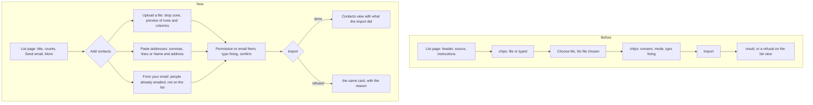
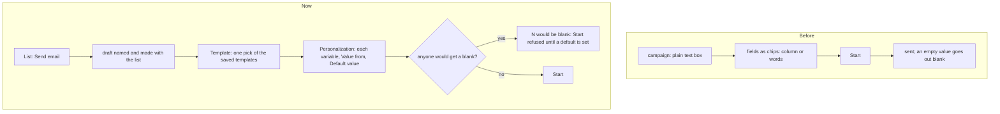

# Lists: adding contacts made plain, and no campaign sends a blank field

> **In plain words.** The owner looked at a list's Add people page on a phone and found it
> confusing: a tall header, long instructions, circled chips everywhere, a bare "Choose file, No
> file chosen" box and words that did not sound professional. He also asked for two things it
> could not do: pick an existing template and its variables so no email goes out with a blank
> where a name should be, and add people smartly, from the people already emailed, then send
> everyone the same email or a personal one from the file's own columns. The Lists pages were
> rebuilt around three ways to add contacts, each a card; the file is previewed before it is sent;
> the people you emailed are offered to tick; and a campaign now names, for each variable, where
> its value comes from and what a person with none gets, and refuses to start while anyone would
> receive a blank.

## What the owner saw, and what changed

| He saw | Now |
|---|---|
| A header taking a third of the phone with the list's name, its source and instructions | One title, one line of counts ("2 contacts, all can be emailed"), **Send email** and a More menu (Download CSV, Edit name and description, Archive, Delete) |
| Every choice as a circled chip: how to add, the permission, keep or replace, typo fixing | How to add is three cards in their own colours (**Upload a file**, **Paste addresses**, **From your email**); the permission is one pick with a line under each answer; replace and typo fixing are switches |
| "Choose file, No file chosen" | A drop zone with an icon and one line; once a file is chosen it shows the file's name and size, how many contacts it holds and its columns, and warns before anything is sent when no column of addresses is found or the file is over 1 MB (the kit's frame script, `data-file-peek`). **Download a sample CSV** sits under it |
| Long paragraphs on consent | **Permission to email them**: They signed up, Existing customers, or Another reason (a line to describe it appears only then), and one confirmation tick |
| Words such as "people", "typed in", "Take an address off every list" | Contacts, Paste addresses, Remove an address from every list, Last import, Status |
| No way to reuse addresses already emailed | **From your email**: the people the signed-in person emailed from Compose, most emailed first, who are not on the list yet, each ticked, with a filter and Select all |
| A campaign page with a free text box for the message and a row of chips for its fields | **Template** as one pick of the saved templates; **Personalization** lists each variable with its state, **Value from** (a column of the list, or Same text for everyone) and a **Default value** |
| Nothing stopped a campaign whose list had empty values | Each variable says "N would be blank" in amber, and the campaign does not start until it has a default value |

## How it works now

### Adding contacts

Before, a refused import came back on the contacts view, so the reason sat away from the form that
caused it. Now each form posts to its own card (`?show=add&how=...`): a refusal is shown there, and a
finished import opens the contacts with what it did (added, updated, duplicates, skipped rows by
number, typos fixed, contacts on the do-not-email list, the fields it brought for emails).

**From your email** reads `GET /api/email/lists/:id/suggestions`: Write's own ranking of the
person's last 100 sent emails (the people written to most first, then the newest), then one read
that drops whoever is already on the list (`notOnList`, a bound `json_each` of at most 100
addresses). The ticked people are posted as pasted addresses with the source `people you emailed`,
so they keep their names and go through the same checks as any import.

Pasted text is read more generously (`typedCsv`): several addresses on a line parted by commas,
semicolons or tabs are several people, as a spreadsheet column or an email's To pastes them, and
`Name <address>` keeps its name.

### Sending to a list without blank fields

- **Send email** on a list opens Campaigns at `/campaigns?list=<id>`: the draft is named after the
  list and the day, made with the list in one press, and opens on its message step. A list that
  cannot be added (deleted, longer than **People in one list** allows) is said in fixed words on the
  draft's who step; nothing from the answer is put in the address.
- **Value from** is a column of the list, the column found by name, or **Same text for everyone**
  (`SAME_FOR_EVERYONE`, stored as `-`): one text every person gets, written in **Default value**.
  This answers the owner's "set a default for all customers and send the same email, or a custom
  email with the file's own variables".
- While the campaign is a draft, its page counts once how many of its people have each variable's
  column empty (`countedFields`: one statement, each column's JSON path bound once, the page's first
  5,000 people). Before a start it counts every waiting person. A variable anyone would get blank,
  with no default, is named in the refusal (`a default value for {{x}} (N people have no value)`,
  `KIT-E-2502`). A variable written with its own words in the template (`{{x|there}}`) never holds
  the start.

## Research behind it

What the large senders do, read from their own help pages before building:

| Service | Adding contacts | Blank values |
|---|---|---|
| Brevo | upload a file, copy and paste, or an integration; columns matched to contact attributes; a consent confirmation | `{{ contact.FIRSTNAME \| default: "there" }}` |
| Mailchimp | import a file, copy and paste, or an integration; tags; a permission statement per import | a default value per audience field, used when a contact has none |
| Resend | contacts with properties, added by API or import | a fallback per variable in the broadcast editor |
| Amazon SES | none: templates are filled by the sender's code | `DefaultTemplateData` sent with each bulk send |
| listmonk (open source) | CSV import with attributes as JSON, consent per list | template functions with a default |
| Kit | import a file or add one by one | Liquid's `default` filter |

All of them keep a default per variable and say how many contacts lack one; none sends a blank
without saying so. Oltrem takes the default per variable from Mailchimp and Resend, the paste and
file ways from Brevo and Mailchimp, and adds what none of them does for a small company: the people
you already emailed, offered to tick.

## What was left as it was

- The campaign page's sending hours, file mode and start time stay as chips: each is one short
  pick of a few options.
- The suggestions read is three small queries (the person's sent emails, the list, the people
  already on it), only when **From your email** is open.

## How it was checked

- `modules/email/test/lists.test.ts`: several addresses on a line; the sample CSV (headings, example
  addresses only, refused without `email.lists.write`); the suggestions ranked, lowered, without the
  people on the list or another person's emails, refused without the capability; a ticked import
  keeping its names and its source.
- `modules/email/test/lists-page.test.ts`: the head holds one New list; a list's two views and
  counts; the three cards with the file one chosen; the preview's attributes and the sample link;
  permission as one pick and no chips; the ticks named; what a ticked or pasted import posts
  (typo fixing off when its switch is off); nothing ticked or no confirmation refused on the same
  card with nothing sent.
- `modules/campaigns/test/campaigns.test.ts`: the blank counts, the refused start naming the
  variable, a default clearing it, Same text for everyone filling the preview, a missing text named,
  a variable with its own words not counted.
- `modules/campaigns/test/from-list.test.ts`: the draft made, the list added, the message step
  opened; each refusal in its own fixed words.
- oltrem-admin `packages/screens/test/frame.test.ts`: the preview's name and size, 120 contacts
  with a quoted comma, its columns, the warning for no address column, a file over the limit not
  read, and an unreadable one said.
- Both review agents (TypeScript and silent failures) were run on the change; their findings were
  fixed before the push: the start counts every waiting person, each column is bound once, a
  failed count is a fault and never "nobody is blank", a list that cannot be used is said on
  Campaigns, a failed suggestions read shows its problem, and the preview says when a file is too
  large or cannot be read.
- `pnpm verify` green in both repositories before the push.
