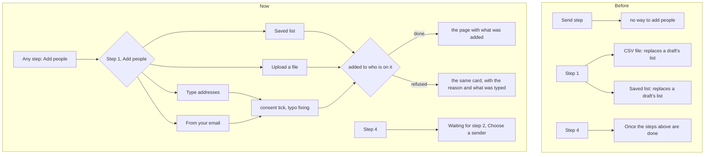

# Campaigns: add people from every step, by list, typed addresses, file or people you emailed

> **In plain words.** The owner opened a draft campaign on his phone, on its last step, Send, and
> asked why there was no way to add a list or type addresses there. Adding people lived only on
> step 1, and only as a CSV file or one saved list, and choosing a saved list replaced the people
> already on the draft. Step 4 said only "Once the steps above are done", so what was missing
> (a sender address) had to be found by hand. Now step 1 has four ways to add people, as a list's
> page does: a saved list, typed or pasted addresses, a file, and the people you emailed. **Add
> people** is a button on every step, step 4 names the step it waits for with a link to fix it,
> and the four step cards sit two by two on a phone. The same day his list's ⋮ menu opened as a
> sheet at the foot of the screen; it now opens under the button and fades in and out (a kit
> change, in oltrem-admin).

## What the owner saw, and what changed

| He saw | Now |
|---|---|
| Send step: no list add, no address add | **Add people** sits beside Send me a test on every step and on a running campaign; it opens step 1's Add people |
| Step 1: a file, or "Or use a saved list" that replaced who was on it | Four cards in their own colours: **Saved list** (added to who is on it), **Type addresses**, **Upload a file**, **From your email** |
| No way to type an address | **Type addresses**: one a line or parted by commas, a name optional (`Ana López <ana@example.com>`), with the consent tick |
| No way to reuse people already emailed | **From your email**: the people you emailed from Write, most emailed first, without the ones on the campaign, ticked with a filter and Select all |
| Step 4: "Once the steps above are done" | "Waiting for step 2." with that step's link, **Choose a sender** when the sender is missing |
| Four tall step cards, one under another, filling the screen | Two by two on a phone, shorter words; four in a row from a wide screen as before |
| Take people off only while it runs | Also on a draft with people |

## How it works now

- **Added, not replaced.** A draft nobody is on yet takes its first list or file whole, so a saved
  list keeps its name for the unsubscribe page's "Only the list's name" choice. After that every
  way adds: who is on it stays, the same address is added once, and whoever is never mailed is
  skipped, as before for a running campaign.
- **Typed addresses** post to `POST /api/campaigns/campaigns/:id/list/add?typed=1&confirm=1`; the
  module reads them with the email module's `typedCsv`, the same reading a list's Paste addresses
  uses, then the same checks as a file (typos, repeats, a bad line by its number). The API refuses
  typed people without `confirm=1`, so the consent tick holds whichever way they come in.
- **From your email** reads `GET /api/campaigns/campaigns/:id/suggestions` only on its own card:
  the email module's new `emailed` (Write's own ranking of the person's last 100 sent emails),
  then one read with a bound `json_each` that drops whoever is on the campaign already. The ticked
  people are posted as typed addresses. It needs `campaigns.write` and, while the campaign runs,
  the right to change a running one.
- **Step 4** takes the first step that still needs something and its link (step 2's link is
  **Choose a sender** when the sender is missing, since that is where its form is).

## Impact on each service

| Part | Change |
|---|---|
| `@oltrem/campaigns` | Add people's four ways and its command; `typed=1&confirm=1` on `list/add`; `GET /campaigns/:id/suggestions` (39 routes now); step 4's words; Take people off on a draft |
| `@oltrem/email` | `emailed(env, session, limit)` on the module, for Campaigns |
| The kit (oltrem-admin) | the new pack in `vendor/mail`; a menu under an icon opens under it on a phone (only Mail's and Write's bars keep the sheet) and opens and closes smoothly |
| Database | no new table, column or migration; one more read on the From your email card only |

## How it was checked

- `modules/campaigns/test/campaigns.test.ts`: typed people refused without `confirm=1`, then
  added with their names, the one already on it counted once; the suggestions without the people
  on the campaign whatever the letters' case; a reader refused; 39 routes.
- `modules/campaigns/test/add-people.test.ts`: typed and picked people posted as typed with
  `confirm=1` and `fix=0`; nothing sent without the tick or with nobody ticked; a saved list added,
  taken whole only by an empty draft; a campaign that cannot be read said so with nothing sent.
- `modules/campaigns/test/steps.test.ts`: step 4 waits for step 2 with **Choose a sender**, and for
  step 1 with **Add people**.
- `modules/email/test/lists.test.ts`: `emailed` gives the people written to most first.
- oltrem-admin `templates/client/test/screens.test.ts`: the whole flow in the client portal;
  `packages/core-ui/test/theme.test.ts`: the menu rules.
- Both review agents (TypeScript and silent failures) were run. Fixed from their findings: the page
  test sat in the wrong type-check program; a campaign read that failed no longer guesses add or
  replace; `emailed` is required, so a missing one cannot look like "no one to suggest"; the API
  checks the consent tick, not only the page; a refused form keeps what was typed.
- On the local portal at 390 px, dark and light: the Send step shows the cards two by two and
  **Add people**; each of the four cards opens its form; a list's ⋮ menu opens under its button
  (not a sheet), fades in, and fades out before it is hidden.

## What was left as it was

- A CSV file and a saved list add people without the consent tick, as before: a saved list keeps
  the reason given at its own import, and a file was never asked.
- A wrong file of thousands added to a draft is taken off by deleting the draft or by address in
  Take people off; there is no "empty the list" button.
