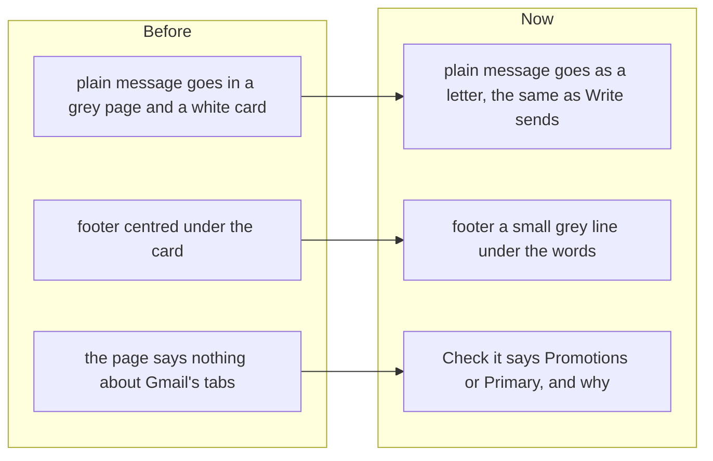
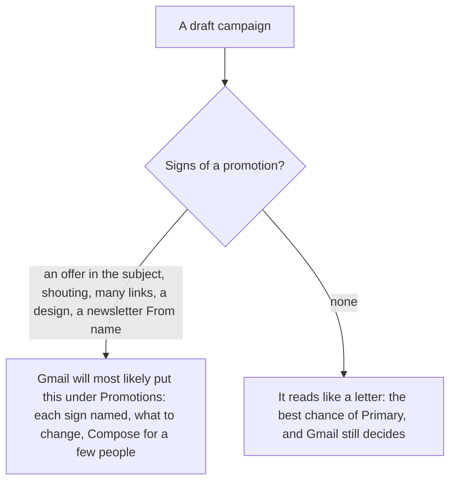

# Campaigns go as plain letters, and the page says which Gmail tab they will reach

> **In plain words.** The owner's first campaign reached its four people, but in Gmail's
> Promotions tab, and he wrote: "It should land in Primary otherwise no one would even look at
> buying our product". Nothing can force that: Gmail chooses the tab for each person, and no
> setting, header or email service decides it. What a portal can do is stop adding signs of an
> advertisement, and say which signs the email still carries before it goes. So a campaign's
> plain message now goes out as **a plain letter**, the way a person's own mail app sends one,
> and the campaign's **Check it** step says which tab it will most likely reach and why.

## What was checked

| What | How | Found |
|---|---|---|
| The campaign as it was sent | The live portal's own record of the campaign, read only | No design was chosen, so it went out in the layout every plain campaign had: a grey page, a white card with rounded corners, a centred grey footer |
| Its words | The same record | A sales letter: package offers, a greeting to nobody by name, several lines in capital letters, rows of exclamation marks, a long signature with phone numbers |
| Its From | The campaign's sender row | An address only for campaigns, as advised on 2026-11-12, with a From name that begins with "News Email from" |
| Its headers | `modules/campaigns/src/message.ts` | `List-Unsubscribe` and `List-Unsubscribe-Post`, which the law and Gmail's bulk-sender rules ask of a campaign; no tracking was added (the provider tracks only when it is switched on, and it was found off on 2026-11-12) |
| Whether it arrived | The owner's own Gmail | All four arrived, in Promotions, not Spam |

The sending was right. Gmail's help describes Promotions as "deals, offers, and other promotional
emails", and this was an offer that looked like one. The earlier research
([2026-11-12](2026-11-12-promotions-tab-cause.md), and section 6 of [the setup page](../../docs/setup.md))
found the same signs named by every provider's guidance, and one large split test in which the
plain version of an email reached Primary and the designed one Promotions.

## What changed

| Part | Now |
|---|---|
| `compose` (`modules/campaigns/src/message.ts`) | The HTML is a plain letter in the type Write uses: no background, no card, no centred text. The footer and the unsubscribe link are one small grey block under the words. The plain-text copy and the one-click unsubscribe headers are as before. A campaign that uses a saved design still goes out in that design |
| `tabSigns` (the same file) | The signs for a campaign: the ones Write reads in the subject and the words, a design in place of a plain letter, and a From name that says newsletter (news, newsletter, offers, deals, promotions, marketing, and their Spanish words). The campaign's view carries them as `promotion` |
| `promotionSigns` (`modules/email/src/before-send.ts`) | One more sign, for Write too: shouting, which is a row of three exclamation or question marks, or a line of two words or more in capital letters. A quoted line, one word in capitals (it may be a code) and a script without capitals do not count |
| The campaign's page | Over the preview: **Gmail will most likely put this under Promotions**, with each sign, what gives the best chance (a short letter from a person's name, no offer in the subject, no capital-letter lines, a question people answer) and a link to Compose for a few people; or **It reads like a letter: the best chance of Gmail's Primary tab**. Both say Gmail decides for each person |

## What the portal cannot control

- Which tab Gmail picks. It decides for each person from who sends, what the email says and looks
  like, and what that person did with the sender's email before. No header, setting, provider or
  product chooses it; a service that promises Primary for campaigns is promising what Gmail does
  not offer.
- An offer. A message that sells something is what Gmail calls a promotion, however it looks.
- The unsubscribe link and headers. They stay on every campaign: anti-spam laws ask for them, and
  a person who cannot leave presses Report spam, which hurts the address far more than a tab.

What helps most is in the sender's hands: write to people as one person to another, from a
person's name, and ask something they answer. A reply, or a move to Primary, is what Gmail learns
from for that person. For a handful of people, Compose sends each their own copy from the
everyday address, with no campaign headers.

## How it was verified

- Tests: `campaigns.test.ts` (the letter has no background, radius, width or centring; the footer
  block; the signs for a letter, a design, a newsletter From name and the shape of the owner's
  campaign; the view's `promotion`), `tab-notice.test.ts` (both notices, their tone and link),
  `before-send.test.ts` (shouting, and what is not shouting).
- `pnpm verify` before the push.

Not verified: which tab Gmail picks for the next campaign. Only a new send to real Gmail
addresses shows it, and it can differ from one person to the next.
