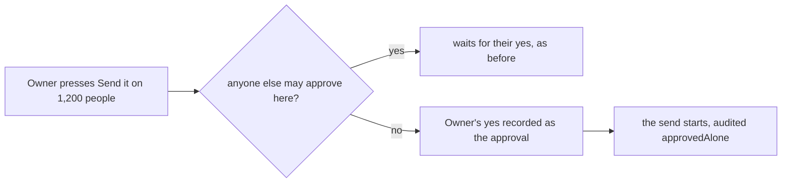
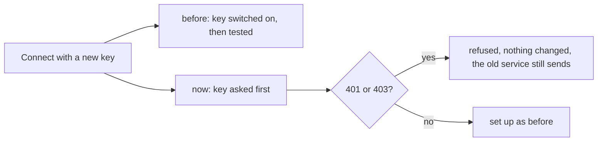

# Mail's journeys walked and fixed

> **In plain words.** The owner asked for the portal's flows to be checked and fixed; the kit's
> record of the same day covers the portal, and this one covers Mail. An audit walked
> connecting an email service, lists, writing, and a campaign from draft to send, as the Vendor
> and as an Owner. A company with one Owner could never send to more than a thousand people,
> because the second yes it waited for had nobody to give it. A refused Connect, campaign Save or
> pasted list threw away what was typed. A wrong key was switched on before it was checked. And
> several reasons were the code's own words. Each is fixed.

## What changed

| Before | Now |
|---|---|
| A campaign over the approval limit waited for someone else's yes, even when nobody else could give it | An Owner or the Vendor with the right to approve, and nobody else who may approve there, presses Send it; the dialog says their yes is recorded as the approval, and the audit row says `approvedAlone`. Wherever another approver exists, the separation stays |
| A refused Connect drew the old address back, and a refused campaign Save or list paste emptied the fields | What was typed stays (never the key) |
| A new key was made the active one, then tested | The key is asked first; only a 401 or 403 refuses it (KIT-E-1513), and nothing is set up or changed. A service that cannot be reached is not a refusal |
| Reasons showed codes such as `KIT-E-…` and capability ids | Plain words, the reference at the end |
| A failed test or delivery-reports line had no way to try again, and "Set up delivery reports" opened a page without that step | Try again on each line; Setup has a Delivery reports pane with one press |
| "Send me a test" always said it was on its way | It says queued when no service is ready, with the Delivery log and Email settings |
| A pasted list was refused with CSV advice and row numbers (and lost) | Words that fit a paste (KIT-E-1514), the text kept |
| Remove on a list's contact, and Delete on a draft from a saved list, acted at once or said the list went too | Remove asks first; Delete says the saved list stays under Lists |
| The From step blamed a missing sender when its domain had not passed its check | It names the domain and links it |

## How it was checked

- The audit's findings, each checked in the code before it was fixed.
- The email tests (243) and campaigns tests (72), with new ones for the lone Owner's send (and
  the approval test with a second approver), the kept fields on Connect, Save and paste, the key
  asked first, the plain reasons, Try again, the Delivery reports pane, the test send's words,
  the domain line and the unsubscribe link page.
- The full `pnpm verify` before the push (summary in the commit).

Not verified: any of it on a phone (the kit's list, P285 to P294); a key refused by a real
provider.

Left: the campaign's sending hours read the alerts' time zone, now named on the page; the kit's
own provider page has no Register delivery reports press yet.
