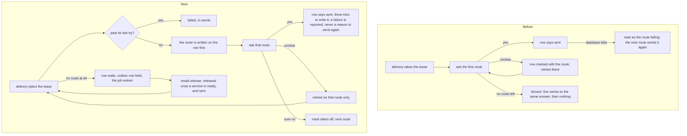

# Mail: what did not land goes again, never twice and never for ever

> **In plain words.** A review of the whole codebase found that an email the queue refused, or
> one held until an email service was connected, was never sent: the kit's part that sends again
> had no caller. Mail's `email.release` job now calls it. Sending again needs two guards, so they
> came with it: a message that may already have left is asked again only where it may have left,
> and every message has a last try after which it says in words what happened. The same review
> found three smaller things in the inbox and in campaigns, fixed here too.

## What was wrong

| What | Where | What it did |
|---|---|---|
| Nothing sent a released or refused message again | `modules/email/src/email.ts`, the `email.release` job | a message released once a service was connected stayed `pending`; one the queue refused was never tried again |
| A delivery cut short after the provider's yes went through another route next time | `deliver` | the route was written on the message only after an unclear answer, so a delivery stopped by the CPU limit, or by a database that could not be written, left a row that said nothing, and the next delivery took whichever route came first: a second copy |
| A database that failed after the provider's yes read as the provider failing | `deliver` and `sendNow` | the next route sent the message again |
| No last try | `deliver` | with the outbox sending an unconfirmed message again for two days, a provider that knows no message key would be asked each round, sending a copy each time |
| The provider went away after the message was queued | `deliver` | it threw; the queue brought it back five more times to the same answer, and nothing sent it afterwards |
| A campaign batch answered 500, 502 or 504 read as "nothing sent" | `modules/email/src/bulk.ts` | the next run mailed the same people under a new key |
| A delivery report could name any address | the delivery reports | a forged report about one of the portal's messages could put anybody on the do-not-mail list |
| A delivery report on a message to several people barred the first one | the delivery reports | a bounce from the person in Cc put the person in To on the do-not-mail list |
| An inline SVG picture got an address of the portal's own | `modules/mail/src/reader/reader.js` | opened on its own, its script would run as the portal |
| A map's links, and SVG links, kept their target | the same file | they could open in the reading frame instead of a new tab |
| The words of an HTML body were read with regular expressions that started again at every `<` | `modules/mail/src/arrival.ts`, `htmlText` | a hostile message of 128 KB cost seconds of CPU, against the ten milliseconds an arriving message has |

## How a message is delivered, before and now

Before, the mark that keeps a message on its route was written only after an unclear answer.
Now it is written before each call and taken off after a sure no or a yes, so whatever stops a
delivery between the call and the answer leaves a row that says where the message may have gone.
The last try is the sixth on the route that may have sent it (`PINNED_TRIES`), and the thirtieth
for a message every route refused for now (`MAX_TRIES`, with the last answer).

## What changed, by part

- **`@oltrem/email`, delivery.** The `email.release` job and `POST /release` replay the outbox,
  ten rows a run; a message the queue refused wakes the job for a minute later. The route is
  written on the row before each call (`pin`). A message with no route left is held in the
  outbox (`outbox.hold`, new in the kit) and waits. The provider's yes is written down outside
  the route's own `try`, three times if need be (`accepted`). `PINNED_TRIES` 6 and `MAX_TRIES` 30
  end the tries. The module's README says each.
- **`@oltrem/email`, bulk.** A 500, 502 or 504 is sorted as for queued mail (`providerFailure`):
  with a key the people are repeated under it, without one they are unclear, so never sent again
  on their own. A 503 did not take the request in and stays "again".
- **`@oltrem/email`, delivery reports.** A report lists only an address its own message went to.
  One that names nobody is about the message's one recipient; on a message to several, an
  address is listed only when the report names it.
- **`@oltrem/mail`, the inbox.** Inline pictures only of flat picture types; every link (an `a`,
  an SVG `a`, a map's `area`) opens in a new tab; `htmlText` reads the text once for the hidden
  parts and once for the tags, with the same result. The inbox design (`docs/inbox.md`) says it.
- **The kit's packed packages** (`kit/`): taken from the kit's commit of the same batch, which
  brings `outbox.hold`, the outbox's last try, the queue's waits and two events an invocation.

## What a client sees

Nothing new on a page. An email that used to stay "queued" or "waiting" for ever now leaves, or
ends as "not sent" with the reason; one that may have left says so and asks to check with the
recipient.

## How it was checked

- New tests in `modules/email/test/routes.test.ts`, each seen failing against the code before
  the change: a delivery cut short after the yes is never sent through another route; six tries
  on the pinned route, then failed in words; thirty tries for the rest, with the last answer; a
  provider that went away holds the message and the release sends it once one is ready. A fifth
  pins one delivery at 10 queries, so the two events of a batch stay far under fifty.
- `modules/email/test/email.test.ts`: the queue refusing, the job and the release route sending
  again, the report after five refusals, the database that fails after the yes.
- `modules/email/test/bulk.test.ts`: a 500, 502 or 504 with and without a key.
- `modules/mail/test/inbox.test.ts`: `htmlText` on ordinary and hostile markup, the flat picture
  types and the link hook in the reader's source.
- The full `pnpm verify`; the summary line is in the commit.

Not checked: a real provider outage or a real cut-short delivery on a live portal; both are
simulated in the tests.

## Left for the owner

After an unclear answer, the message is asked again on the same service, up to six times. Resend
knows the message's key and answers with the email it already took; the others would send a
second copy if the first did leave. The stricter rule is to stop after the first unclear answer
on those services and say "may have been sent". It is asked in the thread of this review.
