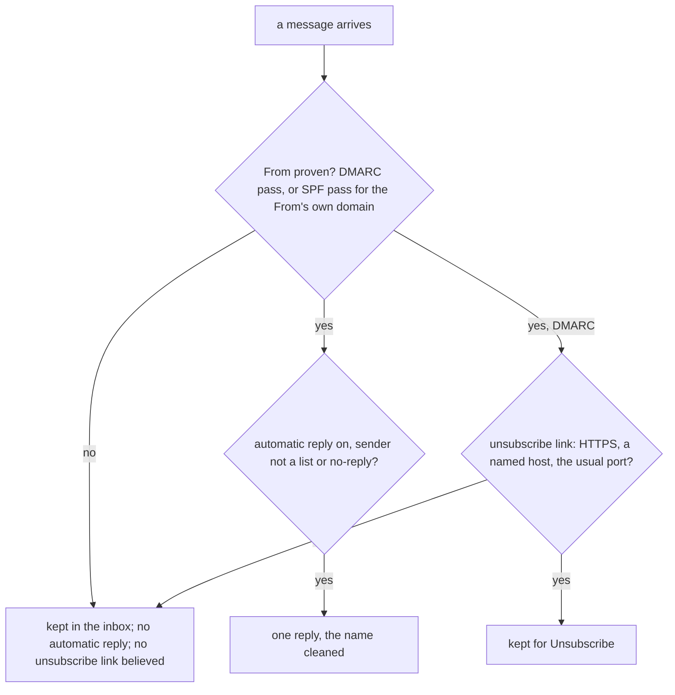

# Mail: company checks, proven senders and safer reading

> **In plain words.** The second part of the full review, on Mail's side. A person given the
> email permissions at one location only could change the whole company's mail (turn on email
> routing, forward a company address, remove the forwarding key, register delivery reports, send
> held mail); those now need the permission at the company itself. The inbox's automatic reply
> and the "unsubscribe" link of a newsletter are now believed only from a sender the checks prove,
> so a forged message cannot make the company's address write to a stranger or post to a
> stranger's server. A few searches treated `%` and `_` as wildcards, and two uploads read their
> whole body before knowing its size. Nothing a person uses day to day looks different.

## What was wrong, and what it is now

| Severity | What | Where | Before | Now |
|---|---|---|---|---|
| High | Company mail changed from one location | `modules/mail/src/module.ts`, five routes of `modules/email/src/email.ts` | the kit's route check found `mail.manage` or `email.manage` held anywhere | every `mail.manage` route, and the hook address, delivery reports, `/release` and `/canary`, are marked `company`: the kit asks for the permission at the company itself |
| High | The automatic reply trusted any passing check | `modules/mail/src/inbox.ts` | a DKIM signature or SPF of any domain counted, so a forged From got the company's reply | the From must be proven: DMARC passing, or SPF passing for an envelope sender of the From's own domain |
| Medium | A list's unsubscribe link from any signature | `inbox.ts`, `arrival.ts` | a message signed by any domain set the address the portal posts to | believed only when DMARC passed; the link must be HTTPS to a named host on the usual port, never an address by number |
| Low | The automatic reply used the sender's name as given | `inbox.ts` | a name with control characters made the send fail and put a problem on the mailbox at an outsider's will | the name is cut to 200 characters without control characters |
| Low | The reader loaded a picture from the portal itself | `modules/mail/src/reader/reader.js` | with pictures off, an image whose address was the portal's own was still fetched, with the reader's cookies | pictures load only when asked, and only from another site over http(s); `data:` and `blob:` as before |
| Low | `%` and `_` in searches | the inbox's From, To and Subject; the do-not-mail list | matched any text | taken as typed (`containing`, `ESCAPE`) |
| Low | A list file read whole first | the email lists' import, the campaigns' list | a body sent without a declared length was read into memory before its size was known | read only to 1 MB (the kit's `readCapped`) |

## How it works now

Before, any one passing check (DKIM, SPF or DMARC, of any domain) let a message through to the
automatic reply, and any DKIM signature let its unsubscribe address be kept. Now only checks that
speak for the From's own domain count.

## What a client sees

Nothing for the Owner. A person whose email or mail permission was given at one location only is
refused on these presses with "needed for the whole company". A forged message no longer gets an
automatic reply, and a newsletter whose sender is not proven shows no Unsubscribe button.

## How it was checked

- Each fix has a test inside the Workers runtime, seen failing against the code before it: the
  location-only person refused on each company route (email and mail), the forged From without a
  reply and the proven one with it, a sender's name with a control character cleaned, the unsubscribe hosts refused and kept, the reader's own-site
  picture, the oversized list in both modules, the wildcards.
- The full `pnpm verify` of Mail; the summary line is in the commit.

Not checked: real messages from outside providers (the checks are read from the headers
Cloudflare adds, built in the tests).

## Left for the owner

Nothing new from this part; the kit's record lists the proposals of the same review.
