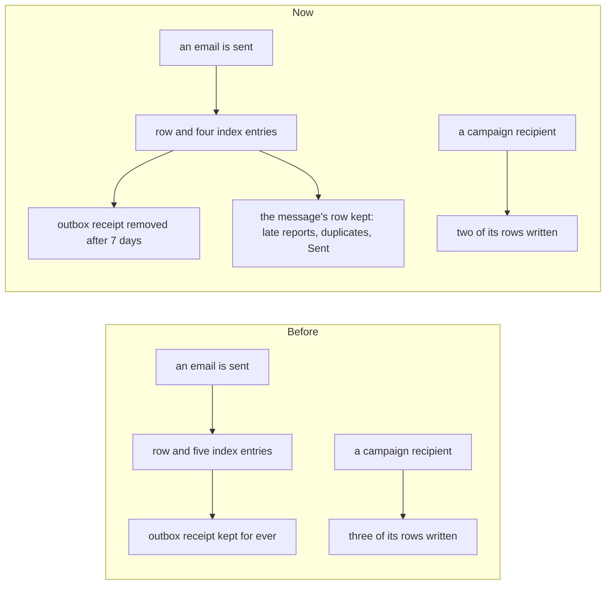

# Mail: a lighter database

> **In plain words.** The owner's database review measured what mail writes to the portal's one
> database. A campaign recipient and a sent email each cost more rows than they needed, the
> outbox kept every finished send for ever, and one table and one index were kept for nothing.
> Mail now writes one row fewer per email and per campaign recipient, and clears the outbox's
> finished sends after a week. The owner first chose to remove email history after 90 days; the
> review of that change found it would break three promises; asked again, the owner chose to keep
> each email's row.

## What changed

| Area | Before | Now |
|---|---|---|
| The outbox | finished sends kept for ever | removed after 7 days by the `email.outbox` job (the kit's `Outbox.prune`), 2,000 a run, hourly while more wait; a key asked for again is answered as a duplicate from the message's own row |
| The index by status | every message and every campaign recipient in it | only those still on their way (`email_messages_moving`, `campaigns_recipients_waiting`): one write fewer each |
| `campaigns_suppressed` | unused since `0044`, still holding addresses | its addresses copied to the do-not-mail list once more, only ever widening, then the table dropped (`1020`, the owner's yes) |
| `mail_messages_age` | unused since `1019` | dropped (`1022`) |
| Email history | every `email_messages` row kept for ever | the same: kept (see below) |

## Why email history is kept

The first version removed a message's row 90 days after it went out, and froze each ended
campaign's figures before. The review found that removing the row breaks three things:

- **A late spam report or unsubscribe would be lost.** A report lists only an address its
  message went to, found through the message's row. People press Junk on old newsletters, so a
  report on a message older than 90 days would add no one to the do-not-mail list (mail law M-4).
- **A key could be sent twice.** The row is what refuses a second send under the same key (M-1).
- **Sent would say "Sending"** for an email delivered months ago, inviting a second send.

A row holds no email text: its key, the addresses, what the provider reported and when. Keeping
it costs far less than these risks. Asked again with these three reasons, the owner chose to keep
every row (2026-11-22).

## How it worked before and how it works now

Before, every email wrote a row and five index entries, and its outbox receipt stayed. Now it
writes four index entries, the receipt goes after a week, and the message's own row, which
answers a late report and a repeated key, stays.

## How it was checked

- Rows written are counted from the local database's own count, which includes index entries. A
  sent message writes 5 and a waiting one 6 (`message-rows.test.ts`). Sending a campaign
  recipient writes at most 2 of their rows (`campaigns.test.ts`, "what a campaign costs the
  database"); it was 3 without `1020`.
- The two readers of messages on their way use the new index, read from SQLite's query plan.
- The outbox job removes finished sends past 7 days and keeps younger and dead ones; every
  message stays, and the job answers idle when fewer than a run's worth waited.
- A key asked for again after its outbox receipt is gone is still answered as a duplicate and not
  sent (`email.test.ts`).
- Migration `1020` run twice on a table holding a spam report the list kept for bulk mail only,
  and an address the list did not hold: the first is widened to all mail, the second added, and
  the table is gone (`campaigns.test.ts`, "migration 1020").
- Mail's review agent and the kit's reviewers read the change; the full suite and `pnpm verify`
  ran before the push; the summary is in the commit.
