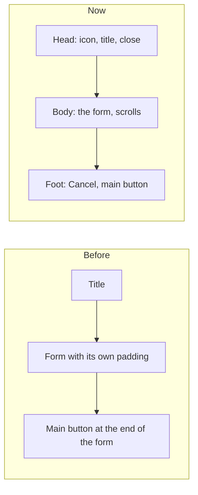

# Mail's dialogs on the kit's remade dialog

> **In plain words.** On 25 November the owner asked for every pop-up to be made over top to
> bottom, and the kit's dialog was remade that day: a coloured head with an icon and a close
> button, a body where only the fields scroll, and a foot that always shows Cancel and the main
> button. Mail's pop-ups now use it the same way, so Email, Campaigns and the inbox look and work
> like every other page.

## What changed

| Before | Now |
|---|---|
| Each form inside a Mail pop-up had its own padding and its main button at its end | The form is the dialog's body (`form`); the main button is in the foot (`submit`), with Cancel |
| No icon in a pop-up's head | Each has its icon: New list, Edit list, Add an address, Add a domain, New template, New campaign, Send this campaign and the others |
| Remove from every list and Delete blank drafts looked like any other | Red (`danger`): the icon tile and the main button |
| Mail built against the kit of 23 November | The kit of 25 November (`pnpm kit:refresh`), which has the remade dialog |

**Impact on each part.** Email, Campaigns and Mail: their pages' dialogs only; no route, field or
stored data changed. The kit's copy of Mail (`vendor/mail/`) is refreshed from this commit.

## How it was checked

`pnpm verify` here, then the kit's verify with the new pack. The kit's record of the same day
says what the dialog does; the phone checks are the kit's P750 to P754, which cover a Mail page as
much as any other.
