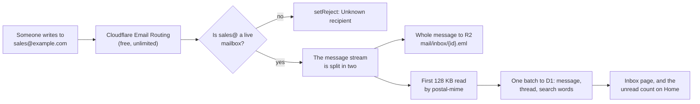

# Oltrem Mail: the inbox

> **In plain words.** The optional inbox on the business's own domain: how mail arrives without
> spending the Worker's 10 ms, where each part is kept so the portal's one database never fills,
> how a message is read safely on a phone, and how threads hold together. Part of
> [the plan](plan.md), approved 2026-11-02; built in phase 4
> ([the record](records/2026-11-02-phase-4-inbox.md)). Where the build differs from the design,
> this page says how it was built and why; `modules/mail/README.md` lists the routes and settings.

The owner said an inbox is not needed but welcome. It costs nothing on Cloudflare and comes in
phase 4 of [the plan](plan.md#13-build-order), after sending is solid.

## 1. How mail arrives

1. **The mailbox is looked up first** (one query). Unknown: `message.setReject("Unknown
   recipient")`, a permanent refusal the sender sees.
2. **The stream is split** with `tee()`. One side goes to R2 as `mail/inbox/{id}.eml` through a
   `FixedLengthStream(rawSize)`, because R2 needs the length. The other side keeps the first
   **128 KB** and is then cancelled.
3. **postal-mime reads those 128 KB:** sender, recipients, subject, date, Message-ID, In-Reply-To,
   References, the 200-character snippet, the plain text for search, and the names and sizes of
   the attachments found there.
4. **One `db.batch()`** writes the message row, the thread and the search words (one query).
5. `has_unparsed_attachments = 1` when the message is larger than 128 KB: parts past that point,
   usually attachments, were not read.
6. **Targets:** about 1.5 ms for the parse, under 3 ms of CPU for the whole arrival, inside the
   10 ms budget whatever the message's size (up to Cloudflare's 25 MiB). postal-mime read a
   128 KB HTML message in 0.7 ms on a warm engine (Node 22, 2026-11-02); the arrival's CPU in
   production is still to be read from the Worker's own figures once a client has mailboxes.
7. **Before it is kept:** a sender on the block list (an address, or a domain with its
   subdomains) is dropped and counted; the rules a manager set and the spam threshold are applied
   in the same batch. A message whose Message-ID was kept before is kept once.
8. **Kept whole or not at all:** when the batch fails, the stored copy is taken back, the mailbox
   says so, and the error is rethrown, so the sender's server is told and tries again later.

Cloudflare already refuses, before our Worker runs, mail that fails its sender's DMARC policy and
mail from blocklisted servers.

## 2. Where each part is kept

| Kept in | What | Why |
|---|---|---|
| D1 (the portal's one database) | Headers, the snippet, attachment names and sizes, thread links, flags, and a search index of the first 8 KB of the message's text | The list and search need them; small rows |
| R2 (the portal's one bucket) | The whole message as received | Bodies and attachments are large |

**Bodies are not stored in D1.** A free D1 database stops at 500 MB, and the inbox shares the
portal's one database. At an average of 30 KB of HTML and 50 messages a day, bodies alone would
pass 500 MB in under a year and stop the whole portal from writing. The search index keeps no
second copy of the text (an FTS5 index without content, checked against D1's SQLite in phase 4).
The Allowance page shows the inbox's share of the database and of the bucket, and a retention
setting keeps both in bounds.

## 3. Reading a message

1. **The phone fetches the first 256 KB** of the stored copy (an R2 byte-range read), or the whole
   message when it is 256 KB or smaller, so a large HTML invoice or confirmation (130 to 250 KB)
   shows in full. The Worker checks the person's right to the mailbox and passes the bytes along
   without reading them: no parsing on the Worker when a message is opened.
2. **The phone parses** them with postal-mime and **cleans the HTML with DOMPurify**, then shows it
   in the reading frame (section 4). Both libraries load only on the Inbox page.
3. **Larger messages:** when the message is over 256 KB, or `has_unparsed_attachments = 1`, a
   clear button reads **"Load full message & attachments (X.X MB)"**, so the person sees that
   attachments are there before spending mobile data. It fetches the whole stored copy (again
   passed along, not read, by the Worker) and the phone pulls the attachments out itself. An
   attachment cannot be cut out by byte range alone: its position is only known by reading the
   message up to it.
4. **Search** covers the first 8 KB of each message's text, and the page says so.

## 4. The reading frame

- **The frame:** `<iframe sandbox="allow-popups allow-popups-to-escape-sandbox allow-same-origin"
  srcdoc="...">`. `allow-same-origin` lets the portal read the frame's height; **`allow-scripts`
  is never added**, because the two together would let a message lift its own sandbox, and a test
  fails the build if it appears. No `allow-forms`, no `allow-top-navigation`.
- **Its own policy, inside `srcdoc`:** `<meta http-equiv="Content-Security-Policy"
  content="default-src 'none'; style-src 'unsafe-inline'; img-src data: blob:; form-action 'none';
  frame-ancestors 'self'">`, with `https:` added to `img-src` only after "Show images". A style
  that tries to load a tracking image is blocked too. (Browsers ignore `frame-ancestors` inside a
  meta tag; it is kept as the owner asked, and the portal's own response header already sends
  `frame-ancestors 'self'`.)
- **Links never move the frame:** a `<base target="_blank">` is always injected and any base the
  message carries is removed; DOMPurify forces `target="_blank" rel="noopener noreferrer"` on every
  `<a>` (a `<base>` element takes no `rel`, so the links carry it) and strips `<form>` and every
  form control. A click opens a new tab and never navigates the frame to a portal address.
- **Images:** remote images are blocked by default, by the policy and by DOMPurify moving their
  addresses aside; "Show images" brings them back for that message. Inline pictures (`cid:`) are
  shown from the parsed message. `<meta name="referrer" content="no-referrer">` keeps senders from
  learning the portal's address.
- **Height:** a `ResizeObserver` on the frame's body sets the frame's height, so there is one
  scrollbar on a phone, and the frame grows smoothly as images load after "Show images". Images and
  tables get `max-width: 100%` so nothing scrolls sideways.
- **Trust:** SPF, DKIM and DMARC results are believed only from Cloudflare's own header. Links
  whose text shows one address and whose target is another are marked.

## 5. Threads

- **Arriving mail** is filed by its `References` and `In-Reply-To` (one lookup of at most the last
  20 ids), else it starts a thread.
- **Arriving mail without those ids** joins a conversation with the same subject (Re: and Fwd:
  taken off) and the same correspondent from the last 30 days.
- **Replies** carry `In-Reply-To` and `References` on every route; Cloudflare allows both headers.
  A reply's References are the answered message's References and its Message-ID, so the
  customer's answer names an id the portal already holds.
- **Message-ID:** Cloudflare makes its own and refuses one we set ("platform-controlled"), and
  some providers do the same. So the portal sets its own only where the route allows it, and
  always stores the id the route returns. Phase 2 checks whether Cloudflare's returned `messageId`
  is the header's value.
- **Plus addresses were not used (as built).** The design put the thread in the reply address
  (`sales+t4k9@example.com`) for a route that hides its Message-ID. Email Routing sends a plus
  address to its base rule only when subaddressing is switched on in its settings, so with it
  off the customer's answer would bounce. It is not needed either: the customer's answer carries
  the ids of the messages the portal stored when they arrived (above), whatever id our own reply
  went out with. An arriving `+tag` is still taken off to find the mailbox.

## 6. Mailboxes, rules and quick actions

- **A mailbox is a row.** Adding `bookings@` makes it live; switching it off disables its rule
  and the portal refuses mail for it. **Each mailbox gets its own literal routing rule** (Email
  Routing Rules, Edit), at most 200 per domain, on the root as on a subdomain (as built: the
  design had a catch-all on the root, which would also take mail for addresses the business still
  receives elsewhere through other rules). A rule the key may not make is shown with its
  dashboard step and retried every hour; a copy of each message may go to a verified address.
- **Who may read and who may send** from each mailbox is a capability, like everything else.
- **Rules:** when the sender, the subject or a recipient contains some words: archive, mark read,
  label, or file as spam, for one mailbox or every one (forwarding is per mailbox). A spam score
  is recorded, nothing is hidden until a manager sets a threshold; a sender block list.
- **Quick actions:** several at once go in one request and one `db.batch()`. As built they are
  forms the server answers (one round trip, no script on the portal's page); the on-screen change
  within one frame needs a script of the portal's and is left for later. Opening a conversation
  marks it read by itself.
- **Undo Send:** the same Undo that Write has. A reply taken back leaves the conversation and its
  words go back into the reply form.
- **Room:** mail is kept until the Owner sets how many days to keep it (`mail.inbox.keep_days`,
  0 by default); the hourly job then removes older mail with its stored copy. The health check
  warns past 250 MB of rows or 8 GB of stored copies, well inside the free plan.
- **Not included:** IMAP. The portal is the mail app.
