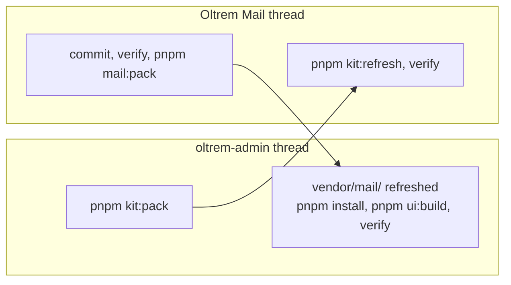

# The agreement between Oltrem Mail and the kit

> **In plain words.** Oltrem Mail runs inside the portal the kit builds, so it uses the kit's
> sign-in, permissions, audit trail, settings and look instead of making its own. This page says
> what mail takes from the kit, what it gives back, which numbers each side holds, and how a
> change crosses from one repository to the other. The owner asked (2026-11-02) for each
> repository to have its own thread, with the two threads talking whenever a change touches
> this agreement.

## What mail takes from the kit

Mail never builds its own version of any of these.

| Need | From the kit | The rule |
|---|---|---|
| Sign-in and sessions | `@oltrem/iam` | every page and `/api/*` route goes through the kit's pipeline: identity, then the CSRF check on a change; only `/hooks/<module>/` is public, mounted before identity |
| Permissions | `@oltrem/iam` | each module declares its capabilities on its own bit plane, checked by the kit's check; the Owner and Vendor floors, roles, grants and fresh sign-in are the kit's |
| Audit trail and logs | `@oltrem/core-audit`, the kit's alerts | every change is audited through the kit's wrapper; mail keeps no log store of its own |
| Settings | `@oltrem/core-config` | settings are rows in the client's database, never new variables (R-09) |
| Sending and jobs | `@oltrem/core-outbox`, `@oltrem/core-module` | a message leaves through the outbox, with the kit's lease per message key; scheduled work is a job the kit's tick runs |
| Providers | `@oltrem/providers` | provider instances, their sealed keys, adapters and failover order |
| Errors | `@oltrem/core-errors` | codes in the blocks mail holds (below) |
| The look | `@oltrem/core-ui`, `@oltrem/core-module/pages` | the kit's tokens and primitives, pages in the sidebar's Messages group, phone first (R-12); the kit's stylesheet is built from mail's packed pages |
| Storage | the client's one database and one bucket | no second Worker, database or bucket; never KV for mail (M-3) |

## What mail gives the kit

Three packages. `@oltrem/email` and `@oltrem/campaigns` keep the names they had before the move,
and every client has them: their pages, their routes under `/api/email` and `/api/campaigns`,
their public hooks (`/hooks/email/<instance>/<token>` for delivery reports,
`/hooks/campaigns/u/<token>` for unsubscribe) and their migrations. `@oltrem/mail` is the
add-on a client gets only when Mail is ticked at setup (the owner's choice of 2026-11-02: left
unticked, a client keeps provider sending, Write, Sent and Bulk mail exactly as today). Each
module's README lists its capabilities, settings, errors and routes; those READMEs own the lists.

### How a client wires the add-on

The kit's tool writes one file into a client that ticked Mail, and leaves it out otherwise:

```ts
// src/mail.ts, written by the kit's tool when Mail is ticked
export { createMail as mail } from '@oltrem/mail';
```

The client builds email first, then the add-on from it, and hands the add-on's route back to
email, which reads it on each message (so the order of building does not matter):

```ts
let addon: MailAddon<Env> | undefined;
const email = createEmail<Env>({ /* as today */ route: () => addon?.route });
addon = mail?.({ email, /* the rest of MailAddonDeps, below */ });
// modules: [..., email.module, ...(addon ? [withPages(addon.module, mailPages)] : [])]
```

| Dependency | What the client hands in |
|---|---|
| `bindings` | the client's one database |
| `on` | whether the `mail` part is on (ticked at setup and not switched off) |
| `settings` | the portal's settings, read live; mail reads `mail.cloudflare_first` |
| `binding` | `env.EMAIL`, the `send_email` binding the deploy adds with Mail |
| `token` | the portal's own Cloudflare key (`KIT_OPS_TOKEN`) |
| `account` | the client's Cloudflare account, from the setting the deploy writes |
| `plan` | the client's Workers plan, from `health.cloudflare_plan` |
| `index`, `report` | the capability index and the error reporter, as for every module |
| `bucket` | the client's one bucket (`FILES`); the inbox keeps each message whole under `mail/inbox/`; without it the inbox refuses mail and its health check fails |
| `worker` | the Worker's own name, as the client's wrangler file names it; each mailbox's routing rule sends its mail to it |
| `local` | optional: true only on the builder's computer (the kit hands `(env) => !env.ACCESS_AUD`, so a deployed portal is never local); a mailbox is then made without Email Routing and its rule, on the domain of `email.from_address` or example.com, so mail tried there reaches the inbox |

The client's Worker hands every arriving message to the add-on, and refuses mail when there is
none, so a client without Mail never keeps mail by accident:

```ts
email: (message, env, ctx) =>
  addon ? addon.receive(message, env, ctx) : message.setReject('Unknown recipient'),
```

`oltrem mail try` posts a message to `/cdn-cgi/local/email` on the local portal, which reaches
the same handler.

`MailAddonDeps` and `MailAddon` are exported by `@oltrem/email` (`src/addon.ts`), so the client
types the wiring without importing the add-on. With Mail on, the deploy adds the `send_email`
binding `EMAIL` and the key's three extra rights: Zone, DNS, Edit; Email Routing Rules, Edit; and
Email Routing Addresses, Edit. Onboarding a domain for Email Sending has no API, so the setup
page gives that one step as a tap in the Cloudflare dashboard (setup.md section 2). Email
Routing Rules, Edit is also what makes each mailbox's rule; without it a mailbox says the
dashboard step and the `mail.soon` job tries again.

The inbox gives the kit three things to show: a Home figure (unread conversations), a search
section (mail by its words) and a privacy search (messages from an address). Its health check
and its hourly job are both `mail.inbox`; a second job, `mail.soon`, runs every five minutes
(snoozed conversations whose time came, addresses waiting for their verify link, rules not made
yet). The Home figure counts the inbox's unread conversations, not Updates or Snoozed. The `mail.cloudflare` check's
words are unchanged. The
Allowance page may read `GET /api/mail/inbox/usage` for the inbox's share of the database and
the bucket.

The reader script is served by the public hook `GET /hooks/mail/reader/<version>/<file>`. Its
answer asks to be kept for ever (`public, max-age=31536000, immutable`), since its address changes
with any byte of it; the kit's HTTP layer sets `no-store` on every hook today, so the phone
fetches it again on each new page load (about 365 KB before compression). Mail has asked the
kit's thread to let a hook's own `immutable` answer stand.

The route taker the add-on hands back also writes a sending domain's missing records on
Cloudflare (`records`, optional on `RouteTaker`), which email's provider card calls in the same
press. The wiring above carries it with no change. The card's page (Email, Set up) also writes
the settings `email.from_address` and `email.from_name` through the kit's settings API
(`PUT /api/settings/values/:key`) as the signed-in person, so it needs the kit's settings routes
mounted, as every client has them. Mailjet's definition in the kit has no DNS fingerprint, so a
Mailjet key, which looks generic, is placed by one tap; an `spfIncludes: ['spf.mailjet.com']`
fingerprint in the kit would place it by the domain's DNS instead.

## Numbers each side holds

| Kind | Mail holds | A new one |
|---|---|---|
| Migrations | `0011`, `0020`, `0043` to `0050`, `0052` to `0054`, in the kit's one series; `1000` (email: the route a message is pinned to), `1001` (mail: the Cloudflare route), `1002` (mail: the inbox), `1003` (email: who left a saved list, and the warm-up's first day of a domain), `1004` (mail: Updates, snooze, mute and the senders a person moved) and `1005` (mail: automatic replies and "No answer yet") | mail's new migrations number from `1000` up; the kit keeps its own series below; a client's own start at `5000` |
| Permission bit planes | `3` email, `13` campaigns, `30` mail | the kit's thread reserves the next free plane in the kit's architecture table first |
| Error codes | the `1500`s email, the `2500`s campaigns, the `4000`s mail (`4001` to `4007` used) | the kit's thread reserves a block the same way |

## How a change crosses



- **A kit change mail uses:** the kit's thread packs the kit and tells the mail thread, which
  refreshes `kit/`, runs `pnpm verify` and fixes what broke before its next push.
- **A mail change:** the mail thread commits, runs `pnpm verify` and `pnpm mail:pack`, and tells
  the kit's thread, which copies the folder into `vendor/mail/`, runs `pnpm install` (and
  `pnpm ui:build` when a page changed), runs its verify and pushes. The folder includes
  `published/`, every document of this repository at its own path (the owner's ask of
  2026-11-02); the kit's docs mirror rebuilds `synced-docs/oltrem-mail/` from it on that push, so
  mail's documents are public with every pack and never need a step of their own.
- **A change to this agreement** (a new capability plane, error block or migration range, a
  hook address, a kit interface mail needs, a permission floor, a step in the setup page, the
  shape of what is audited or logged): the thread that wants it messages the other thread first.
  Neither pushes it alone. The owner's approvals stay in the thread doing the work.
