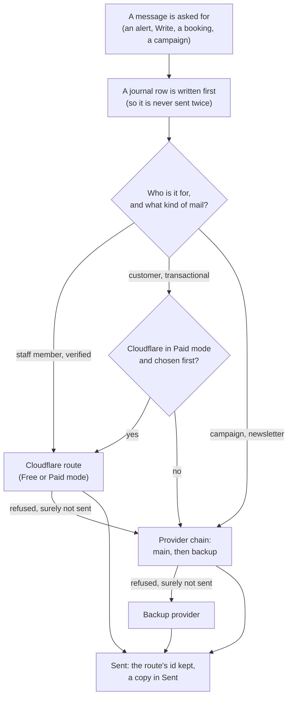

# Oltrem Mail: the plan

> **In plain words.** Oltrem Mail is every email feature of an Oltrem portal, kept in its own
> private repository and always running inside the portal's one Worker. It sends a business's mail
> by two routes: an email provider such as Brevo or Resend, set up with two fields (the default
> From address and the provider's key), and Cloudflare's own email, set up with one button. It can
> also give the business a real inbox on its own domain, for free. It runs on Cloudflare's free
> plan. **We do not run a mail server or own any IP address**, so there is no reputation to build
> from scratch: both routes send from large networks that mailbox providers already know. What we
> look after is the business's domain: its records, a slow start and low complaints, and the
> portal does most of that by itself. **Status:** approved by the owner on 2026-11-02 with his
> revisions (section 14); phase 1 is done ([the record](records/2026-11-02-phase-1-move.md)).

## Contents

1. [Your questions, answered](#1-your-questions-answered)
2. [What Oltrem Mail is, and is not](#2-what-oltrem-mail-is-and-is-not)
3. [Where the code lives](#3-where-the-code-lives)
4. [The two sending routes](#4-the-two-sending-routes)
5. [Setup: two fields, or one button](#5-setup-two-fields-or-one-button)
6. [The inbox (optional)](#6-the-inbox-optional)
7. [The records that keep mail trustworthy](#7-the-records-that-keep-mail-trustworthy)
8. [Features, as staff will see them](#8-features-as-staff-will-see-them)
9. [Limits and constraints](#9-limits-and-constraints)
10. [What one message costs on the free plan](#10-what-one-message-costs-on-the-free-plan)
11. [Getting mail into the inbox, not spam](#11-getting-mail-into-the-inbox-not-spam)
12. [Risks, and what we do about each](#12-risks-and-what-we-do-about-each)
13. [Build order](#13-build-order)
14. [The owner's decisions](#14-the-owners-decisions)
15. [Ideas borrowed, and from where](#15-ideas-borrowed-and-from-where)

---

## 1. Your questions, answered

### "Providers like Resend are trusted, their mail lands fast. Will we have a problem hosting ours?"

**No, because we are not hosting a mail server.** The trust problem belongs to projects that run
their own mail server (Postal, Stalwart, BillionMail): a new server has a new IP address that Gmail
and Outlook have never seen, and it takes weeks of careful sending before they trust it. Oltrem
Mail never sends from an IP address of its own:

| Route | Who delivers the mail | Whose IP reputation |
|---|---|---|
| Provider (Brevo, Resend, Mailjet, ...) | The provider's mail servers | The provider's, built over years |
| Cloudflare Email Sending | Cloudflare's mail servers | Cloudflare's; Cloudflare also signs the mail and handles bounces |
| A self-hosted mail server | Our own machine | Ours, from zero: **we do not do this** |

What matters on every route is the **domain's** reputation: SPF, DKIM and DMARC records, a modest
start and low complaints. The portal checks those records daily (section 11).

One caveat: Cloudflare's sending has been in public beta since 2026-04-16, and nobody has measured
yet how often its mail reaches the inbox compared with Resend or Brevo. So providers carry
customers' mail, Cloudflare carries staff mail and alerts first, and we measure placement ourselves
before trusting it with more (phase 2).

### "What is the ceiling of emails we can send, and the free-tier usage?"

Free allowances as published on 2026-11-02 (they change; the portal reads the live figure where the
provider allows it):

| Route | Free allowance | Past it |
|---|---|---|
| **Cloudflare, Workers Free** | No count limit, but **only to verified addresses** in the account (at most 200) and only from a domain with Email Routing on | Mail to anyone else is refused |
| **Cloudflare, Workers Paid ($5 a month)** | 3,000 a month included, then $0.35 per 1,000; a daily cap that starts low and grows with good sending | Refused until the next day |
| **Brevo Free** | 300 a day (about 9,000 a month) | Up to 1,000 transactional mails wait in a retry queue; beyond that they are lost |
| **Mailjet Free** | 6,000 a month, 200 a day | Queued up to 3 days, then deleted |
| **Resend Free** | 3,000 a month, 100 a day | Refused |
| **Mailgun Free** | 100 a day (supported, not recommended) | Refused |
| **SMTP2GO Free** | 1,000 a month | Refused |
| **Amazon SES** | No lasting free allowance; about $0.16 per 1,000; new accounts start in a sandbox | Charged per message |

**The recommended free setup: one main provider and one backup** on the same domain:

| Pair | A day | A month, about |
|---|---|---|
| Brevo 300 + Resend 100 | 400 | 12,000 |
| Brevo 300 + Mailjet 200 | 500 | 15,000 |

More providers would add little and cost a lot: each one adds DNS records, an account to look after,
and SPF lookups against a hard limit of 10
([setup](setup.md#4-a-backup-provider-and-the-spf-limit)). The portal never sends past a provider's
limit (Brevo loses mail past its queue). Cloudflare's free route adds staff mail and alerts on top,
without touching any allowance.

**Cloudflare resources used:** about 10 database rows written per sent message, delivery reports
included, and no KV writes. 500 sends a day use about 5% of the database's daily writes
(section 10).

### "How complex is the setup?"

| Route | What the person does | What the portal does by itself |
|---|---|---|
| **Provider** | Types the default From address (for example `hello@example.com`) and pastes the provider's key; taps a logo only when the key does not reveal the provider; a few providers ask for one or two more fields | Finds the provider, adds the domain there if missing, writes the DNS records on Cloudflare, registers its delivery-report address, checks everything, sends a test to the person |
| **Cloudflare** | Presses "Use Cloudflare email" and types the default address; each staff member clicks one confirmation link from Cloudflare once | Turns on Email Routing, verifies staff addresses, finds out whether the plan allows sending to anyone, sends a test |

### "Pros and cons? Is it really worth it?"

| Worth it | Not worth it |
|---|---|
| **One home for all mail**, with the simplest setup we can make | Replacing providers for customers' mail on the free plan: Cloudflare forbids it (transactional only, verified addresses only) |
| **Staff mail and alerts for free**, with no key and no daily limit | Running our own mail server: weeks of reputation work and a machine to look after |
| **A free inbox** on the business's own domain (`sales@`, `bookings@`), which otherwise costs about $6 to $8 per mailbox per month with Google or Microsoft | A copy of Google Workspace (calendar, drive) |
| **Records that make bulk mail safe**: never sent twice, consent per list, one-tap unsubscribe | |
| **12,000 to 15,000 free emails a month** with one main and one backup provider, with safe failover | |

**Verdict: worth it**, as long as the goal is "the simplest, cheapest, safest mail for a small
business" and not "our own email provider".

### "Can we have both setups in that repo, the provider one as simple as possible?"

**Yes.** One Mail setup page with two cards, "Use an email provider" (two fields) and "Use
Cloudflare email" (one button). A business can use both: Cloudflare for staff and alerts,
providers for customers and campaigns. The twelve providers the kit supports keep working
underneath; the page hides their differences.

---

## 2. What Oltrem Mail is, and is not

| It is | It is not |
|---|---|
| Every email feature of a portal: sending, setup, templates, lists, campaigns, an optional inbox | A webmail product with its own sign-in: the portal's people, roles and pages are used |
| Always inside the portal's one Worker (the owner's decision: never a second Worker) | A separate service with its own address |
| Its own private repository, packed into each client's repository like the kit | A public package or service: no registry, no organisation |
| Built for Cloudflare's free plan; Workers Paid only widens the Cloudflare route | A mail server: no machine, no port 25, no IP address of our own |
| Phone first, like the rest of the portal | A calendar, drive or booking product |

## 3. Where the code lives

**Decided: all mail moves into Oltrem Mail.**

| Moves to Oltrem Mail | Stays in the kit |
|---|---|
| `@oltrem/email` and its pages | `@oltrem/providers`: it also holds storage and SMS providers, and the sealed keys |
| `@oltrem/campaigns` | The core packages (errors, HTTP, jobs, outbox, UI) Oltrem Mail builds on |
| The new parts: the Cloudflare route, the setup page, the inbox, the records of section 7 | Every other module: they send through one small interface and never know which route was used |

**How the two repositories fit together**, with no registry and no token (the owner's rule):

1. Oltrem Mail builds and tests against the kit's packed packages, kept in its own committed
   `kit/` folder, exactly as a client repository does.
2. Oltrem Mail packs its two packages the same way, and the kit keeps a copy of them, so its client
   template and its tests still have email.
3. `oltrem new client` and `oltrem upgrade` copy both sets into the client's `kit/` folder.
4. Each Oltrem Mail pack names the kit commit it was tested against (`kit/kit.json`, copied into
   `oltrem-mail.json`). The kit's packages are all 0.0.0 for now, so a drift is caught by the
   kit's own type check and tests, which run the vendored mail; a strict version check comes when
   the kit gets version numbers.
5. Oltrem Mail has its own verify chain, taken from the kit's own scripts (the kit is ours, so
   R-03 allows it).

Phase 1 changes no package name, table, route or hook address, so existing clients upgrade without
any data change. **The cost:** a kit change that touches what mail uses needs a round trip (pack
the kit, refresh Oltrem Mail, verify, pack mail, refresh the kit's copy); a script does it when both
repositories sit side by side.

## 4. The two sending routes

- **Staff and alerts:** Cloudflare when the address is verified (free on every plan); otherwise the
  provider chain.
- **Customers' transactional mail** (confirmations, invoices, password links): the provider chain;
  in Paid mode the owner may put Cloudflare first.
- **Campaigns and newsletters: always the provider chain.** Cloudflare's rule: "Email Service
  supports transactional email only."
- **Failover only when it is safe.** Every route's errors are sorted into one list (Cloudflare's
  error codes and each provider's answers): a recipient problem (record it, move on), a throttle or
  a used-up day (wait, or try the backup), a setup problem (stop and tell the owner in words). An
  unclear answer, such as a timeout, is never sent again by another route: the first may have
  delivered it.
- **Every route carries the thread.** A reply passes `In-Reply-To` and `References` on every route
  ([inbox](inbox.md#5-threads)).

## 5. Setup: two fields, or one button

The Mail setup page has two cards; [setup.md](setup.md) holds the full design.

- **"Use an email provider":** the default From address and the provider's key. The key's start
  names the provider (`re_` Resend, `xkeysib-` Brevo and others); otherwise the domain's DNS or one
  tap on a logo does. Mailjet, Amazon SES and SMTP ask for one or two more fields. The portal adds
  the domain at the provider, writes the records on Cloudflare (finding the parent zone of a
  subdomain), registers its delivery-report address, and sends a test.
- **"Use Cloudflare email":** one button. It turns on Email Routing (on a subdomain when the
  business already has mailboxes elsewhere), verifies staff addresses, and finds out whether the
  plan allows sending to anyone: **"Ready (Free Plan: Verified Staff Addresses Only)"** or
  **"Ready (Paid Plan: Staff & Customer Transactional)"**.
- **Delivery reports** arrive at `/hooks/email/<provider instance>/<token>`, their secrets sealed
  in the database; they feed the Sent timeline, the do-not-mail list and the bulk self-pause.
- **A backup provider** from the same card, with a count that keeps the SPF record within its 10
  lookups.

## 6. The inbox (optional)

An inbox on the business's own domain, free on Cloudflare, in phase 4; [inbox.md](inbox.md) holds
the full design.

- **Arrival:** unknown addresses are refused; the whole message goes to R2 while only its first
  128 KB is read (postal-mime), under 3 ms of CPU at any size.
- **Storage:** D1 keeps headers, the snippet and a search index; bodies stay in R2, because a free
  D1 database stops at 500 MB and is shared with the whole portal.
- **Reading:** the phone fetches the first 256 KB (or the whole message when smaller), parses and
  cleans it itself, and shows it in a sandboxed frame without scripts; a button loads the full
  message and its attachments.
- **Threads** hold together by `In-Reply-To` and `References`, with a thread tag in the reply
  address when a route hides its Message-ID.

## 7. The records that keep mail trustworthy

| Record | What it does | Why it matters |
|---|---|---|
| **Journal** | Every outgoing message gets a row before it leaves; a retry finds it and does not send again; a missing Sent copy is restored from it | No double sends, ever |
| **Consent in three scopes** | Leaving one series, leaving the newsletter, leaving everything are separate choices | People stop what they meant to stop, and only that |
| **Do-not-mail list by address** | Filled by "leave everything", hard bounces and complaints; covers people who are not contacts | Protects the domain's reputation |
| **Checked twice** | Consent checked when a campaign is planned and again just before each send | Someone who left a minute ago is not mailed |
| **Unsubscribe that scanners cannot press** | The link opens a page; only its button changes anything; mail apps get one-tap unsubscribe headers | Gmail and Yahoo require one-tap unsubscribe for bulk mail |
| **Every recipient written before a campaign starts** | One row per intended message, then sending | A campaign survives a crash and can be audited |

**Checked in batches.** The checks before a send read up to 99 addresses at a time with `WHERE
email IN (...)`, because D1 takes at most 100 bound values per query and the tenant is one of them.
Journal updates go out as one `db.batch()`, which D1 counts as one query and applies all or
nothing.

## 8. Features, as staff will see them

Sections in the sidebar, each page's options in a sideways row (R-12).

| Page | What it shows | Phase |
|---|---|---|
| **Mail setup** | The two cards; one line per route with today's use and its checks | 2 and 3 |
| **Write** | To, Cc, Bcc, From (only addresses the person may use), templates, Send later, 10-second Undo (exists today) | moved in 1 |
| **Sent** | Each message with its route, the route's id and its timeline: sent, delivered, opened, bounced (exists today; gains the route) | moved in 1, route in 2 |
| **Inbox** | Mailboxes the person may read, threads, search, rules, reply | 4 |
| **Mailboxes** | Add or switch off an address, who may read and send, forwarding | 4 |
| **Campaigns** | Lists, designs, live progress, approval over a size (exists today) | moved in 1, scopes in 5 |
| **Do-not-mail** | Who is suppressed, why and since when; release with a permission | 5 |
| **Allowance** | Today's use per route against its limit, and the inbox's share of the database and the bucket (exists today; gains Cloudflare) | 2, inbox share in 4 |

## 9. Limits and constraints

### Cloudflare's email rules (read 2026-11-02)

| Rule | Effect on the plan |
|---|---|
| Email Sending is **transactional only** | Campaigns never use Cloudflare |
| Workers Free: only to **verified addresses** (at most 200 per account), only **from routing domains** | The Free mode is for staff; the domain needs Email Routing on |
| Workers Paid: 3,000 a month included, $0.35 per 1,000 after, a daily cap that grows | Optional route for customers' transactional mail |
| At most 50 recipients and 25 MiB per message; custom headers at most 16 KB, 20 non-X headers, 2,048 bytes each | Bulk mail is one message per person anyway |
| `Date`, `Message-ID` and other headers are platform-controlled; `In-Reply-To` and `References` are allowed | Threading as in [the inbox](inbox.md#5-threads) |
| Email Routing replaces the domain's MX records; catch-all rules only at the root; 200 rules per domain; 30 routing or sending domains per zone | A subdomain when the business has mailboxes elsewhere; one rule per mailbox there |
| Inbound messages up to 25 MiB | The 128 KB rule keeps arrival cheap at any size |
| Email Sending is in beta | Placement measured before relying on it (risk 1) |

### The free plan's budgets

| Budget | Limit |
|---|---|
| CPU per request, cron run and received message | 10 ms |
| Worker requests | 100,000 a day |
| D1 rows written | 100,000 a day (every index entry counts) |
| D1 rows read | 5,000,000 a day |
| D1 queries per request | 50 (a `db.batch()` counts as one) |
| D1 bound values per query | 100 |
| D1 database size | 500 MB, shared with the whole portal |
| KV writes | 1,000 a day (Oltrem Mail writes none) |
| Outside calls per request | 50, at most 6 at a time |
| Files (R2) | 10 GB stored, 1 million writes and 10 million reads a month |

### The kit's rules that apply

| Rule | Effect |
|---|---|
| R-04: nothing identifying in the repository | Examples use `example.com` only |
| R-05: every Worker secret by name in the token registry | The portal key's wider rights update its registry row; provider keys and webhook secrets are sealed in the database, not in the registry |
| R-09: one of each resource, never a second Worker, settings are database rows | Mail adds tables to the one database and files to the one bucket; the `send_email` binding goes through the manifest check |
| R-10: fail closed, real data only | A route that cannot prove it is ready does not send |
| R-11: ask before guessing | Open questions go to the owner |
| R-12: phone first | Every page in section 8 is drawn at phone width first |

## 10. What one message costs on the free plan

Estimates, each measured from D1's own counts and the kit's profiler in the phase that builds it.

| Step | D1 rows written | D1 rows read | D1 queries | R2 | Worker CPU |
|---|---|---|---|---|---|
| Send, any route | About 4 (journal, status, Sent copy, index entries) | About 10 (consent, do-not-mail, allowance) | 2 to 3, or a share of one batch in bulk | None | Small; the route does the work |
| Delivery reports for it | About 2 per report, up to 3 reports | A few | 1 to 2 per report | None | Small |
| Receive (inbox) | About 10 (message, thread, search index, counter) | A few | 2 to 3 | 1 write | Under 3 ms (target) |
| Open a message | None | About 1 | 1 | 1 range read | No parsing |
| Load full message | None | About 1 | 1 | 1 read | No parsing |
| A page of the thread list | None | About 50 (the index reads only the rows shown) | 1 | None | Small |

**At 500 sends and 50 arrivals a day:** about 5,500 rows written (5.5% of the daily allowance) and
about 1,600 Worker requests for reports and arrivals (under 2%). Lists page by the last row seen,
never by OFFSET, which would read every skipped row.

**Storage:** about 4 KB of D1 per received message (row and search index), so 50 a day use about
75 MB a year of the 500 MB; R2 holds about 130,000 messages of 75 KB in its free 10 GB. The
retention setting (for example, drop search entries after a year and raw copies after a set time)
keeps both in bounds.

## 11. Getting mail into the inbox, not spam

1. **Checks the domain daily:** one SPF record within 10 lookups, DKIM, DMARC present; says in
   words what is missing. Exists today for providers; Cloudflare's records and the lookup count
   join it.
2. **Separate addresses for separate jobs:** Cloudflare's advice is a different subdomain for
   transactional and marketing mail, so a campaign's complaints cannot hurt password links. The
   setup page suggests `news.` for campaigns.
3. **A slow start:** a new domain's first campaigns are paced in small daily steps (the bulk engine
   already paces; a warm-up schedule is added).
4. **Self-pause on bad signals:** campaigns stop at 0.3% complaints or 5% bounces (exists today),
   fed by the delivery reports
   ([setup](setup.md#3-delivery-reports-registered-by-themselves)).
5. **One-tap unsubscribe and a postal address** in every bulk mail, as Gmail, Yahoo and Microsoft
   require.
6. **Placement test:** "Send a test to my Gmail and Outlook", so staff see where the mail lands
   before a campaign.

## 12. Risks, and what we do about each

| # | Risk | What we do |
|---|---|---|
| 1 | Cloudflare's sending is beta; its placement is unmeasured | Staff first; measure with real Gmail and Outlook accounts before offering it for customers |
| 2 | Turning on Email Routing breaks a business's existing mailboxes | Detect existing MX records and refuse without an explicit choice; offer a subdomain |
| 3 | Free allowances change or providers close free plans | Read live usage where allowed; a backup provider; never send past a known limit |
| 4 | A provider loses mail past its daily limit (Brevo) | Stop before the limit, as the portal does today |
| 5 | A received message is too heavy for 10 ms | Only the first 128 KB is read on arrival; the phone parses the rest; measured with the profiler |
| 6 | The inbox fills the 500 MB database or the 10 GB bucket | No bodies in D1; a search index without a second copy; shares on the Allowance page; retention |
| 7 | The plan-limit answer from Cloudflare is misread | Only an answer that names the plan or the missing sending right selects Free mode; anything unclear shows "could not check" |
| 8 | Delivery reports are forged | Signatures checked, or the long token in the address; a report changes nothing when the check fails |
| 9 | A message escapes the reading frame | No `allow-scripts` (a test enforces it), the frame's own policy, DOMPurify, links forced to new tabs |
| 10 | Replies lose their thread on a route that hides its Message-ID | The thread tag in the reply address |
| 11 | Moving the modules breaks existing clients | Same names, tables, routes and hook addresses; the client-repository check and the upgrade path tested before the push |
| 12 | Two repositories drift apart | each mail pack names the kit commit it was tested against, and the kit's verify runs the vendored mail; a strict version check once the kit has version numbers |
| 13 | Spam arriving in the inbox | Unknown addresses refused at the door; Cloudflare's DMARC and blocklist refusals; spam score; block list |

## 13. Build order

Each phase ends with its tests, its documents, a verify run and short phone test steps.

| Phase | What | Size | Needs from the owner |
|---|---|---|---|
| 1 | **The repository and the move:** tooling and verify chain; `@oltrem/email` and `@oltrem/campaigns` moved in unchanged; packed both ways (section 3) | L | Nothing more |
| 2 | **Cloudflare route and the setup page:** the two cards, Free and Paid modes, staff verification, the routing rule, one error list, the journal, the `send_email` binding, Cloudflare on the Allowance page; check Cloudflare's returned `messageId` | L | On existing portals, make the portal key once more with its new rights |
| 3 | **The simple provider card:** two fields and detection, extra fields per provider, records written on Cloudflare, delivery reports registered by themselves, the backup provider, the SPF count, the placement test | M | None |
| 4 | **Inbox:** mailboxes and routing rules, arrival with the 128 KB rule, threads, search, the reading frame, attachments on the phone, rules, replies, quick actions, retention; postal-mime and DOMPurify registered | L | None |
| 5 | **Consent and unsubscribe:** three scopes, do-not-mail by address, batched checks before each send, the unsubscribe page and headers, the warm-up schedule | M | None |
| Later | Signed click tracking, mailboxes for AI agents, importing old mail | | Each when wanted |

**Phase 1 in detail.** Oltrem Mail gets the kit's way of working: pnpm with a pinned catalog,
TypeScript, ESLint, Prettier on code files, tests in the Workers runtime, and one `pnpm verify`
(type check, tests, lint, format, the docs gate, the identifier scan, the dependency and token
registries, the `ai.md` check). The kit's packed packages go in `kit/`; the two modules move in
with their tests; `pnpm mail:pack` packs them; the kit swaps its own copies for the packed ones and
its new-client and upgrade commands carry them. **Done when** both repositories pass verify, a new
client repository built from both passes the kit's client-repository check, an existing client
upgrades, and no table, route or hook address has changed.

## 14. The owner's decisions

All answered on 2026-11-02.

| # | Question | The owner's answer |
|---|---|---|
| 1 | Approve this plan? | Yes, with seven revisions, now part of this plan |
| 2 | Move all mail into Oltrem Mail? | Yes: `@oltrem/email` and `@oltrem/campaigns`, one mail codebase |
| 3 | Widen the portal's Cloudflare key? | Yes, scoped to the client's own zone and account: DNS Edit, Email Routing Rules Edit, Email Routing Addresses Edit, and Email Sending Edit only on Workers Paid |
| 4 | Add the `send_email` binding to the client template? | Yes: `"send_email": [{ "name": "EMAIL" }]` |
| 5 | How to read received mail? | postal-mime (MIT, no dependencies), with the 128 KB rule on arrival |
| 6 | A second Worker for mail? | **Never.** Oltrem Mail runs inside the portal's one Worker (R-09). The reason given was that a service binding doubles requests; Cloudflare in fact bills such a call as one request, and the decision stands on its own: one Worker is simpler, has one door and needs no exception |

**Where this plan differs from the letter of a revision,** each adjustment approved by the owner on
2026-11-02:

| Revision | As written | In this plan | Why |
|---|---|---|---|
| 1 | Free mode on a 401 or 403 | Free mode only when Cloudflare's answer names the plan or the missing sending right | A network or server error must not choose a mode (R-10) |
| 2 | Two fields for every provider | Two fields, plus one or two for Mailjet, Amazon SES and SMTP | Those providers cannot work with one key |
| 3 | `/api/mail/webhooks/:provider` | `/hooks/email/<provider instance>/<token>` | `/api/` is behind the sign-in; `/hooks/` is the kit's door for providers |
| 3 | Signing secret in the token registry | Sealed with the provider's key in the database (KEK) | The registry holds names only, never values |
| 5 | Sanitized body stored in D1 | Body read from R2 and cleaned on the phone | D1's 500 MB cap, shared with the whole portal |
| 5 | Attachments by R2 byte range | The whole message fetched on a tap, parsed on the phone | An attachment's position is unknown until the message is read up to it |
| 7 | `sandbox="allow-popups allow-popups-to-escape-sandbox"` | Plus `allow-same-origin`, never `allow-scripts` | The portal must read the frame's height to avoid double scrollbars |
| 7 | Message-ID on every route | Our own only where the route allows; the route's id stored; thread tag in the reply address | Cloudflare refuses a Message-ID we set |

**Confirmed by the owner on 2026-11-02 at 04:19 UTC:** the Email Routing permission (Rules Edit plus
DNS Edit, with the guided tap on a 403); the subdomain toggle and the parent-zone lookup; 128 KB on
arrival and 256 KB on open with the "Load full message & attachments" button; the `ResizeObserver`;
the frame's link and form lockdown.

## 15. Ideas borrowed, and from where

All taken as designs, not code. The comparison of about 35 projects is in oltrem-admin
`docs/reference/mail-projects.md`.

| Idea | Seen in |
|---|---|
| Fail over only when the mail surely was not accepted; one error list | 0list |
| Every recipient written before a campaign; consent checked again before sending; three consent scopes | big-mailer (kolea) |
| A sent-mail journal; trusting received authentication only from a named server | cmail |
| A mailbox is a row; unknown addresses refused at the door | cf-mail |
| Two provider tracks with a simple choice | Quickinbox |
| Unsubscribe pages that scanners cannot press | Ownlist, feedmail |
| Routing rules: store, forward, reject, sort | Mailflare |
| A setup that creates everything and checks it works | CloakMail, Quickinbox |
