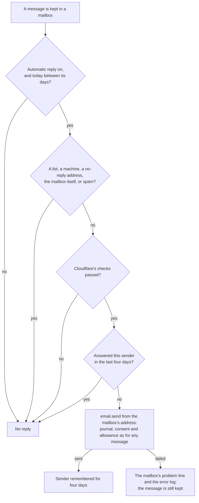
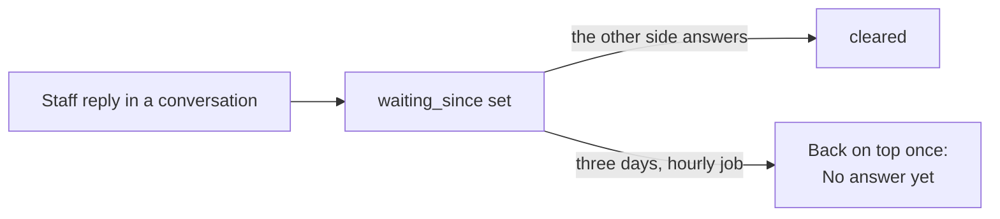

# Bundle B: the inbox answers by itself

> **In plain words.** Staff now spend less time on the same answers. A mailbox can answer by
> itself while the office is closed, or to say "we got your message", and it never answers the
> same person twice in four days, a newsletter, or a machine. The company's saved replies sit
> above the reply box and go in with one press. A conversation that staff answered and heard
> nothing back on for three days comes back to the top, marked "No answer yet", so nobody is
> forgotten. And the Owner can make Undo send last from 5 to 30 seconds. This is bundle B of
> [the research on making mail easier](../research/2026-11-02-easier-mail.md), built at the
> owner's choice of all five bundles.

## What changed

| Before | Now |
|---|---|
| an office closed for the holidays left senders wondering | an **automatic reply** per mailbox: on or off, an optional first and last day, a subject and the words, sent from the mailbox's own address |
| a common answer was typed again, or copied from elsewhere | **saved replies** above the reply box: the company's saved templates for Write, added under what is typed, with the person's details filled in |
| a conversation waiting on the other side was easy to forget | **No answer yet**: three days after the portal's last reply with nothing back, it returns to the top of its box once |
| a sent email waited ten seconds for Undo, fixed | the Owner sets 5 to 30 seconds (`email.undo_seconds`, 10 by default) |

## When an automatic reply is sent

Before, nothing was sent back by itself. The reply goes through email's send rather than
Cloudflare's `message.reply()`, so mail law M-1 (the message key `mail.auto.<tenant>.<message>`
answers the same delivery once) and M-4 (the do-not-mail list) hold. The four-day wait follows
Gmail's vacation responder; the skip rules follow RFC 3834's advice on automatic responses.

## How No answer yet works

Muted, snoozed and spam conversations are left alone, and a conversation comes back once only.

## What it means for each part

| Part | Impact |
|---|---|
| Staff reading mail | the automatic reply form under each mailbox on Mailboxes and rules; a row of saved replies above the reply box; a "No answer yet" badge on the list and a line on the conversation |
| The mail add-on | migration `1005_mail_answers.sql` (seven columns on `mail_mailboxes`, one on `mail_senders`, two on `mail_threads`, one partial index); route `PUT /api/mail/inbox/mailboxes/:id/auto-reply` (managing the mailbox); a mailbox's answer carries `auto`, a conversation's `waitingSince` and `nudged`; the hourly `mail.inbox` job runs the nudge before its upkeep |
| The email module | the setting `email.undo_seconds` and the `undoSeconds` option of `createEmail`; Sent and Write's Undo use it; `merge` (Write's merge fields) is also exported from `@oltrem/email/pages`, for the saved replies |
| The kit | hands `undoSeconds` from the portal's settings, next to `timeZone`; nothing else to wire |
| Cloudflare's free plan | an automatic reply is one queued message and one batch of writes; the nudge is one write an hour for all conversations; no KV |

## How it was checked

- `modules/mail/test/inbox.test.ts` (3 new): an automatic reply answers a person once in four days
  and never a list, a machine or a sender that failed the checks; it waits for its first day,
  stops after its last and stops when switched off; a conversation answered here and not since
  comes back once after three days, and an answer clears it.
- `modules/mail/test/inbox-pages.test.ts` (3 new): the automatic reply form on its mailbox, on or
  off with its days; saved replies above the reply box, one added under the typed words; the
  "No answer yet" badge.
- `modules/email/test/senders.test.ts` (1 new): Undo send lasts as long as the Owner set, and a
  value outside 5 to 30 is the 10 seconds.
- `pnpm verify` passes; its summary line is in the commit message.

Not checked here: a live provider's delivery of an automatic reply, which the first client's
mail shows on its first holiday.
