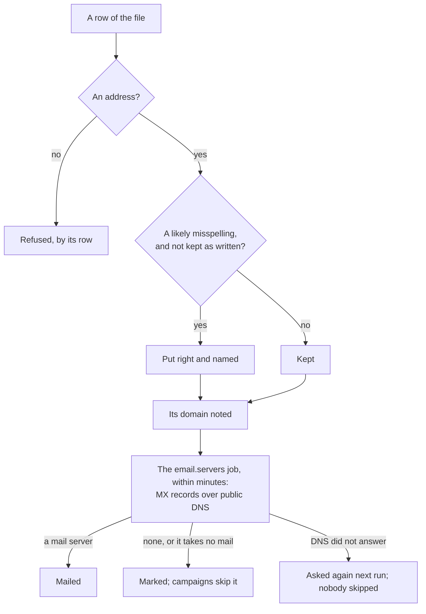

# Bundle L: cleaner lists

> **In plain words.** Fewer campaign emails bounce now, so the company's sending stays trusted and
> campaigns pause themselves less often. When a list is uploaded, a mistyped address such as
> one at `gmial.com` is put right by itself, and the answer says which ones were fixed. Shared
> inboxes such as `info@` are marked, and `noreply@` addresses are left out, since nobody reads
> them. In the next few minutes the portal checks each domain on the list for a mail server, and
> campaigns skip the people no email can reach. Nobody has to press anything for any of it. This is
> bundle L of [the research on making mail easier](../research/2026-11-02-easier-mail.md), built
> at the owner's choice of all five bundles.

## What changed

| Before | Now |
|---|---|
| an address at `gmial.com` was mailed as typed, and bounced | a likely misspelling of Gmail, Yahoo, Hotmail or Outlook, or an ending such as `.con`, is put right on import and named; a tick keeps the addresses exactly as written |
| `info@` and `noreply@` were mailed like anyone | a shared inbox is marked and counted, and still mailed; a no-reply address is marked, counted and left out of campaigns |
| an address at a domain with no mail server was found only when it bounced | each domain is looked up over DNS within minutes of the import, and again each month; campaigns skip the people at one with none, and the list counts them |

## How an address is read now

Before, an address was checked for its shape only.

## What it means for each part

| Part | Impact |
|---|---|
| Staff uploading a list | the import's answer names each misspelling put right and counts shared and no-reply inboxes; each person on the list says when they are never mailed and why; the list's pill counts them |
| The email module | `src/clean.ts` (`likelyDomain`, `likelyAddress`, `kindOf`, `NO_REPLY_LOCALS`); `readList` takes `{ fix }` and answers `fixed`, `fixedCount`, `shared`, `noReply` and `domains`; `POST /lists/:id/import` takes `fix=0`; the job `email.servers` every five minutes; `lists.noteDomains`, `lists.lookServers` and `lists.unreachable`; bulk mail skips what no mail reaches; migration `1006_email_clean_lists.sql`; a list summary carries `unreachable`, a member `flag` |
| The campaigns module | a CSV upload puts misspellings right unless `fix=0`, notes its domains, and answers `fixed`, `fixedCount` and `noReply`; the saved list picker counts who can be mailed without the unreachable |
| The kit | the migration and the job come with the module; its worker test lists the new job |
| Cloudflare's free plan | ten domains a run, five at a time, one DNS call each: ten of a run's fifty outbound calls; one batch of writes a run; no KV |

## How it was checked

- `modules/email/test/lists.test.ts` (3 new): misspellings named for Gmail, Yahoo, Hotmail and
  Outlook and for endings that are no top-level domain, and real services one key apart left
  alone; shared, no-reply and personal addresses told apart; an import that puts one right,
  counts the shared and no-reply inboxes and notes each domain once, and one asked to keep the
  addresses as written; the job asking each domain once, a domain with no MX and one with a null
  MX marked, one DNS did not answer left for later, and the list's count and each person's mark.
- `modules/email/test/bulk.test.ts` (1 new): a no-reply address and an address at a domain with no
  mail server skipped with the reason, and nothing handed to the provider.
- `modules/email/test/email.test.ts`, `modules/campaigns/test/campaigns.test.ts`: the manifest's
  new job and the import answers' new fields.
- `pnpm verify` passes; its summary line is in the commit message.

The identifiers scan lets only addresses at example.com and example.org be written; the tests
need a misspelled one, so `scripts/identifiers.json` allows the one string `example.con`, a
domain that exists nowhere since `.con` is no top-level domain.

Not checked here: a live import's look-ups against public DNS, which the first client's first
list upload shows within minutes in its job log.
