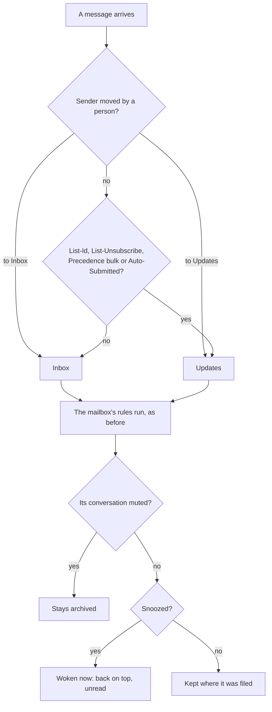
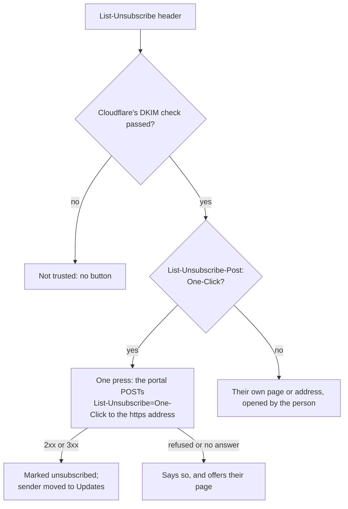

# Bundle A: an inbox that works the way people expect

> **In plain words.** The portal's inbox now behaves like Gmail and Outlook, so staff need no
> training. Newsletters and automatic notices go to their own Updates box instead of crowding
> the inbox. One press unsubscribes from a list, and Updates shows every list that writes in.
> A conversation can be snoozed until later, tomorrow or next week, muted, or swept away with
> everything else from the same sender. Every change can be undone from the line that confirms
> it. Search understands `from:`, `subject:`, `has:attachment` and the other words Gmail uses,
> and on a phone a swipe archives or marks read. This is bundle A of
> [the research on making mail easier](../research/2026-11-02-easier-mail.md), built at the
> owner's choice of all five bundles.

## What changed

| Before | Now |
|---|---|
| every message landed in the inbox | mail from a list or a machine goes to **Updates**, out of the inbox and its unread count; Move to Inbox or Move to Updates is remembered for that sender |
| leaving a list meant finding the link at the bottom of the message | **Unsubscribe** in one press when the list offers it, made by the portal for the person; Updates lists every subscription with its button |
| a conversation stayed until it was archived | **Snooze** to three hours, tomorrow at 8 or Monday at 8 on the company's clock; it comes back on top, unread, or sooner when someone answers |
| a busy conversation kept coming back | **Mute**: its new replies stay archived until it is unmuted |
| clearing out a sender meant ticking each conversation and writing a rule | **Archive all from sender**: all of them in one press, and a rule for what they send next |
| a change was done with no way back but the opposite command | **Undo** beside "Done", for every change but sweep and block |
| search matched words only | Gmail's words: `from:`, `to:`, `subject:`, `has:attachment`, `is:unread`, `before:`, `after:`, `in:`, with chips for the usual ones |
| phones used the tick boxes and the row of buttons | **swipe** left to archive and right to mark read, through the same buttons |

## How arriving mail is filed now

Before, every message went to the inbox and only the mailbox's rules could move it.

## How Unsubscribe works

Before, there was no Unsubscribe in the portal.

## What it means for each part

| Part | Impact |
|---|---|
| Staff reading mail | people's mail stays in the inbox; lists wait under Updates; the usual Gmail presses all work, and every one can be undone |
| The mail add-on | migration `1004_mail_familiar.sql` (three columns on `mail_threads` and the `mail_senders` table); routes `GET /api/mail/inbox/subscriptions` and `POST /api/mail/inbox/unsubscribe`; `POST /api/mail/inbox/actions` takes snooze (with `until`), unsnooze, mute, unmute, updates, people and sweep; a conversation's answer carries `sender`; the `mail.soon` job also wakes snoozed conversations; `mail.inbox` also removes senders kept only for their list once their mail is gone; `swipe.js` is served beside the reader |
| The email module | `email.timeZone(env)`, the company's time zone as Write uses it, for snooze times |
| The kit | nothing to wire: the migration, routes and job come with the module; the Home figure counts the inbox's unread, not Updates or Snoozed |
| Cloudflare's free plan | waking snoozed conversations is one write a run; an unsubscribe is one outbound request when a person presses it; no KV |

## How it was checked

- `modules/mail/test/inbox.test.ts` (8 new): list headers read for a list or a machine, and an
  unsubscribe believed only when signed and https; Gmail's search words parsed; a list message goes
  to Updates and out of the unread count, Unsubscribe POSTs RFC 8058's body to its address and is
  recorded, a refusal is reported with the sender's page, and someone who does not read the
  mailbox is refused; Move to Inbox and Updates remembered for the sender's next mail; snooze
  times (three hours, Thursday at 8 and Monday at 8 from a Wednesday), the five-minute job waking
  one only when due, and an answer waking one early; a muted conversation's reply staying
  archived; sweep archiving a sender's conversations and adding its rule once; search words across
  the boxes; old senders removed with their mail but the ones a person chose kept.
- `modules/mail/test/inbox-pages.test.ts` (6 new): the list's boxes, commands and chips, a snooze
  with its time and one refused without, Undo's form and its ids (an id that is not one is never
  put back), Updates with its subscriptions and the three ways to leave, the conversation's
  commands and notices, and where each change from a conversation goes next.
- `pnpm verify` passes; its summary line is in the commit message.

Not checked here: the swipe itself (a browser script; it presses the same buttons the tests
cover), and a real list's answer to the one-click POST, which the first client's mail shows.
