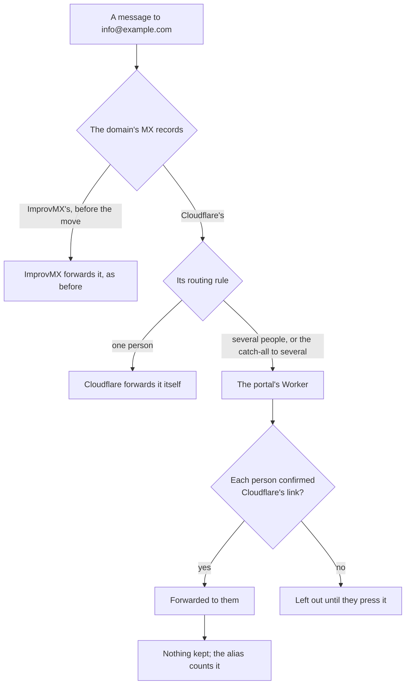
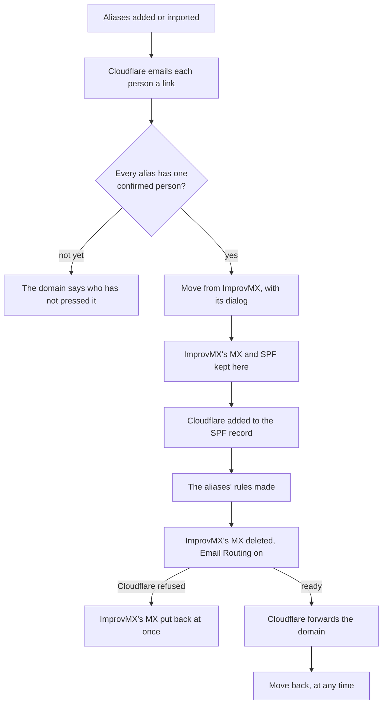

# Bundle F: forwarding, as ImprovMX does it

> **In plain words.** The portal now does what ImprovMX does today: `info@` or `sales@` on any of
> the company's domains is passed on to one person or to several, and nothing is kept. One more
> option, the catch-all, takes every other address of a domain. Aliases come over from ImprovMX in
> one paste. Each person gets one email from Cloudflare with a link to press. Once they press it,
> the alias starts working by itself. Then, one domain at a time, one press moves the domain's
> mail from ImprovMX to Cloudflare. A dialog says first what will change. Should something go
> wrong halfway, ImprovMX's records are put back straight away. **Move back** returns the domain
> to ImprovMX at any time. ImprovMX itself is never touched, so its aliases are still there. This
> is bundle F, added to [the research on making mail easier](../research/2026-11-02-easier-mail.md)
> after the owner's question of 2026-11-02. The owner chose to build it right after bundle C's
> work.

## What changed

| Before | Now |
|---|---|
| forwarding a domain's addresses needed ImprovMX, outside the portal | aliases on the Forwarding page (`/email/forwarding`), on any domain in the client's Cloudflare account |
| a mailbox could copy its mail to one address, and kept it too | an alias forwards to one person or up to ten and keeps nothing; the catch-all (`*@example.com`) takes every other address |
| each forwarding address had to be verified in the Cloudflare dashboard | the portal asks Cloudflare to email each person its link, reads the answer back, and makes the rule the moment it is pressed |
| moving off ImprovMX meant editing DNS records by hand, with mail lost if a step was missed | one press a domain, offered only once every alias has a confirmed person; the old records are kept for Move back, and a failure puts them back at once |

## How mail to an alias travels

Before, only the left-hand path existed: every domain's forwarding was ImprovMX's.

## How a domain moves

## What it means for each part

| Part | Impact |
|---|---|
| The Owner | one page for every domain's forwarding; an import in one paste; one press a domain to move, one to move back. `mail.manage` is on the owner floor, since a move changes where a domain's mail goes |
| The people mail is forwarded to | one email from Cloudflare with a link to press, once for every alias that names them |
| The mail add-on | `src/forwarding.ts` (the aliases, the import reader, the move, Move back, `receive` for aliases, the job and health), `src/forwarding-pages.tsx`; the Cloudflare helper gains `api`, `zone`, `ask` and `readBack`; ten routes under `/api/mail/forwarding`; the health check `mail.forwarding`; errors `KIT-E-4008` and `KIT-E-4009`; migration `1007_mail_forwarding.sql` |
| The inbox | unchanged, except that an address is an alias or a mailbox, never both, and a mailbox's own address is the inbox's even when a catch-all covers its domain |
| The kit | the migration, the page and the health check come with the pack; its wiring is unchanged (the `email` handler already hands every message to `receive`) |
| Cloudflare's free plan | 35 Cloudflare and DNS calls a press and 8 a run of the five-minute job, inside the 50 an invocation; an alias to one person uses no Worker time; an alias to several uses one database read and one write a message; no KV |

## The facts it rests on, read 2026-11-02

- Cloudflare's API reference: a routing rule's forward action takes **exactly one verified
  destination address**, and so does the catch-all rule (`PUT .../email/routing/rules/catch_all`).
  Cloudflare's limits page says the same, and that several people take a Worker that forwards to
  each. 200 rules a domain, 200 verified addresses an account, 30 domains a zone.
- Enabling Email Routing (`POST .../email/routing/dns`) adds and locks its MX and SPF records;
  unlocking (`PATCH`) lets other records sit beside them; disabling (`DELETE`) removes them.
- ImprovMX's API (v4): HTTP basic sign-in with the account's API key; aliases listed by domain,
  each with its `forward` as a comma-separated list of addresses or webhooks; `*` is the catch-all
  alias; its MX hosts are `mx1.improvmx.com` and `mx2.improvmx.com`, its SPF include
  `spf.improvmx.com`.

## How it was checked

- `modules/mail/test/forwarding.test.ts` (12 new), inside the Workers runtime with Cloudflare's API
  scripted and its DNS records kept per zone: the reader of pasted lists and of ImprovMX's export;
  where mail goes by MX host, and the SPF record with and without Cloudflare; only the Owner may
  change it; a domain with no MX turned on in the same press and an ImprovMX domain left alone;
  one person's link asked for and the forward rule made once it is pressed; several people and
  the catch-all through the Worker, an unconfirmed person left out, a mailbox's address never the
  catch-all's, and loops and taken addresses refused; switched off and deleted, the rule gone; the
  import, the move refused until every link is pressed, a second paste changing nothing; the move
  call by call and Move back call by call; a move Cloudflare stops halfway putting ImprovMX's
  records back; a long list asked about eight a press and the rest by the job; the health check.
- The rest of the add-on's suites pass unchanged; `pnpm verify` passes; its summary line is in the
  commit message.

Not checked here, so each is said where it applies and checked on the first live move:

- whether Cloudflare makes a rule on a zone before Email Routing is on there. The move does not
  depend on it: a rule refused before the move is made by the move itself, after Email Routing
  is on, in the same press;
- whether Email Routing adds a second SPF record when the domain has one already. The move adds
  Cloudflare's include to the existing record first, and the domain's line says so if two appear;
- `DELETE .../email/routing/dns` with a domain's name, for one domain of a zone that has several.
  Move back refuses, with the dashboard steps instead, whenever the zone also carries the
  sending route, another forwarding domain or mailboxes.

Waiting for the owner: reading ImprovMX directly with the account's API key, typed once and never
kept, is the true one-press import. It is a new credential, so it waits for his yes (R-05). The
pasted list works without it.
