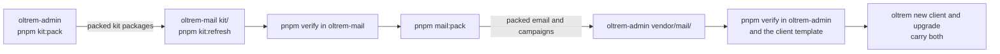

# Phase 1: the move

> **In plain words.** The two mail modules, `@oltrem/email` and `@oltrem/campaigns`, used to
> live inside the kit. They now live here, in their own private repository, with their own
> checks. Nothing a client sees changed: the package names, tables, routes and hook addresses
> are the same, and the kit still ships them, as packed copies. No registry is involved, in
> line with the owner's decision that Oltrem stays private.

## What changed

| Before | Now |
|---|---|
| `modules/email` and `modules/campaigns` in oltrem-admin | the same two modules in oltrem-mail, moved unchanged apart from their kit dependencies |
| the kit's packages reached through the kit's workspace | the kit's packed packages in `kit/`, recorded in `kit/kit.json` with the kit commit and each file's fingerprint |
| one verify chain, the kit's | this repository has its own `pnpm verify` (see [What pnpm verify runs](../reference/verify.md)) |
| the kit built and tested mail with everything else | the kit keeps packed mail in `vendor/mail/`, with `oltrem-mail.json` naming the mail commit and the kit commit it was tested against |

## How the two repositories trade packages

The kit's packages are all at version 0.0.0 for now, so "the version mail was tested against"
is the kit commit written in `kit/kit.json` and copied into `oltrem-mail.json`. A drift is
caught by the kit's own type check and tests, which run the vendored mail modules. A strict
version check comes when the kit gets version numbers.

## How it was checked

- Both modules' type checks and all 129 module tests pass here against the packed kit.
- The kit's manifest check passes on both modules, run by the kit's own command-line tool from
  `kit/`.
- `pnpm verify` passes in this repository; its summary line is in the commit message.
