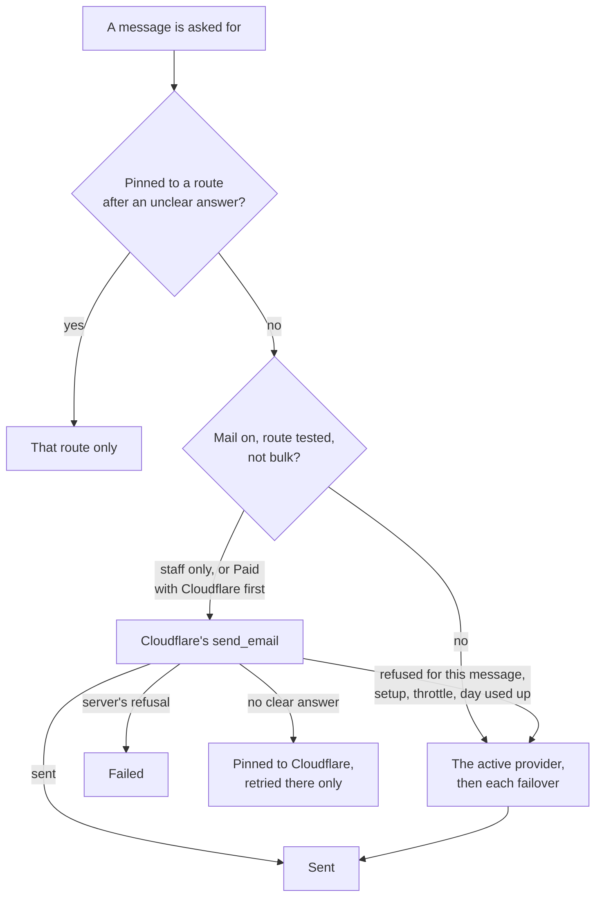

# Phase 2: the Cloudflare route

> **In plain words.** A portal whose owner ticked Mail at setup can now send its staff mail
> through Cloudflare for free, and on Workers Paid its customers' everyday mail too. The owner
> sets it up on one page, Mail setup, step by step. A portal without Mail sends exactly as
> before. Whatever route a message takes, it is never sent twice: when a route gives no clear
> answer, the message stays on that route and is never handed to another.

## What changed

| Before | Now |
|---|---|
| every message went through the email providers, active first, then the failovers | an add-on route goes first when it takes the message, then the providers |
| each provider's refusal was read on its own | every route's answer is sorted into one list: fails now, let the next route try, or no clear answer |
| a timeout on one provider could send the message again through the next | no clear answer pins the message to that route (`pinned_route`, migration `1000`); retries go there only |
| two packages, `@oltrem/email` and `@oltrem/campaigns` | a third, `@oltrem/mail`, which a client gets only when Mail is ticked |

## How a message picks its route

Before this phase the same picture had only the right-hand path: the providers, in order, with
any refusal moving on to the next.

## What it means for each part

| Part | Impact |
|---|---|
| Clients without Mail | none: email and campaigns behave as before; the one change is the pinning, which only makes a retry safer |
| Clients with Mail | the kit's tool adds the `send_email` binding and the key's three extra rights; the Owner opens Mail setup |
| The kit | wires the add-on (docs/kit-contract.md), mounts its module and page, and keeps the key's registry row |
| Cloudflare | Email Routing turned on by the portal, staff addresses verified by Cloudflare's own link; onboarding the domain for sending is one dashboard tap, since Cloudflare has no API for it |

## How it was checked

- `modules/email/test/routes.test.ts` (7 tests): the add-on route first, bulk left to providers,
  a refusal failing over, a server's refusal failing at once, an unclear answer pinning, a 503
  failing over while a 500 or a broken connection pins, a pinned route that went away failing.
- `modules/mail/test/mail.test.ts` (13 tests): the setup against a scripted Cloudflare API and
  DNS, the MX refusal, the dashboard step on a 403, staff verification and read-back, the test's
  states, Free and Paid routing through the real `deliver`, pinning on Cloudflare, the daily job,
  the health check, switched off, stopping, and the sorting of Cloudflare's codes.
- `pnpm verify` passes; its summary line is in the commit message.

Not checked here: a real Cloudflare account. The API paths and the binding's error codes were
read from Cloudflare's documentation on 2026-11-02; the first real portal with Mail is the live
check, on the phone steps in the report.
