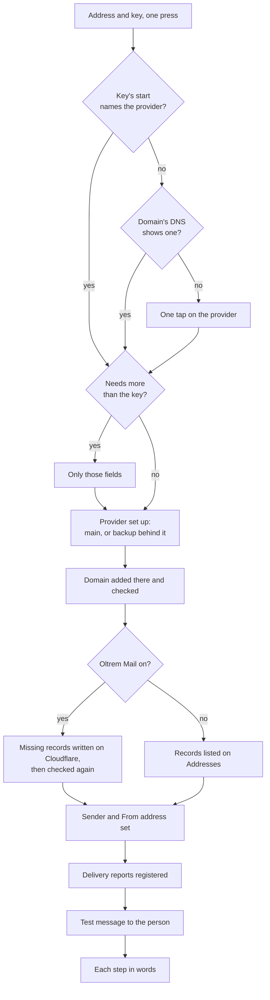

# Phase 3: the simple provider card

> **In plain words.** Connecting email now takes two fields and one press. The person types the
> address mail comes from and pastes the provider's key. The portal works out which provider it
> is, sets it up (as the main provider or as the backup), adds the domain there, writes the DNS
> records on Cloudflare when Oltrem Mail is on, adds the sender, registers delivery reports at
> the provider, and sends a test. It then lists each step and what it found. It asks a question
> only when it cannot tell which provider the key is from, or when that provider needs one more
> field. A second form sends one test to a Gmail and one to an Outlook address, so staff can see
> where the mail lands.

## What changed

| Before | Now |
|---|---|
| connect a provider on Integrations, then add the domain on Addresses, then add a sender, then paste the reports address in the provider's dashboard, then test | Email, Set up: the address and the key, one press |
| the provider picked from a list | read from the key's start or the domain's DNS; a tap only when neither says |
| a backup provider set up as a second instance and its order changed by hand | **Add it as the backup** on the same card |
| DNS records copied one by one to the DNS host | written on Cloudflare in the same press (Oltrem Mail), or from Mail setup with **Write them**; only ever added |
| delivery reports' address pasted in each dashboard | registered by API at Resend, Brevo and Mailjet |
| one SPF record, not two, was all that was checked | the 10-lookup limit counted as receivers count it, warned at 9, and a provider that would pass it named first |

## How the card works now

Before this phase each box on the right was its own page and its own press.

## What it means for each part

| Part | Impact |
|---|---|
| Clients without Mail | the card, the reports, the SPF count and the placement test work as described; records are listed to add by hand |
| Clients with Mail | the card also writes the records on Cloudflare with the portal's key (DNS Edit, already among its three rights); Mail setup lists domains with records missing |
| The kit | no wiring change: `records` rides on the route taker the add-on already hands back; the page uses the kit's settings API. One suggestion: a DNS fingerprint for Mailjet in the kit's definition (docs/kit-contract.md) |
| Providers | Resend, Brevo and Mailjet get the portal's address for delivery reports registered through their APIs; the others keep the guided step |

## How it was checked

- `modules/email/test/connect.test.ts` (7 tests): the key prefixes and the key field, a Brevo key
  setting everything up in one press and a second press making nothing twice, a Resend key as
  the backup behind Brevo, a generic key placed by Postmark's include in DNS, one tap then
  Mailjet's secret key, a sending subdomain, a bad one, and a clerk refused.
- `modules/email/test/reports.test.ts` (4 tests) and `modules/email/test/spf.test.ts` (4 tests):
  registration at each provider and its removal, a key that may not register, the lookup count
  through nested includes, the limit, a loop, a provider's include named before it is added.
- `modules/mail/test/records.test.ts` (5 tests): only adding (an existing SPF record, another
  mail server, a CNAME, DMARC kept), the body Cloudflare takes, the card writing Brevo's records
  in the zone with one audit row, Mail setup writing again with nothing to add, a key refused
  DNS Edit told so, an unknown domain and someone who may not.
- `pnpm verify` passes; its summary line is in the commit message.

Not checked here: real provider and Cloudflare accounts. The API paths were read from each
provider's reference on 2026-11-02; the first real portal is the live check, on the phone steps
in the report.
