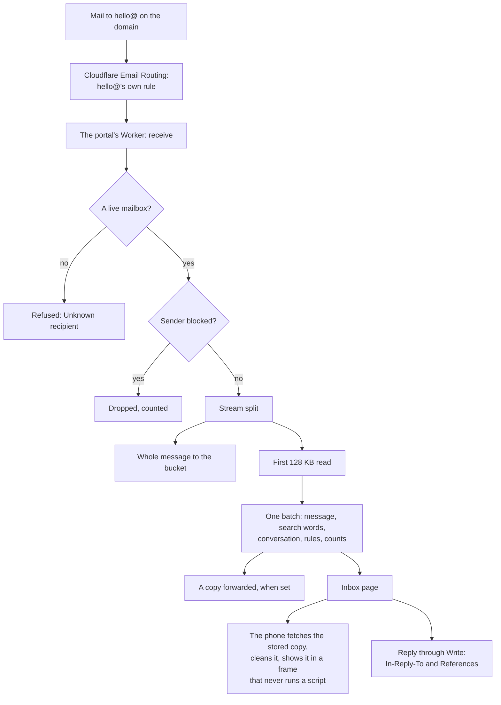

# Phase 4: the inbox

> **In plain words.** A business with Oltrem Mail can now receive mail at its own addresses,
> such as hello@ or bookings@, inside the portal. The team reads it on a phone, answers from the
> same address, and the answer and the customer's next message stay in one conversation. A
> message is never shown by running anything it contains. Unknown addresses are refused, blocked
> senders are dropped, rules file mail by themselves, old mail is removed by itself when the Owner
> sets how long to keep it, and a check warns long before the free plan fills.

## What changed

| Before | Now |
|---|---|
| mail to the business's domain went to a mail app outside the portal, or nowhere | mailboxes in the portal, each with its own routing rule in Cloudflare, made by the portal |
| replies were written in another app | **Reply** in the conversation, from the mailbox's address, with Write's Undo and the Sent page |
| — | search over the first 8 KB of every message, accents folded |
| — | rules (archive, mark read, label, spam), a block list, a spam threshold, a copy to a staff address |
| — | the inbox's room against the free plan, retention by days, and a health check |

## How mail arrives and is read now

Before this phase the portal had no way in for mail at all; only the right half of Write
existed.

## What it means for each part

| Part | Impact |
|---|---|
| Clients without Mail | nothing changes: the client's `email` handler refuses every address |
| Clients with Mail | the Inbox tab in Email, Mailboxes and rules, a Home figure, search and a privacy search; the bucket gains `mail/inbox/`; the database gains migration `1002` |
| The email module | `thread` on a message (In-Reply-To and References), and `write` as a function the inbox calls |
| The kit | wiring: `bucket`, `worker`, the `email` handler; error codes `4001` to `4007`; the job and health check `mail.inbox`; and a request: let a hook's own `immutable` cache answer stand (docs/kit-contract.md) |
| Dependencies | postal-mime and DOMPurify, approved by the owner on 2026-11-02, each with its registry row |

## Where it differs from the design

docs/inbox.md says each in full: mailbox rules are always literal (no catch-all on the root);
plus addresses do not carry the thread (they bounce when subaddressing is off, and the stored
ids already thread the answer); the quick actions are forms the server answers, not changes on
screen within one frame; arrival CPU in production is still to be read.

## How it was checked

- `modules/mail/test/inbox.test.ts` (17 tests): the pure readers (the `+tag`, Cloudflare's first
  header believed and no other, the score, the subject, the search words); mailboxes and their
  rules (made, refused with the dashboard step and retried by the job, permissions per location);
  arrival (refused, stored and found with accents folded, joined by ids and by subject, kept once,
  the 256 KB part and the whole, rules, the spam threshold, blocked senders and domains, the
  forwarded copy); actions; a reply with its headers in the queued message, the sender added by
  itself, and Undo taking it out of the conversation; switching off and the refused delete;
  retention; the health check; the reader's hook; and the sandbox guard (no `allow-scripts`,
  `allow-top-navigation` or `allow-forms` anywhere in the pages or the reader).
- `modules/mail/test/inbox-pages.test.ts` (10 tests): each form's call and where it goes next.
- `modules/email/test/email.test.ts`: a reply's In-Reply-To and References reach the provider,
  and a malformed id is refused.
- A one-off headless Chromium run (not committed) of the reader on a hostile message: its
  `<script>` and `onerror` did not run, the form was removed, the link whose words showed another
  address was marked, and no remote image or style was fetched until Show images.
- `pnpm verify` passes; its summary line is in the commit message.

Not checked here: a real Cloudflare account. The rules API was read from Cloudflare's reference
on 2026-11-02; the first real portal is the live check, on the phone steps in the report.
