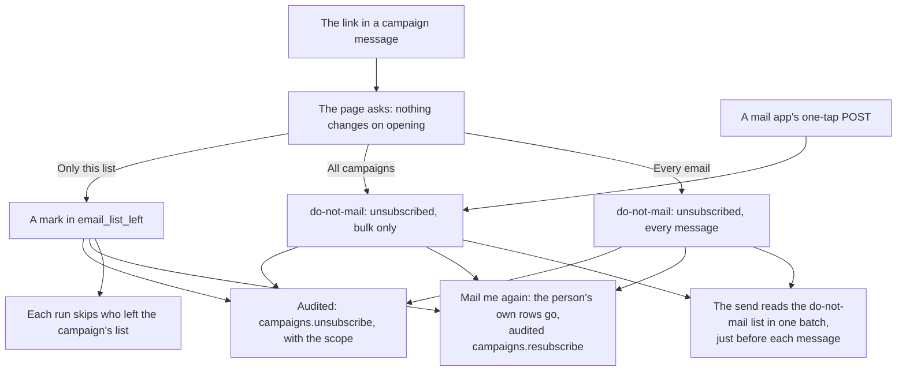
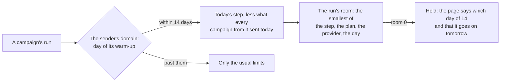

# Phase 5: consent and the warm-up

> **In plain words.** Someone who no longer wants a business's emails can now say exactly what
> they mean, in one press: stop this list, stop all campaigns, or stop every email. Nobody at the
> business has to do anything, and a person who changes their mind presses **Mail me again**.
> Someone who leaves is never mailed again, even by a campaign already sending. A new sending
> domain also starts slowly by itself, as Gmail and the others expect, so its first campaigns
> do not land in spam.

## What changed

| Before | Now |
|---|---|
| one unsubscribe: all campaigns | three choices on the page: only this saved list, all campaigns, every email; a mail app's one-tap unsubscribe is "all campaigns" |
| leaving was for good, unless staff took the address off by hand | **Mail me again** on the same page takes back the person's own choice; a bounce or a spam report is not theirs to undo |
| a person who left one list was barred from every campaign | they are skipped by the campaigns of that list, and not added from it again, but still get the others |
| a new domain could send its daily limit on its first day | it warms up over 14 days, from 50 campaign messages to 10,000, then only the other limits; a domain that sent before keeps its history |

## How leaving works now

Before, the page had one button, which wrote the bulk-only row, and only an Owner could undo it.

## How the warm-up works now

The first day is written on the domain by the first run that sends from it. A domain with older
campaigns counts from its first campaign message, so the change does not slow a portal already
sending. The setting `campaigns.warmup` turns it off.

## What it means for each part

| Part | Impact |
|---|---|
| People who receive campaigns | three clear choices, one press each, and a way back |
| Staff | nothing to do for unsubscribes; a held campaign says why in words |
| The email module | migration `1003`: `email_list_left` and `email_domains.bulk_since`; lists show "left this list" and count it; forgetting an address or deleting a list removes the marks; the privacy answer gives `leftAt` |
| The campaigns module | the three scopes, Mail me again, the list skip before each run, the warm-up and its setting |
| The mail add-on | an optional `local` dependency (the kit's ask): on the builder's computer a mailbox is made without Email Routing |
| The kit | wiring only: the new setting is listed by the module, the migration runs in its series, and `local` is handed in when it wants it |

## Also fixed: arriving mail that was never kept

The kit's own Worker test found that phase 4's `receive` hung on every real message. The runtime
hands in a native stream; a branch of its `tee()` cannot be piped straight into the
`FixedLengthStream` the bucket reads ("Inter-TransformStream pipeTo() is not implemented"), so
the pipe never settled and Email Routing would have seen a failure for every message. The stored
branch now passes through a plain `TransformStream` first. The tests hand in a native stream, as
the runtime does: with the old code they print that error, with the fix all pass.

## How it was checked

- `modules/campaigns/test/campaigns.test.ts` (35 tests, 3 new): the page offers the three scopes;
  each writes what it says; "every email" is not narrowed by a later one-tap; Mail me again
  removes the person's rows and is audited; a bounce stays; a person who left the list mid-send
  is skipped with the reason and not added from the list again; a new domain sends 50 on day 1,
  is held with the words, records its first day and sends the rest on day 2.
- `modules/email/test/lists.test.ts` (13 tests, 1 new): the mark shows as "left this list" in the
  list and its download, is counted, survives an import, is in the privacy answer, and goes when
  the address is forgotten.
- `modules/mail/test/inbox.test.ts` (18 tests, 1 new): with `local`, a mailbox is made on the
  sending address's domain without a Cloudflare rule, a message tried there reaches its inbox, and
  without a sending address the domain is example.com; without `local` the same press is refused.
- `pnpm verify` passes; its summary line is in the commit message.

Not checked here: a real mailbox provider's reaction to the warm-up steps. The steps follow the
usual published schedules; the first client's figures on the Campaigns page are the live check.
