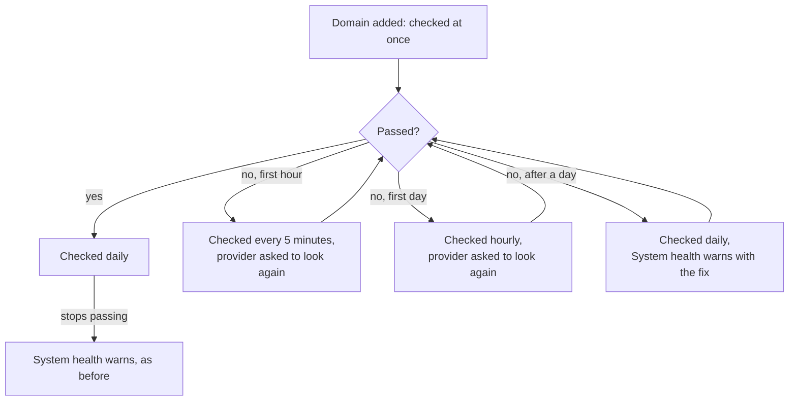
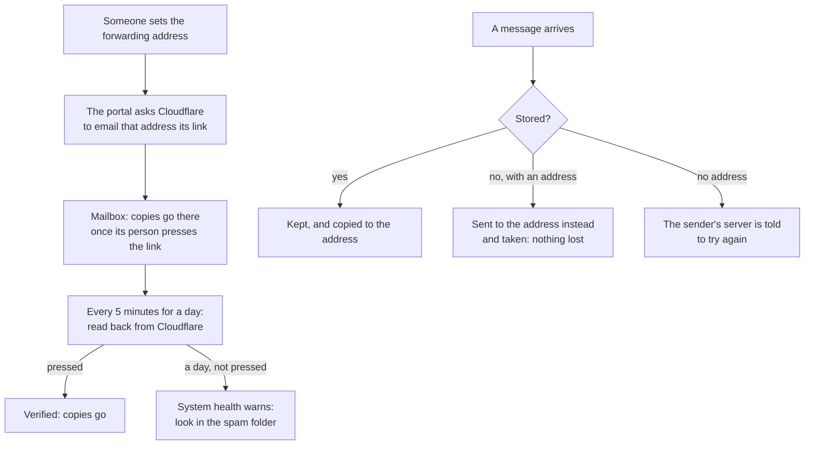

# Bundle C: mail that sets itself up and checks itself

> **In plain words.** After someone adds a domain or a forwarding address, the portal now does
> the waiting for them. It looks again by itself every few minutes, says on the page the moment
> things pass, and raises a warning on System health if something is still stuck a day later,
> saying what to fix. Cloudflare's "press this link" email goes out by itself when a forwarding
> address is set. A message the portal cannot store still reaches the forwarding address, so
> nothing is lost. Everyday mail such as a password reset moves to the backup provider before the
> main one runs out for the day. Each domain also says, in one line, whether it is ready for
> Gmail, Yahoo and Outlook. This is bundle C of
> [the research on making mail easier](../research/2026-11-02-easier-mail.md), built at the
> owner's choice of all five bundles.

## What changed

| Before | Now |
|---|---|
| a new domain was checked again once a day, or when someone pressed Check | checked by itself every five minutes in its first hour, hourly in its first day, then daily; the provider is asked each time to look at its records again |
| DMARC was looked for only at `_dmarc.<domain>` | the domain's own record, or else the nearest one above it, as mail providers look it up; a subdomain under a strict parent passes |
| the one press wrote the provider's DMARC record if it offered one, even under a parent's stricter policy | DMARC is written only when no policy covers the domain: the provider's record, else `v=DMARC1; p=none`; a parent's policy is never weakened |
| nothing said whether a domain met Gmail's, Yahoo's and Microsoft's sender rules | a "Ready for Gmail, Yahoo and Outlook" line on each domain, or what is missing |
| a domain that never passed stayed quiet | System health warns once it has not passed in a day, naming why |
| a forwarding address had to be verified in Cloudflare's dashboard by hand | setting it asks Cloudflare to email the link; the mailbox shows "once its person presses the link" and sees the press within five minutes |
| a message that could not be stored was refused, and the sender's server tried again later | with a forwarding address it goes there instead and is taken; without one, the sender's server tries again as before |
| a routing rule that could not be made was tried again hourly | every five minutes in the mailbox's first hour, hourly after; old mailboxes' forwarding addresses are asked about too |
| everyday mail used the main provider until it refused | it goes through the backup first once the main one is down to its last tenth of an allowance |

## How a new domain is checked now

Before, every domain waited a day between checks unless someone pressed the button.

## How a forwarding address works now

Before, the person had to verify the address in the dashboard, and a message that could not be
stored always went back to the sender's server.

## What it means for each part

| Part | Impact |
|---|---|
| Staff setting up email | no waiting and pressing Check: the page catches up by itself; DMARC is written in the same press when needed |
| People who receive copies | they get Cloudflare's link by itself and press it once |
| The email module | `email.domains` runs every five minutes (four domains a run, only those due); `RECHECK_SOON`, `DMARC_START`, `wantedOf` and `inboxesOf`; the domain view's `inboxes`; the `email.domains` health check also names domains stuck for a day; everyday mail's order follows what each provider has left |
| The mail add-on | a new job, `mail.soon`, every five minutes; `mail.inbox` now only removes old mail; the mailbox view's `forward`; the safety copy on arrival; Mail setup's **Write them** uses the same DMARC rule as the card |
| The kit | nothing to wire: the jobs and health checks come with the modules; its five-minute schedule already runs `email.release` |
| Cloudflare's free plan | the five-minute jobs read a few rows and call nothing unless a domain or address is waiting; a listing of verified addresses is one call for every address waiting |

## How it was checked

- `modules/email/test/senders.test.ts` (31 tests, 1 new): a subdomain under a parent with
  `sp=quarantine` passes DMARC with "Covered by"; the job leaves it alone two minutes on and checks
  it at five, asking Brevo to look again; past its first hour it waits an hour; a day without
  passing warns on System health with the provider's words; once verified it passes, the line
  says "Ready for Gmail, Yahoo and Outlook" and the warning clears.
- `modules/email/test/email.test.ts` (21 tests, 1 new): with the active provider at 5 of 100 left
  today, an everyday message goes through the failover; with room again, through the active one.
- `modules/mail/test/inbox.test.ts` (20 tests, 2 new): setting a forwarding address asks
  Cloudflare (the mailbox says `waiting`); after the link is pressed the job reads it back five
  minutes later and the mailbox says `verified`; with the bucket down, a message for a mailbox
  with a forwarding address goes there and is taken, the problem saying so, and one for a mailbox
  without one is refused for a retry. The rule retry waits five minutes, then makes the rule.
- `modules/mail/test/records.test.ts` (2 new): `wantedOf` leaves out the provider's DMARC record
  when a policy covers the domain, offers it (or `v=DMARC1; p=none`) when none does, and decides
  nothing when DNS did not answer.
- `pnpm verify` passes; its summary line is in the commit message.

Not checked here: Cloudflare's live answers to the verified-address calls (scripted from its API
reference), and whether a forward after a failed store works for every message Email Routing
hands in (the runtime allows `forward()` after the stream was read; the first client's mail is
the live check). The placement test is not re-run by itself: a person has to look where the
message landed, so it stays a press.
