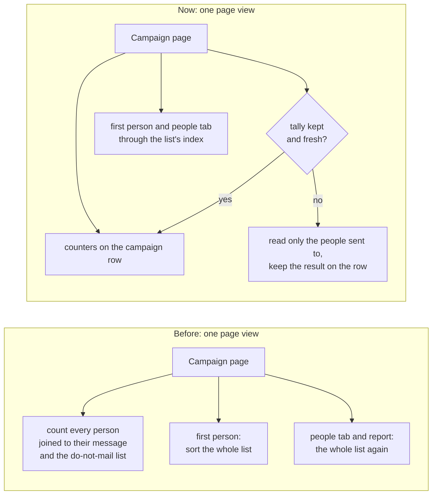
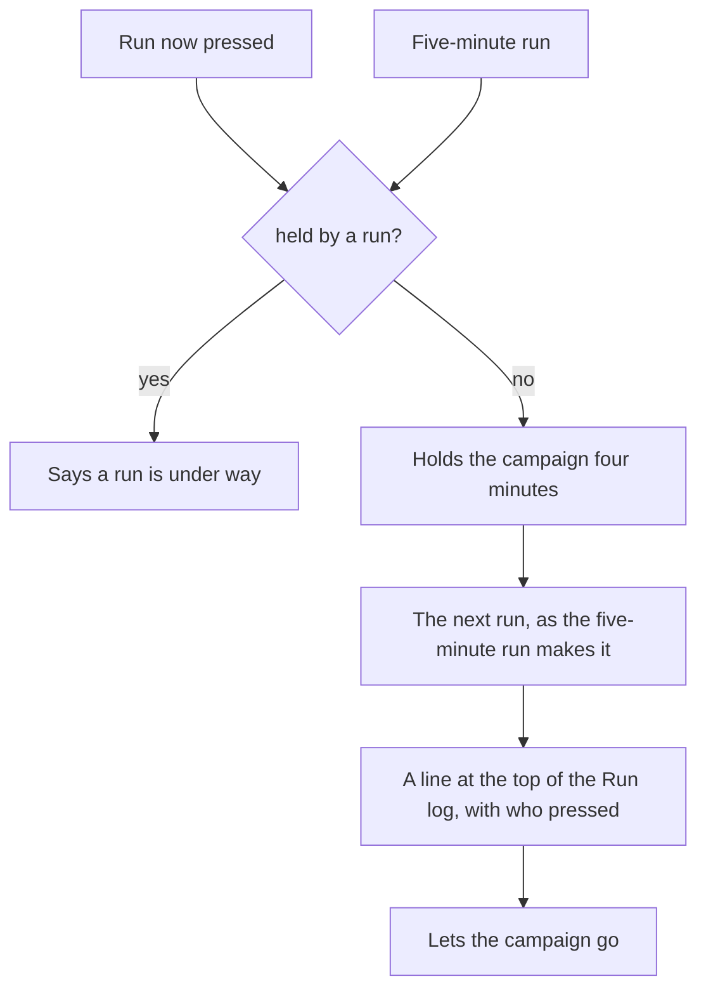

# Campaigns: fewer rows read, the footer, steps, Run now and the Run log

> **In plain words.** The owner set up one campaign on a live portal and saw the database read
> 186,000 rows in under four hours, with only him using it. The cause was the campaign's own page:
> every time it was opened or a Save was pressed it read about four rows for each person on its
> list, plus two more for its people and its report. Now it reads the figures the campaign already
> keeps, so the same page reads ten rows instead of eight thousand. The page also told him "It
> needs the footer in the Campaigns settings" with nowhere to fix it: the footer is now written
> right there, in step 3. A draft now shows its four steps as tabs, one at a time, and a new
> permission lets someone press **Run now** on a sending campaign and watch the **Run log** fill
> in live.

## What changed

| Area | Before | Now |
|---|---|---|
| Rows read by a campaign's page | about 4 a person each view (8,009 for 2,000 people), 2 more for its people, 2 for its report, 1 a person on the Campaigns list | the engine's counters on the campaign; delivery figures read only for the people sent to and kept on the campaign (`tally`) a minute while it runs, ten once over; the report kept ten minutes; the list read in order through a new index: 10 rows as a draft, 18 sending, 103 for its people, 3 for the list |
| The footer | named as missing, with no link and no field | step 3 has a **Footer** field and **Save the footer**, which saves the `campaigns.footer` setting; who may not change it is told who may |
| A draft's page | every section stacked | the four steps as a row of tabs and one step at a time, opening on the first step that needs something, with **Next** |
| Running now | wait for the next five-minute run | `campaigns.run` (new, class operate): **Run now** makes the next run at once, under a four-minute hold so it never runs beside the five-minute run |
| What a run did | the last run in one line | the **Run log**: the newest 20 runs, waits and failures in words, who pressed Run now, the newest eight on the page, refreshed every ten seconds |

## Before and after

Before, the work grew with the list: a page left open, a Save pressed, a step corrected, each read
the whole list several times. Now the work grows only with the people already sent to, and only
once a minute while a campaign runs (ten minutes once it is over).

## How it was checked

- `modules/campaigns/test/campaigns.test.ts`, "rows read": a campaign of 1,500 people, its page,
  the Campaigns list and its people each read under the limits above, measured with D1's own
  `rows_read`. Before the change a probe of the same calls read 8,009, 2,005 and 4,003 rows for
  2,000 people.
- "Run now and the Run log": a draft does not run, the sender role may not press it, Run now sends
  the next run and its log line names who pressed, and a held campaign answers `busy` and sends
  nothing.
- `modules/campaigns/test/steps.test.ts`: each missing item links to its step, the footer to the
  footer field in step 3, and a draft opens on the first step that needs something.
- The existing campaign tests pass unchanged, except the reports test, which now moves the clock
  past the ten minutes a finished campaign's figures are kept (an unsubscribe through the
  campaign's link still shows at once).
- Not checked here: the live portal's own rows read after the deploy (the owner reads Cloudflare's
  D1 page after a day of use).
