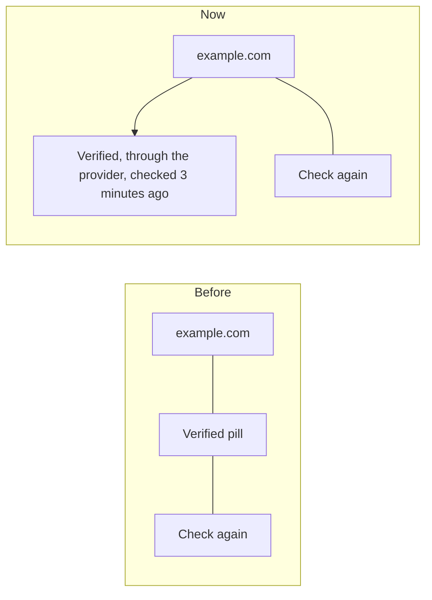

# The Email pages tidied for a phone

> **In plain words.** The owner sent two phone screenshots (Write, and Email settings >
> Addresses) and asked for every Email page to be reviewed for spacing, wasted room and
> arrangement, because it looked sloppy. Each page was photographed at a phone's width and
> checked against published interface rules (Vercel's Web Interface Guidelines, Apple's and
> Google's touch-target sizes, the "no card inside a card" and "one chip style" rules). The
> fixes: a domain's name no longer breaks in the middle of a word; its status sits under the
> name instead of fighting the buttons; an address row says what it is used for in words, not in
> dot-joined strings; the two head buttons look alike; the page title no longer repeats the first
> tab; Write's labels take less room and its sideways rows show no scrollbar; empty charts and
> seven empty bars are gone; the Campaigns list comes before the figures; the Setup steps lost
> their boxes.

## What changed

| Page | Before | Now |
|---|---|---|
| Addresses: the domain head | the name broke mid-word beside a status pill and two buttons | the name on its own line; under it the status and "Through X, checked 3 minutes ago"; only **Check again** beside it |
| Addresses: an address row | `everyday · default · scope` in grey | the address, then a word tag for its use and a blue tag for **Default for everyday mail** |
| Addresses: the inbox rules | a row of dots | "Gmail, Yahoo and Outlook rules", a status word and one sentence |
| Addresses: the head buttons | **Look at my provider** outlined, **Add a domain** filled | **Sync with provider** and **Add a domain**, the same kind |
| The settings tabs | the title "Email settings" and a first tab of the same name | the first tab is **Setup** |
| Write | a 68 px label column; scrollbars under the toolbar and the Send bar; a hint that wrapped out of line; `· link` | a 52 px column; no visible scrollbars; the hint cut to one line; ", as a link"; To says "Name or email" |
| Usage and limits | seven bars reading "Not measured" | measured figures as bars, the rest named in one line: "Not measured yet: …" |
| Setup (connect) | each step in its own grey box | a tight numbered list |
| Templates, Forwarding, Mail | `a · b · c` | "a, b" or "a; b" |
| Campaigns | the figures and the CSV template first, the list last | the list first, then the CSV template, then today's room |

The kit's part (the chip look, the head row, empty states in a box, the folder row's fade, the
row of tabs opening with the tab before the marked one whole, the 14-day chart's empty line) is
in the kit's own record of the same day.

## How the domain head reads now

Before, four things shared one line 358 px wide, so the name wrapped inside itself. Now the head
holds the name and one button, and the status line wraps under it on its own.

## How it was checked

- Every Email page photographed at 390 px wide, light mode, before and after, on the local
  portal with real local data (no mock rows).
- New and changed tests: `senders-page.test.ts` (the head holds only **Check again**, the row's
  tags are words, no middle dots), `mail-screen.test.ts` (unmeasured figures named in one line),
  `kinds-page.test.ts` (the first tab is **Setup**, the order of the tabs).
- `pnpm verify` green before the push.

## Not done, and why

- **The inbox's snippet line** keeps its dot between sender and time: that is the layout Gmail
  users know.
- **The Users page** is reworked in its own thread.
