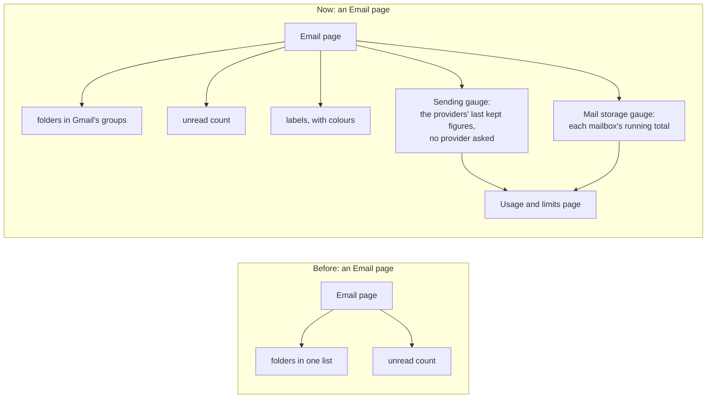
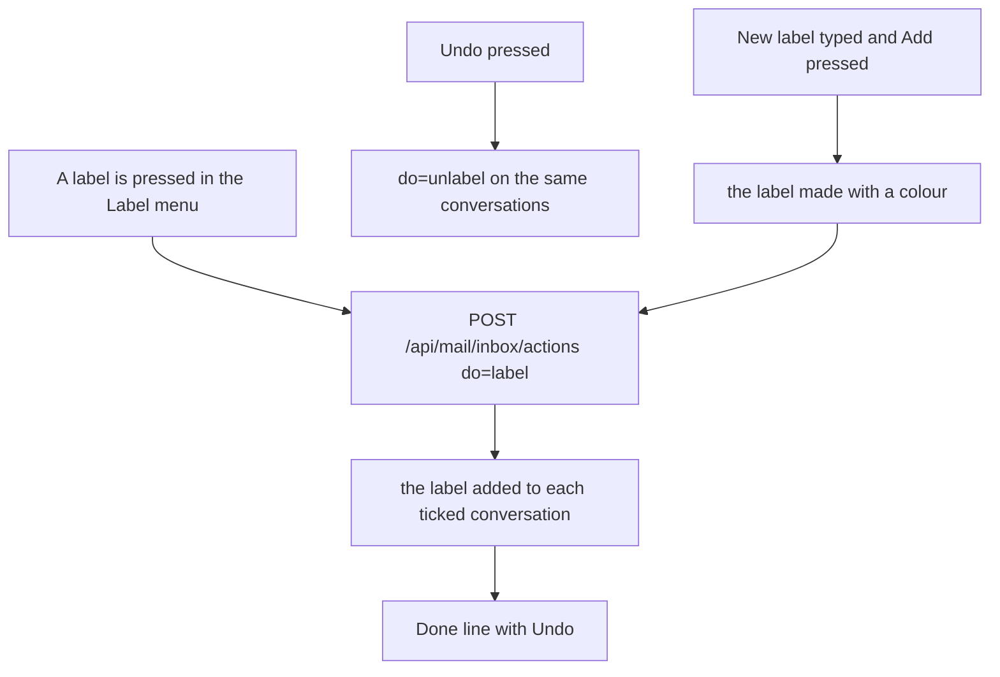

# Email made to work like Gmail

> **In plain words.** The owner asked that anyone coming from Gmail find what they know in Email,
> that the left pane look better, and that every page say how much of each free allowance is used,
> in words a client understands. [The research](../research/2026-11-11-gmail-style.md) found what
> Gmail does and what may be reused. Now conversations can be starred and labelled, labels have
> colours and their own folders, Gmail's keyboard shortcuts work, the list has Gmail's top bar
> with a search, menus and a quick-settings panel (split view, compact rows), and the left pane is
> grouped like Gmail's, with Labels and two small gauges at the bottom: emails sent against the
> provider's allowance, and mail storage. A new page, **Usage and limits**, explains every figure
> in plain words. No Gmail name, logo, icon or font is used; the icons are Lucide (ISC).

## What changed

| Area | Before | Now |
|---|---|---|
| Stars | none | a star on every row and on the open conversation; a **Starred** folder; `is:starred` and `in:starred` in search; key `s` |
| Labels | only a rule could put one on, shown as plain text | anyone who reads the inbox can put a label on ticked conversations or the open one, or make a new one from the same menu; each label has a colour and a folder in the left pane; **Labels** (`/email/inbox/labels`) renames, recolours and removes them; a rename follows onto every conversation and rule; `label:` in search |
| The list | a row of mailboxes, a search and a row of commands | Gmail's top bar: a search box, then the tick-all box, Archive, Spam, Mark read and unread, a **Snooze** menu, a **Label** menu and a **More** menu; the commands only show once a row is ticked, the rest of the time the refresh and the page range |
| Each row | who, when, subject, first words | as before, plus the star, the colour chips of its labels, a paperclip when it carries a file, and on a computer the row's own Archive, Mark read and Snooze when the pointer is over it |
| Quick settings | none | the cog opens: **Split** (the conversation beside the list) or **Full** (it takes the list's place), **Default** or **Compact** rows, the keyboard shortcuts and Mailboxes and rules; kept in a cookie on that browser, no database write |
| Keyboard | none | Gmail's own keys: `j` `k` move, `o` or Enter opens, `x` ticks, `s` stars, `e` archives, `!` spam, `I` `U` read and unread, `u` back to the list, `c` writes, `/` searches, `r` replies, `g` then `i` `s` `t` `d` `a` go to Inbox, Starred, Sent, Drafts, All; `?` shows them all; they can be switched off in that sheet |
| The left pane | every folder in one list | grouped as Gmail's: Inbox, Starred, Snoozed, Sent, Drafts on top; Updates, Archived, Spam, All under **More**, which opens by itself when one of them is open; then **Labels** with a + to make one; then the pages that manage mail (Delivery log, Templates, Mailboxes and rules, **Usage and limits**); at the bottom two gauges, **Sending** and **Mail storage**, each a link to Usage and limits, green, then amber at 70%, red at 90% |
| Usage and limits (`/email/usage`) | figures spread over the Email home and System health | one page: each provider's emails used and left today, this month or on the plan, when it resets, and what the portal sent itself; the inbox's storage against the bucket's 10 GB; how the allowance is protected (the order of providers, the stop at the limit, everyday mail first); and the Cloudflare plan's figures (database reads, writes and size, quick-store writes, background tasks, requests, time per request) from the kit's budgets, in plain names, or why they are not measured yet |
| Room used by the inbox | added up from every message each time | each mailbox keeps a running total, added to as a message arrives and taken from as old mail goes, so the pane reads one row a mailbox |

## Before and after

Every Email page now asks for its pane in one go: the folders with their counts, the labels and the
two gauges, side by side. The sending gauge reads what each provider last said, kept on its row, so
drawing a page never calls a provider; the provider itself is asked at most every 15 minutes, on
the Usage and limits page, as before. The storage gauge reads one row per mailbox.

## Limits kept

- **10 ms of CPU (M-3):** the pane's two reads are one small row each; the keyboard and the menus
  run in the browser (`keys.js`, served with the reader's scripts); the page sends no more HTML
  than before for a list of 50.
- **No KV writes (M-3):** the view and row choices are a cookie; labels and stars are D1 rows.
- **One of each resource (R-09):** migration 1016 adds a column to `mail_threads`, a column to
  `mail_mailboxes` and one small table, `mail_labels`, in the client's one database.
- **Real data only (R-10):** a figure the provider did not give stays "Not measured yet", with why.

## Not done, and why

- **R2 in the Cloudflare plan's figures.** The kit reads its budgets from Cloudflare's GraphQL
  Analytics; R2's fields were not checked against a live account, and one wrong field would make
  every budget fail. The inbox's own storage is shown from its running total instead.
- **Skipping a provider with nothing left.** Each provider already refuses at its limit and bulk
  mail stops there; moving one with 0 left behind the others in the send path touches code other
  work owns, so it is left for its own change.
- **The gauges on a phone.** The phone shows the folders as a row of chips; the gauges are on the
  Usage and limits chip's page.

## How it was checked

- The mail module's tests: stars, labels made, renamed, recoloured and removed (403 for someone who
  may only read, 422 for a label without a name), the room equal to the stored messages' sizes and
  back to 0 after the tidy, `label:` and `is:starred` in search, the Label menu with Undo, the star,
  the Quick settings cookies and the Labels page (28 page tests).
- The email module's tests: the new folder order, `paneExtras`, `/usage/brief`, and the Usage and
  limits page (the screen tests, 10).
- The kit's core-ui tests: the groups, labels and gauges in `MailShell`, More opening by itself,
  the gauge's colours, the label colours, the row and the top bar (20).
- On a local portal with migration 1016: a label put on adds its chip and folder and Undo takes it
  off; a star is kept; Quick settings switches to split and compact and back; `j` then `e` archives
  the row under the cursor; Usage and limits shows the database's real size and "Not measured yet"
  with the token's problem.
- `pnpm verify` in both repositories before the push.
