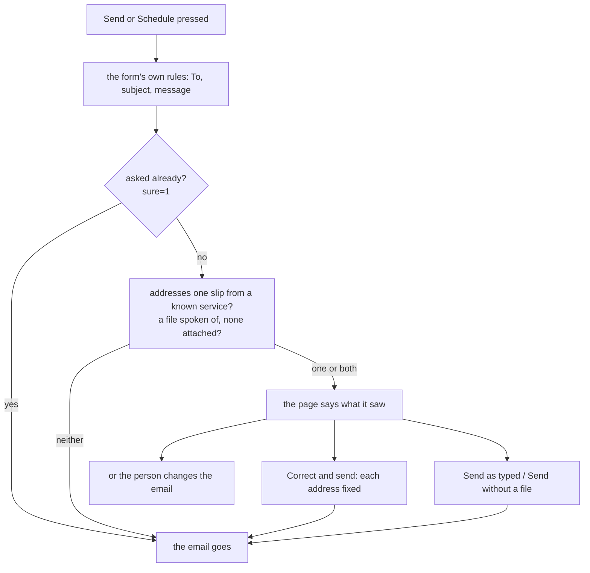

# Write made smarter and slimmer

> **In plain words.** The owner asked which of the first client's email-page features Write
> lacks (reading pasted addresses, filling in people from past emails, checks that catch
> mistakes, a better To and From) and, from a phone screenshot, for a Write page without the
> wasted head, edge to edge. Write already had chips, suggestions from past emails, Cc and Bcc,
> Ctrl and Enter, drafts, Send later, Undo, templates and Preview. Now a list pasted into To (a
> spreadsheet column, a signature, a line of another email) becomes one chip per person; the same
> person is never added twice; someone written to before shows by name; the people written to most
> are suggested first; Send asks once when an address looks misspelt (`gmial.com`) and offers the
> fix, or when the message says "attached" and nothing is; and leaving with words typed makes the
> browser ask first. On a phone the page's own head is gone: the compose head holds the way back,
> runs edge to edge, and the Send bar stays at the foot of the screen.

## What changed

| Area | Before | Now |
|---|---|---|
| A pasted list | split only at commas, semicolons and new lines; a pasted column lost its new lines in the one-line box and became one wrong chip | read before the box flattens it; tabs and spaces between bare addresses part them too; `Name <address>` and `Name address` stay whole; `mailto:` and quotes go |
| The same person twice | two chips | one, whatever the capitals or the name |
| A bare address known before | shown as typed | shown with the name it was sent with |
| Suggestions | the newest 30 of the last 40 emails sent | from the last 100 sent, the people written to most first, then the newest |
| A misspelt address | sent as typed | asked once: **Correct and send** or **Send as typed** |
| "Attached" with no file | sent | asked once: **Send without a file**, or attach one |
| Leaving with words typed | lost without a word | the browser asks first |
| The phone's head | the page's heading band, a Back line, then the compose head: about a third of the screen | the compose head alone, with the way back in it; the page's heading kept for a screen reader |
| The Send bar on a phone | at the end of the form, two rows | kept at the foot of the screen, one row that scrolls sideways |
| The files line | "PDF, Office, pictures, text or ZIP: 10 MB attached, larger as a link up to 95 MB" | "Up to 10 MB attached, 95 MB as a link" |

## How a send is checked now

The checks read only what was posted: no query, no provider call, so a send costs what it did.
The pasting, the one chip a person and the names run in the browser (the kit's frame script).

## Not done, and why

- **A test email to oneself** (the first client's page has one): Preview already shows the email
  as it will be sent, and a test would spend the provider's allowance.
- **Saving the draft by itself every few seconds**: each save is a request and a database write;
  the question before leaving keeps typed words from being lost without one.
- **Suggestions from the inbox or the customers list**: they would show one person's contacts to
  another, or reach across a module's walls; the suggestions stay the person's own sent mail.

## How it was checked

- `test/before-send.test.ts`: misspelt addresses found once and corrected, a file spoken of in
  English and Spanish, and not in quoted, forwarded or replied words, nor in a word that only
  starts the same way.
- `test/write-composer.test.ts`: Send asks and sends nothing; Correct and send fixes To and Cc;
  Send as typed keeps them; a file spoken of with none attached asks, with one it goes.
- `test/recent.test.ts`: the people written to most first, then the newest, once each, only
  the person's own.
- The kit's `frame.test.ts`: a pasted column, signature and line become the right chips, with
  names and no repeats; a link out of a typed Write form is left to the browser.
- On a local portal at phone width: the page's head gone, Back in the compose head, the Send bar
  at the foot, the stop panel spaced from the top bar.
- `pnpm verify` in both repositories before the push.
