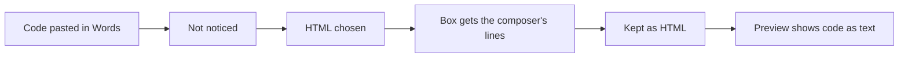
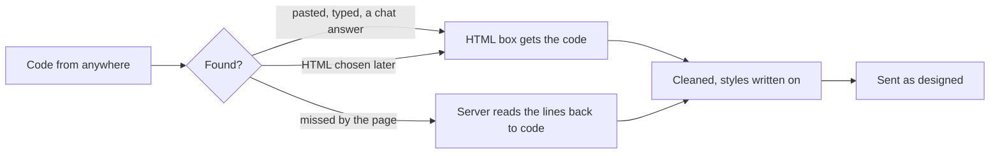

# A coded email goes as designed, wherever it is pasted

> **In plain words.** The owner pasted a whole designed email (HTML and CSS from an AI chat) into
> Write, chose HTML and pressed Preview: the preview showed the code as text. The cause was not
> the permission (the owner was signed in as the Vendor, who holds every permission). The code
> went into the composer, the page did not notice it, and choosing HTML then handed the HTML box
> the composer's own lines of the code (`
&lt;!DOCTYPE html&gt;
…`) instead of the code,
> so the email was kept as its code shown as words. Now the code is found wherever it comes from
> and whatever is chosen, an old draft saved that way mends itself, everyone who sends may use
> code, signatures can be designed the same way, and the page's lists share one dropdown.

## What was found

The stored draft held 20,521 characters: the composer's lines (`
…
`) with every tag of
the email written as `&lt;…&gt;`, format HTML, with no composer mark. That is exactly what the
page posts when HTML is chosen after the code is already in the composer: the switch synced the
box from the composer's HTML. The server took it as HTML, cleaned it (nothing to remove) and kept
it; the preview drew it, so the code showed as text.

## What changed

| Part | Before | Now |
|---|---|---|
| Choosing HTML with code in the composer | the box got the composer's lines | the box gets the code itself |
| The server | read composer lines back only with the composer's mark | also reads lines and nothing else whose text is code, so old drafts mend on their next save |
| A chat's answer | whole text, words and fences, had to be code | the code alone is taken (`codeIn`): a fenced html block, a whole email between words |
| A phone keyboard's clipboard | no paste event, not noticed | a long run that came in at once is read |
| Back to Words | the code was stripped to words | the code shows as lines, which go as the code again |
| Who may use code | Owners and admins (`admin` class) | everyone who sends (`operate`, migration 1017), at a branch too |
| Signatures | words, 1,000 characters | written in Write's composer, or designed and pasted as code, cleaned and kept as HTML |
| Lists on the page | From's own card, a select for templates and Text size | the kit's `Dropdown` for From (its card the whole line), templates, Text size and the default addresses |
| Words or HTML | a toggle on the page | in the ⋮ More menu; code is found by itself |
| Cc and Bcc | two buttons | one Cc/Bcc button |

## Impact

- Owner's data: none moved. Migration `1017` adds role rows and bumps each company's access
  version; it runs again harmlessly.
- Sending: unchanged. Code is still cleaned (`sanitizeEmailHtml`) and its styles written onto its
  tags (`inlineStyles`) before it is kept or sent.

## How it was verified

- `modules/email/test/code-in.test.ts`: a chat's answer, a whole email between words, a byte-order
  mark and zero-width spaces, a table piece; a mention of a tag is not code.
- `modules/email/test/senders.test.ts`: migration 1017 run twice, the writer bound at a branch
  sends a fenced chat answer as code, and the owner's case (composer lines posted as HTML with no
  composer mark) goes as the designed email; a designed signature from code and from the composer.
- `modules/email/test/template.test.ts`, `signature-form.test.ts`: a designed signature sent as it
  is, its words after `-- `; each kind of signature opens the right way.
- The kit's `packages/screens/test/frame.test.ts`: HTML chosen with code in the composer hands over
  the code; a signature's composer takes pasted code into its box.
- Screens checked at a phone's width in the dark theme: the To line's chips, the From card, the
  template and Text size cards.
