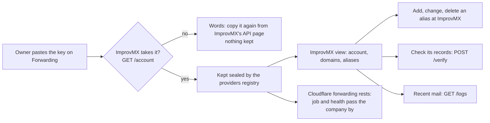

# Forwarding through ImprovMX, and plainer Forwarding and Mail setup pages

> **In plain words.** The owner asked whether an ImprovMX API key could set forwarding up by
> itself instead of Cloudflare, since ImprovMX is easier for him, and picked "Forwarding through
> ImprovMX" on the card. Now the Forwarding page opens on an ImprovMX view: paste the key once,
> and the portal keeps it locked, lists the account's domains and aliases, adds, changes and
> deletes aliases at ImprovMX, checks a domain's records and shows the mail ImprovMX forwarded.
> Cloudflare is not needed for any of it; the Cloudflare forwarding moves to its own view and
> rests while ImprovMX is connected. The same night the owner found the Mail setup and Forwarding
> pages "as confusing as ever" and the boxes of figures on Addresses a waste of the page: Mail
> setup now leads with the one next step, and the boxes are gone.

## What changed

| Area | Before | Now |
|---|---|---|
| An ImprovMX key | Typed once to import the aliases into Cloudflare forwarding, never kept | Also **Connect ImprovMX**: tried on the account, then kept sealed by the kit's providers module (kind `forwarding`, definition `improvmx`); never shown, logged or audited |
| The aliases | Kept in the portal and set as Cloudflare rules | With ImprovMX connected: kept at ImprovMX alone, read live (10 calls a view at most), changed there at once, each change on the audit log by its address |
| A domain's records | Read from Cloudflare's zone | With ImprovMX: **Check its records** asks ImprovMX, each of MX, SPF, DKIM and DMARC found or missing, with the value it expects |
| What was forwarded | Not shown | **Recent mail**: the newest 20 messages ImprovMX forwarded or tried, with their last step |
| The Forwarding page | One page: domains, aliases, try, import | Two views in a sideways row: **ImprovMX** (first) and **Cloudflare**; ImprovMX is asked only on its own view |
| Cloudflare forwarding while ImprovMX forwards | (no such case) | Rests: the five-minute job and the health check pass the company by; nothing deleted, so Disconnect picks it up again |
| Mail setup | A box of facts and a list of four steps to read through | **Next:** the first step that has not passed, with what to do, or **Everything is ready**; the four steps under **All four steps (N of 4 done)** |
| Addresses | Two boxes of figures over the views | No boxes: the views carry the counts, the domains as "1 of 2" until all are verified |

## How it works now

The key is opened only inside a request that calls ImprovMX. ImprovMX's free plan has the API,
aliases and logs and no webhooks or sending, so nothing here receives or sends mail. The kit gave
the providers module a new kind, `forwarding`, and its first definition, ImprovMX, so the email
screens, which list only kind `email`, never offer ImprovMX as a way to send. The email module
hands its providers registry to the Mail add-on (`Email.providers`), so no new wiring in the
client was needed.

Before, the only use of an ImprovMX key was the one-press import into Cloudflare forwarding; that
stays, on the Cloudflare view, for anyone moving off ImprovMX.

## Decisions taken

- The owner's pick (decision card, 2026-11-12): "Forwarding through ImprovMX": the key kept
  locked, aliases managed at ImprovMX, delivered mail shown. Its token row, `IMPROVMX_API_KEY`,
  now says where the key is kept and why.
- The owner's word that night ("take all decisions"): the Forwarding page in two views with
  ImprovMX first; Mail setup led by its next step; the figure boxes on Addresses removed rather
  than slimmed, since the views already carry the counts.
- Flat tints, not gradients, stay the rule for these pages until the design thread changes it.

## How it was checked

- `modules/mail/test/improvmx.test.ts`, 15 tests inside the Workers runtime against a scripted
  ImprovMX: a refused key never kept; the right key sealed, absent from the row's clear fields,
  the answers and the audit log; the view's shape and its four calls; alias add, change and delete
  with their audit rows; people checked before any call; ImprovMX's refusals in its words; the
  records check; recent mail; the Cloudflare job and health check resting, then back after
  Disconnect.
- `modules/mail/test/inbox-pages.test.ts`: the Forwarding page's two views, which one a visit
  opens on, the forms each view posts, the key shown nowhere after Connect, the records list; Mail
  setup's next step and **Everything is ready**.
- `modules/email/test/senders-page.test.ts`: no figure boxes, the counts on the views.
- The kit: `modules/providers/test/definitions.test.ts` holds the ImprovMX definition (basic auth
  with the user `api`, a probe of the account, no send, no reports, no fingerprint).
- The ImprovMX calls follow its API reference (https://improvmx.com/api/, v4), read on
  2026-11-12. Not checked against a real ImprovMX account: the owner's key is his to paste.
