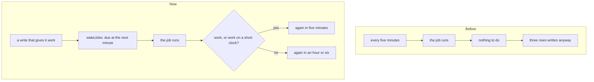
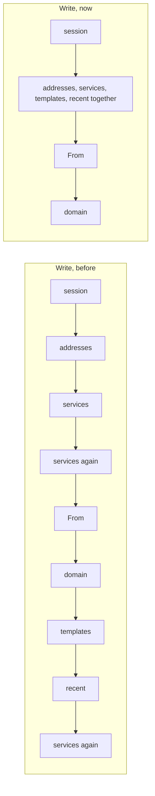

# The mail jobs sleep while they have nothing to do, and Write waits for less

> **In plain words.** The owner, testing a live portal alone, saw it read about 202,000 database
> rows and write more than 10,000 in a day. Most of it was the portal's timer running jobs that
> had nothing to do, and each run writes to the database just to say it ran. Six of those jobs are
> mail's: they ran every five minutes, all day, on a portal sending nothing. Now each of them
> sleeps while it has nothing to do, and whatever gives it work wakes it at once: a message held,
> an email scheduled, a domain added, a list taken in, a campaign started, a conversation snoozed,
> a press on the Mail setup. The Write page also starts its reads together instead of one after
> another, so it opens in about half the time.

## What the jobs cost

A job run costs three rows written whether it found work or not. Five jobs every five minutes is
1,500 runs a day, 4,500 rows written, before anyone sends an email. `mail.soon` adds 300 runs where
Oltrem Mail is on.

## What changed

The kit's jobs gained a slow pace (`idle`) on 2026-11-12: a job that answers `'idle'` runs next
at that pace, and `wakeJobs` makes it due now. Each mail job that polls now uses it.

| Job | It sleeps when | Slow pace | What wakes it |
|---|---|---|---|
| `email.release` | no message is held for want of a provider | six hours | a message held |
| `email.written` | no email is scheduled | an hour | Send later |
| `email.domains` | no check was due and no domain not yet passing is in its first hour | an hour | a domain added, a send that says something new of a domain |
| `email.servers` | every domain of the lists was looked up | six hours | a list taken in, on Lists or in a campaign |
| `campaigns.send` | no campaign is sending or waits for its start time | an hour | a start, a resume, Send again |
| `mail.soon` | nothing it serves is on a short clock (below) | an hour | a snooze; any press that changes the route, a mailbox or forwarding |

`mail.soon` keeps its five minutes while a conversation is snoozed, a mailbox is in its first
hour, an address was sent its verify link in the last day, a Cloudflare test is being sent again,
or an alias or a forwarding domain is not settled in its first day. Everything else it retries is
hourly already, which is its slow pace.

`campaigns.send` asks one question first (is any campaign sending?) and, with none, reads neither
the limits nor the plan.

**The Write page.** `GET /write` read ten things one after another, and the services that may
send three times. Its reads now start together, the services are read once and handed on, and
the readiness check starts its own three reads together.

## The figures

- **Job runs in a day of a portal with nothing to do** (the kit's client template, 1,500
  one-minute ticks): mail's five jobs made 1,500 runs and now make 85. The whole portal made about
  3,950 and makes 390, which the kit's test pins.
- **The Write page**, on this computer with every trip to the database made 25 ms slower: 339 ms
  and 11 trips in a row before, 158 ms and 4 now; 9 queries where there were 11.

## Decisions

- **The slow pace is the safety net, the wake is the rule.** A wake that was lost is found at the
  next slow run. No job wakes itself.
- **A thing waiting for its time keeps the job at five minutes.** A scheduled email, a campaign
  with a start time and a snoozed conversation must go on time, and a job cannot yet ask to be run
  at a given minute, so the job polls while one exists and sleeps when none does.
- **A setup press wakes `mail.soon` whatever it answered.** A press that half worked (a rule the
  key could not make) is exactly what the job retries.
- **The hourly jobs are left as they are** (`email.ready`, `email.files`, `mail.inbox`,
  `mail.cloudflare`): 24 runs a day each.

## Impact

| Part | Impact |
|---|---|
| A live portal | after its next deploy: mail's jobs stop writing every five minutes while nothing is sent |
| Sending, Send later, campaigns, the inbox | unchanged for a person: what gives a job work wakes it within the minute |
| The kit | needs `wakeJobs` (`@oltrem/core-module`); the tests take `@oltrem/core-jobs` for the jobs' table |

## How it was verified

- `@oltrem/email`: `email.release` idle with nothing held, woken by a held message, at its pace
  while one waits; `email.written` idle with nothing scheduled, woken by Send later, at its pace
  while one is scheduled; `email.domains` woken by a domain added, at its pace in the domain's
  first hour, idle after; `email.servers` idle once every domain was looked up, woken by a list.
- `@oltrem/campaigns`: `campaigns.send` idle with none sending, woken by a start and by a resume.
- `@oltrem/mail`: `mail.soon` woken by a snooze and by a setup press, at its pace while a
  conversation is snoozed or a test is sent again, idle after.
- The kit's client template: a day of ticks with these modules in, the day's runs pinned.

## What is left

- A job that could ask for its next run at a given minute would let a far-off scheduled email, a
  campaign's start time or a long snooze sleep until then.
- `GET /write` still waits for the From address before the domain's row: one trip more than the
  least.
