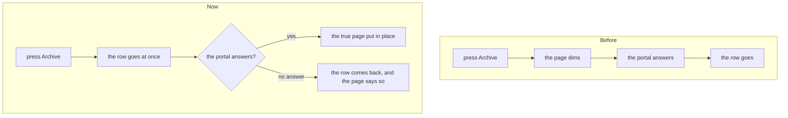

# Mail reads through indexes, and a row changes before the portal answers

> **In plain words.** The owner asked for four things across the platform: no query repeated once
> per item, an index on what is searched and sorted, a copy of what rarely changes, and a screen
> that changes before the server answers. In Oltrem Mail, three reads walked a whole table that
> grows with every email: the Home cards and the hourly mail check. Each now reads only what it
> needs through an index (migrations `1018` and `1019`, which only add indexes). The Email page's
> file sizes read each provider's listing once instead of once per provider. And archiving,
> snoozing, moving or marking a conversation read or unread now changes its row at once; the
> portal's answer then puts the true page in place, and with no answer at all the row comes back
> and the page says so.

## What changed

| Where | Before | Now |
|---|---|---|
| Home, the Email card (`GET /home`) | counted every message ever sent, grouped by status, to show the last day | reads the last day through `email_messages_created` (`created_at`, `status`), migration `1018` |
| Home, the unread card | walked every conversation of the tenant | a partial index of unread conversations in the inbox, `mail_threads_unread`, migration `1019` |
| The hourly mail check (`health`) | counted every stored message, every hour | reads the highest message number and the mailboxes' stored bytes; counts only once that number passes the size warning line |
| The nightly tidy | walked every message to find the ones past keeping | `mail_messages_received` (`received_at`), migration `1019` |
| The Email page's file sizes | one listing read per provider set up | the listings read once |
| A conversation's archive, snooze, move, read and unread | the page dimmed until the portal answered | the row changes at once (`data-optimistic`, the kit's frame) |

The star already had its own button; the kit's conversation row now turns it at once too.

## What was left as it was

- The nightly tidy still deletes empty conversations with one statement over the table; it runs
  once a night and touches only what it deletes.
- The loops over tenants and providers in the jobs are bounded by the few providers and tenants a
  portal has, and each was already one read per item it acts on.

## How it was checked

- Each new index was checked with `EXPLAIN QUERY PLAN` in the tests (`modules/email/test/email.test.ts`,
  `modules/mail/test/inbox.test.ts`): the Home card reads `email_messages_created (created_at>?)` in
  one query, the unread card `mail_threads_unread`, the tidy `mail_messages_received`.
- The hourly check counts no message normally and counts once after a message numbered past the
  warning line, with no warning.
- `modules/mail/test/inbox-pages.test.ts` checks which commands carry `data-optimistic` in the
  inbox and in Starred (where archive does not take the row away).
- `pnpm verify` green before the push.
