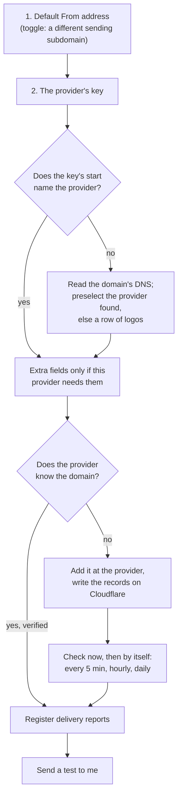

# Oltrem Mail: the setup page

> **In plain words.** How a business turns on email in its portal: an email provider with two
> fields, or Cloudflare's own email with one button, delivery reports that register themselves, a
> backup provider, the check that keeps the domain's SPF record valid, and forwarding the way
> ImprovMX does it, with a guided move from ImprovMX. Part of [the plan](plan.md), approved
> 2026-11-02; built in phases 2 and 3, forwarding in bundle F.

## 1. "Use an email provider"

- **Field 1, the default From address.** The domain is read after the @. The toggle "Use a
  different sending subdomain" moves the address to a subdomain (`hello` at `mail.example.com`), and
  that subdomain is what gets set up at the provider. Typing a subdomain address directly works the
  same way.
- **Finding the zone.** Whether the person uses the toggle or types an address at `mail.example.com`, the
  portal finds the Cloudflare zone by walking up the name (`mail.example.com`, then `example.com`)
  and writes every record relative to that parent zone.
- **Field 2, the key.** Its start names the provider: `re_` Resend, `xkeysib-` Brevo, `SG.`
  SendGrid, `api-` SMTP2GO, `AKIA` Amazon SES. When it does not (Mailjet and Postmark keys look
  generic), the portal first reads the domain's DNS (the kit already detects providers this way)
  and preselects what it finds; only if that finds nothing does a sideways row of logos ask for one
  tap. A key of the wrong kind is refused in words, as the kit does today (for example Brevo's
  SMTP key).
- **Extra fields, only when needed:** Mailjet also needs its secret key; Amazon SES a secret and a
  region; plain SMTP a host, user and password. Resend, Brevo, SendGrid, SMTP2GO and Postmark stay
  at two fields.
- **Already in the kit:** reading a provider's domains and addresses (8 providers), adding a domain
  at Resend and Brevo, records with Copy buttons, the check in words, DMARC required, sender
  addresses with permissions.
- **Built in phase 3 (2026-11-02):** the single card (Email, Set up), which does every step in
  one press and lists each in words; the records written on Cloudflare when Oltrem Mail is on
  (DNS Edit; only adds, each press audited); delivery reports registered by themselves (section
  3); a backup provider from the same card (section 4); the placement test. What each step does
  is in the email module's README ("The simple provider card") and the mail add-on's ("Records
  on Cloudflare").
- **Built in bundle C (2026-11-02):** a domain not yet passing is checked by itself every five
  minutes in its first hour, hourly in its first day, then daily, the provider asked each time to
  look again; DMARC is read from the domain or the nearest parent, and written in the same press
  only when none covers it, so a parent's stricter policy is never weakened; each domain says
  whether it is ready for Gmail, Yahoo and Outlook; a domain that has not passed in a day warns
  on System health; everyday mail goes through the backup first once the main provider is down
  to its last tenth. The record is
  [records/2026-11-02-sets-itself-up.md](records/2026-11-02-sets-itself-up.md).

## 2. "Use Cloudflare email"

Cloudflare Email Sending to any recipient is not available on Workers Free. On Free, the
`send_email` binding still sends, without a count limit, to the account's verified addresses, from
a domain with Email Routing on. The card sets up both cases and tells them apart:

1. **Where mail is received.** If the domain already receives mail elsewhere (Google Workspace,
   Microsoft 365), turning Routing on at the root would replace those MX records, so the portal
   offers a subdomain (for example `mail.example.com`) and never replaces existing MX records
   without an explicit choice.
2. **Turn on Email Routing** on that domain (`POST /zones/{zone_id}/email/routing/dns`, which adds
   and locks the MX and SPF records). The owner confirmed this needs Email Routing Rules Edit plus
   DNS Edit, both in [decision 3](plan.md#14-the-owners-decisions). If Cloudflare answers 403, the
   card shows the one guided tap in the Cloudflare dashboard instead.
3. **Verify staff addresses:** each staff member is added to Verified Destination Addresses
   (`POST /accounts/{account_id}/email/routing/addresses`). Each person clicks Cloudflare's link
   once; the portal reads the verified state back (on demand, every five minutes for a day after
   asking, then daily) and keeps it in the
   database, never in KV. New staff are added when they join.
4. **Onboard the domain for sending, and send the test.** Cloudflare has no API for onboarding a
   domain to Email Sending (checked 2026-11-02, when phase 2 was built), so this one step is a
   tap in the dashboard (Email Service, Email Sending, Onboard Domain), and the portal never asks
   for Email Sending Edit: the key needs the three rights above and nothing more, narrower than
   [decision 3](plan.md#14-the-owners-decisions) allowed. Checked again on 2026-11-03: the
   Email Sending API has sending, suppressions and SMTP, and still no onboarding call. The step's
   line links straight to the dashboard's Email Sending page, and a test refused only because the
   domain is not onboarded is sent again by itself to the same address every five minutes for a
   day (the `mail.soon` job, four companies a run), so the route turns ready without a second
   press. The test tells the states apart: an
   answer that the domain is not onboarded shows the dashboard step; an unverified recipient
   shows "verify it first"; a pass marks the route ready. The mode is read, never guessed: Paid
   only when the portal's plan setting says Workers Paid, Free otherwise, and a plan that changes
   sends the route through its test again. A network error, a server error or any other answer
   shows "could not check, try again" and never quietly chooses a mode (fail closed, R-10). In
   Paid mode Cloudflare writes its own records on `cf-bounce.example.com` (bounce MX, SPF, DKIM)
   and a DMARC record.
5. **The route's line on the page** reads either **"Ready (Free Plan: Verified Staff Addresses
   Only)"** or **"Ready (Paid Plan: Staff & Customer Transactional)"**.
6. **A test** goes to the person who pressed the button (verified first), or to the verified
   address they type. The route sends nothing until a test passed on it.
7. **What the route carries.** Never bulk mail (Cloudflare's rule, mail law M-2). In Free mode,
   only mail whose every recipient is a verified staff address. In Paid mode also customers'
   transactional mail, when the Owner turns on the setting `mail.cloudflare_first`. It sends from
   the route's own address unless the message's From is on the route's domain; a message from an
   address someone picked on another domain keeps its provider. A message the route took and got
   no clear answer for stays on it and is never sent through a provider (mail law M-1).

Sending always uses the structured call, `env.EMAIL.send({ to, from, subject, html, text, headers,
attachments })` (with `cc`, `bcc` and `replyTo` when needed), never the older raw `EmailMessage`.
The binding in the client template is `"send_email": [{ "name": "EMAIL" }]` ([decision
4](plan.md#14-the-owners-decisions)).

## 3. Delivery reports, registered by themselves

The Sent timeline, the do-not-mail list and the bulk self-pause (0.3% complaints, 5% bounces) all
need the provider's delivery reports. So once a provider's domain checks out, the portal registers
its address there by API, for delivered, bounced, complained and opened:

| Provider | How it is registered | How a report is checked |
|---|---|---|
| Resend | Resend's webhook API; it returns a signing secret | The signature (the kit's Standard Webhooks check) |
| Brevo | Brevo's webhook API, transactional events | Brevo does not sign: the long random token in the address (as the kit does today) |
| Mailjet | Mailjet's event callback API, one call per event | Mailjet does not sign: the token in the address |
| The others | The kit's guided manual step, as today | The kit's existing checks (six signature schemes) |

- **The address** is the kit's public hook door, `/hooks/email/<provider instance>/<token>`.
  Everything under `/api/` sits behind the Access sign-in and the cross-site check, so a provider
  could never reach it; `/hooks/` is mounted before sign-in and let through by Access, for exactly
  this. One address per provider instance, so two accounts at one provider never mix.
- **The secret** is sealed with the provider's own key in the database, encrypted with the kit's
  KEK. It is never in `tokens.registry.json`, which lists only the names of the Worker's own
  secrets (R-05). No new Worker secret is needed.
- **Known limits:** Resend's webhook API needs a full-access key; with a sending-only key the
  portal shows the guided manual step. Mailjet has no "delivered" event; its "sent" means the
  receiving server accepted the mail. "Opened" overcounts, because Apple Mail opens messages
  automatically for privacy: it is shown with that note and never used for decisions.
- **Removing a provider** removes its webhook there; both steps are audited.

## 4. A backup provider, and the SPF limit

The card offers "Add a backup provider". The recommendation is one main and one backup ([the
plan](plan.md#1-your-questions-answered)): Brevo with Resend, or Brevo with Mailjet. Mailgun stays
supported for clients who already use it.

A domain's SPF record may cause at most **10 DNS lookups** when a receiver checks it, and at most 2
lookups that find nothing; past that, receivers treat SPF as broken. The portal counts them the
way the standard (RFC 7208) does: `include`, `a`, `mx`, `ptr`, `exists` and `redirect`, followed
through every include. It warns at 9 and refuses to add a provider that would pass 10.

Where each route puts its SPF, so the root stays small (the counter measures the live records
instead of trusting this list):

| Route | Its SPF | Lookups added at the root |
|---|---|---|
| Resend | On `send.example.com` | None |
| Cloudflare Email Sending (Paid) | On `cf-bounce.example.com` | None |
| Cloudflare Email Routing | `include:_spf.mx.cloudflare.net` on the domain Routing runs on | Its own, if Routing runs at the root |
| Mailjet | `include:spf.mailjet.com` at the root | Its own |
| Brevo | Whatever Brevo's own records ask for | Counted live |

## 5. Forwarding, as ImprovMX does it

Built in bundle F ([its record](records/2026-11-02-forwarding.md)), on its own page, Forwarding
(`/email/forwarding`), in the Email tabs. An **alias** forwards one address of a domain
(`info@example.com`), or every address of it that has no alias or mailbox of its own (the
catch-all, written `*@example.com`), to one person or up to ten, and keeps nothing. A **mailbox**
of [the inbox](inbox.md) keeps the mail in the portal; an address is one or the other.

| What | How Cloudflare carries it |
|---|---|
| An alias to one person | Cloudflare's own forward rule: the Worker is not used at all |
| An alias to several people | a rule that sends the mail to the portal's Worker, which forwards it to each confirmed person (Cloudflare forwards to exactly one address a rule) |
| The catch-all | Cloudflare's catch-all rule, the same two ways |
| Each person it goes to | an address verified in Email Routing; the portal asks Cloudflare to email each one its link, at most eight a press and the rest by the five-minute job, and starts the alias by itself once one is pressed |

**A domain**, added by hand or by the first alias on it, is looked up in the account's Cloudflare
zone (never a cached DNS answer):

| Its MX records | What the portal does |
|---|---|
| None | turns Email Routing on in the same press: nothing is replaced |
| Cloudflare's | reads Email Routing's state |
| ImprovMX's | notes it: the aliases are saved and set on Cloudflare ahead, and the domain's mail keeps going to ImprovMX until **Move from ImprovMX** is pressed |
| Another mail service's | notes it and changes nothing; forwarding there takes a subdomain |

**The import** is one press: **Read from ImprovMX** takes the account's API key (the API page of
ImprovMX's dashboard), reads every domain of the account and every alias of each, 200 a page, and
takes them all. The key is used in that press's requests and nowhere else: it is not stored,
logged, audited or shown again (its row, `IMPROVMX_API_KEY`, is in the
[token registry](reference/tokens.md)). A press makes at most 12 calls to ImprovMX beside its 35
to Cloudflare; a domain it could not reach is named, to fill in for the next press. A wrong key,
ImprovMX asking to wait (with how long), or a domain it does not know each say so in words. A
domain on ImprovMX's rules has its aliases read and its other rules named, since those are not
aliases.

Without a key, the import takes what a person pastes: ImprovMX's exported list as it is (a header
naming the alias and its forwards), or one alias a line followed by its people, with spaces,
commas, tabs, `->` or `=>` between. A line without a domain takes the one filled in. Either way a
webhook is left out, saying so; the same list again changes nothing; a changed list changes the
people.

**The move**, one domain at a time, is offered once every alias of the domain has at least one
confirmed person. Its dialog says what changes. Then, in this order:

1. ImprovMX's MX records and the SPF record are kept in the portal, so Move back works from any
   point of the move.
2. `include:_spf.mx.cloudflare.net` is added to the SPF record (ImprovMX's include stays, so mail
   sent through ImprovMX keeps passing); a record that would pass 10 lookups stops the move first.
3. The aliases' rules are made, while mail still goes to ImprovMX.
4. ImprovMX's MX records are deleted and Email Routing is turned on, which adds Cloudflare's.
   Should Cloudflare refuse either, ImprovMX's records are put back at once and the domain stays
   with ImprovMX.

**Move back** unlocks Cloudflare's records, adds ImprovMX's MX records again beside them (both
forward, so no mail is lost in between), turns Email Routing off for the domain, which takes
Cloudflare's own records away, and takes Cloudflare's include out of the SPF record. ImprovMX itself
is never changed by either, so its aliases are there on the way back. When the same Cloudflare zone
also carries the sending route, another forwarding domain or mailboxes, Move back is refused with
the dashboard steps instead, since turning Email Routing off would stop those too.

**On the builder's own computer** (the portal tried with the kit's start page), Cloudflare is
never asked: each domain says "On this computer", everyone an alias names counts as confirmed,
and Move and Move back say that nothing moves there. **Send a test**, on the Forwarding page and
on Mailboxes, hands the portal a message as Email Routing would and says what became of it:
forwarded to whom, kept in which inbox, or refused, as the sender would be told. Nothing leaves
the computer. Read from ImprovMX works there too, since it only reads.

Every Cloudflare and DNS call is counted: 35 a press and 8 a run of the five-minute job, inside
Workers Free's 50 an invocation; what is left over is done by the next run. Each move, move back
and import is on the audit log, a refused one too.
